## background

[返回资源总索引](../Resources.md)

### 二次元

#### 404 Live Bar

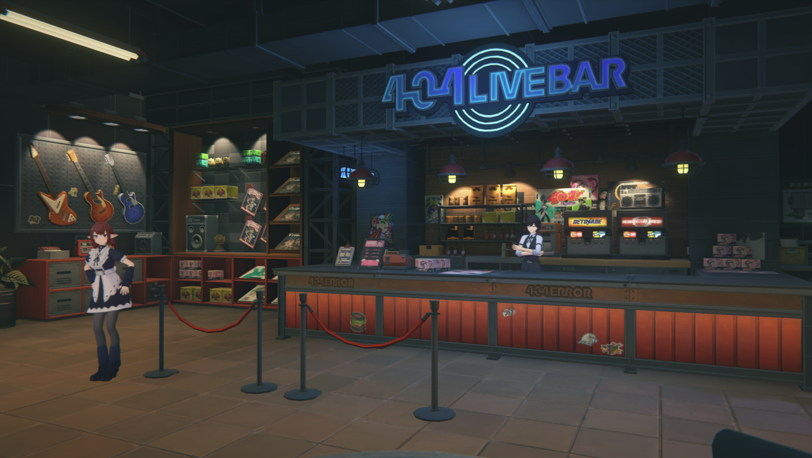

> 场景描述：404 Live Bar 室内场景参考。场景用途：音乐酒吧与后台社交空间；可用于人物交流和排练间隙。配色：深蓝、黑、红、暖黄；室内夜景。视觉要素：中央酒吧柜台；顶部 404 LIVEBAR 霓虹招牌；墙面乐器、音箱、货架、唱片和暖色吊灯；工业金属结构、红色柜台、深色背景、蓝色与暖黄色混合灯光。

#### 404 售票处

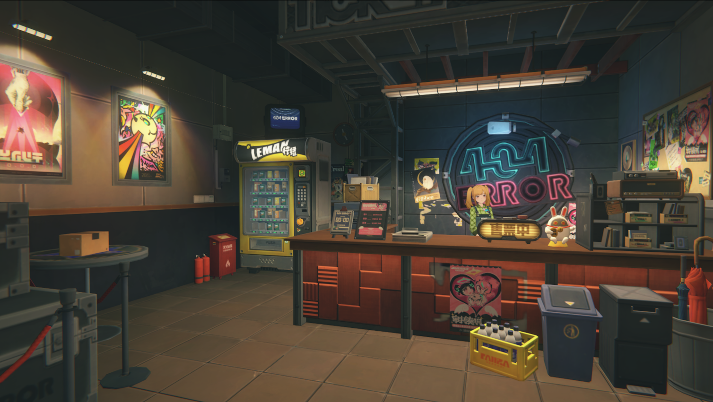

> 场景描述：404售票处室内场景参考。场景用途：演出入口与售票空间；可用于出道前准备、应援物和票务镜头。配色：暖黄、红、深灰、青蓝；室内暖光。视觉要素：正面售票柜台；背景有 404ERROR 圆形标志；自动售货机、海报、票务设备、纸箱、邦布摆件和红色隔离绳；暖色顶灯配深灰墙面，生活化、略拥挤的地下音乐空间。

#### 404 舞台

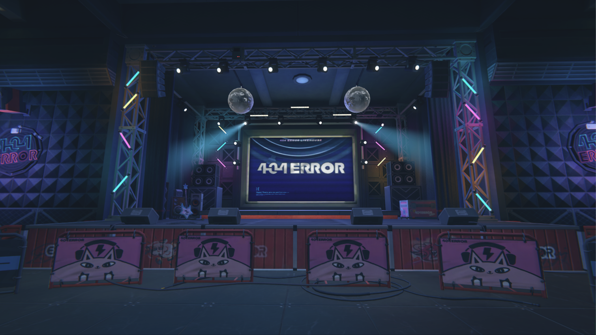

> [AI识图] 绝区零场景·空舞台（无角色），横向16:9。404 ERROR Livehouse 室内演出舞台，暗调冷色：桁架灯光、两颗镜面迪斯科球、青/粉/黄霓虹灯棒，中央大屏显示"404 ERROR"（"404 ERROR LIVEHOUSE"）；舞台上音箱、监听、星形吉他；台前红色挡板挂四张粉色应援横幅，印戴耳机白猫+闪电Logo。氛围：偶像/乐队演出，最适合舞台表演。用途：场景背景/首帧。

#### 404 走廊

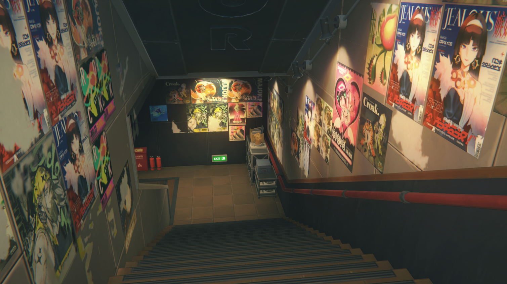

> 场景描述：404走廊与楼梯场景参考。场景用途：后台动线与转场空间；可用于人物奔跑、上下场和海报蒙太奇。配色：深灰、红、暖黄、海报高饱和色；室内过渡光。视觉要素：向下延伸的楼梯；镜头可沿扶手形成强透视线；两侧密集演出海报、红色扶手、器材推车和绿色 EXIT 标志；暖色顶灯照亮狭长空间，墙面海报形成连续视觉纹理。

#### 404 门口夜景

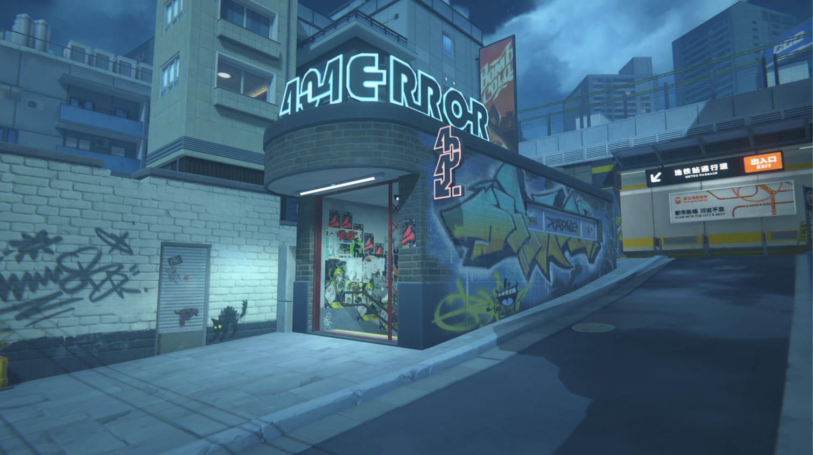

> 场景描述：404门口夜景场景参考。场景用途：短片开场与外景建立镜头；可用于雨夜出道前夜。配色：冷蓝、青白、少量粉红；雨夜霓虹。视觉要素：弧形 404ERROR 霓虹招牌；玻璃入口和墙面海报；涂鸦墙、城市建筑、地铁入口指示、斜坡道路和路边积水；蓝色夜景主调，霓虹青白光映在湿润街面。

#### HIA 大门

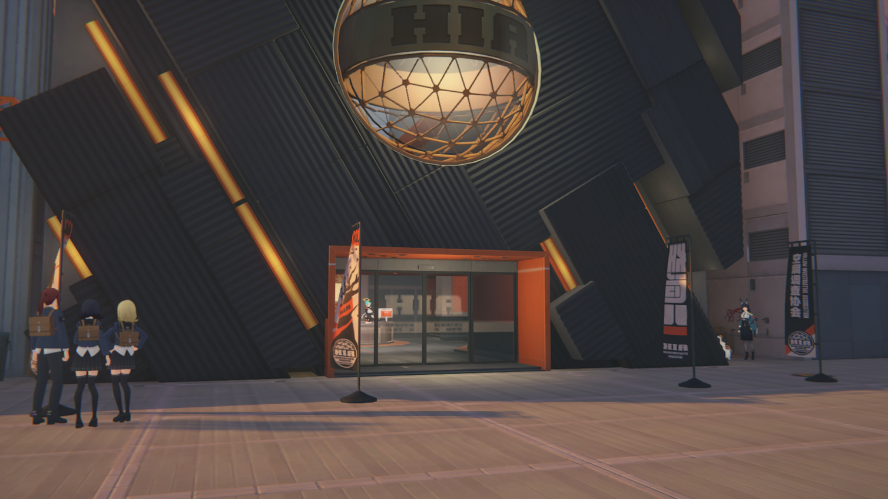

> 场景描述：HIA大门建筑场景参考。场景用途：大型机构外景与现代建筑过场；可用于城市规模感。配色：黑、深灰、橙、红；日间暖光。视觉要素：黑色几何倾斜立面；中央红色玻璃入口；顶部球形吊灯、橙色线性灯、门口立牌与开阔广场；硬朗工业建筑与暖橙灯光，适合低机位仰拍。

#### Random Play 门口

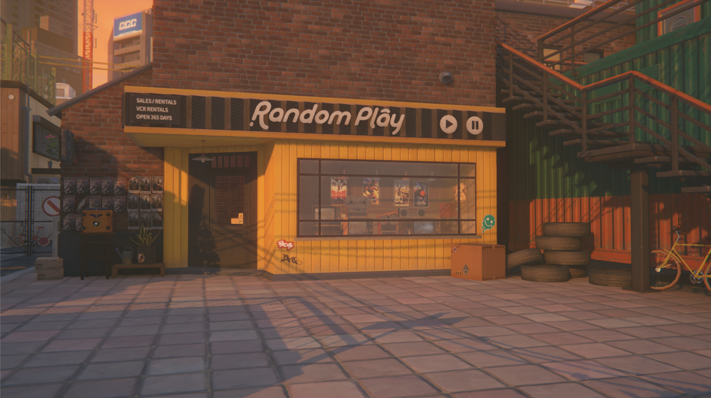

> [AI识图] 绝区零场景·空镜（无角色），横向16:9。黄昏暖光下的复古录像带/唱片租赁店门口：红砖墙+黄色店面，黑底招牌白色手写字"Random Play"+播放▶/暂停⏸图标，小字"SALES/RENTALS · VCR RENTALS · OPEN 365 DAYS"；橱窗陈列录像带海报+旧电视；左侧海报墙、禁停标志、自行车，右侧铁楼梯、绿色集装箱、堆叠轮胎、黄色自行车、纸箱；方砖地面，背景起重机与楼宇剪影。氛围：街头休闲/黄昏。用途：场景背景。

#### 六分街

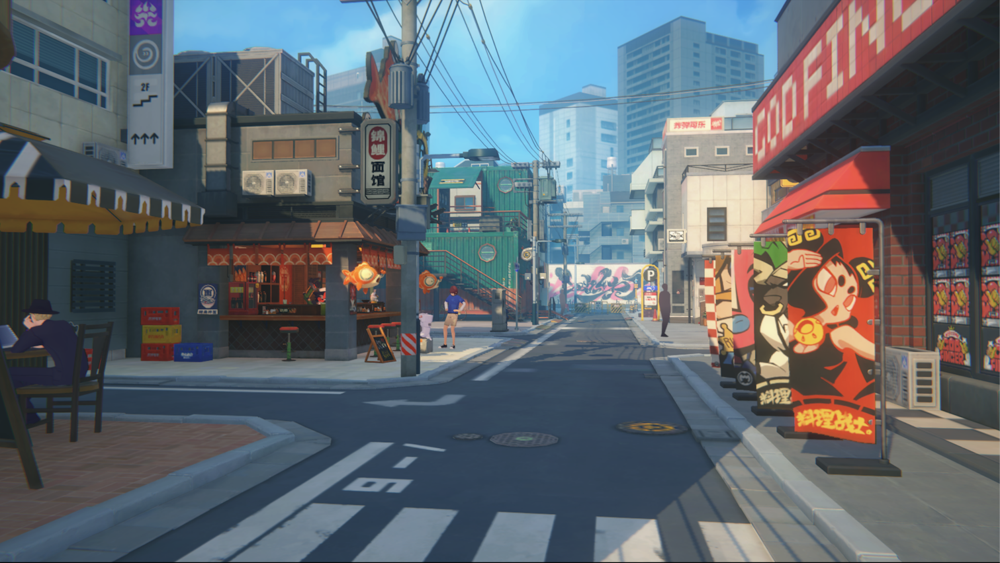

> [AI识图] 绝区零场景·六分街白天街景，横向16:9。晴空下都市市井街道：左侧黄条纹遮阳棚小吃摊+"锦鲤面馆"竖招牌+塑料筐，戴帽西装男坐读报；中央柏油马路带斑马线与"1-9"路面编号，电线杆杂乱电线，远处高楼与"秀秀购乐"招牌、集装箱、涂鸦墙；右侧红店面挂"料理战士"动漫风竖幅海报+海报墙+红遮阳棚，零星路人NPC。氛围：白天街头日常。用途：场景背景。

#### 六分街 141 便利店

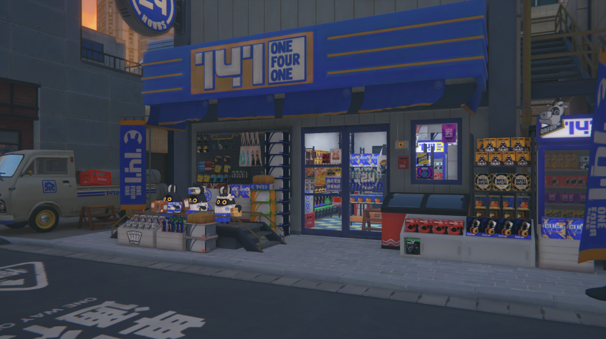

> 场景描述：141便利店街景场景参考。场景用途：城市街区便利店；可用于日间六分街或城市过场。配色：蓝、金、灰、白；日间冷色城市光。视觉要素：蓝色与金色门头；大型 141 / ONE FOUR ONE 标识；临街玻璃门；货架、饮料、零食和外摆商品；低层城市建筑、灰色人行道、街边车辆与邦布货架。

#### 厄匹斯港

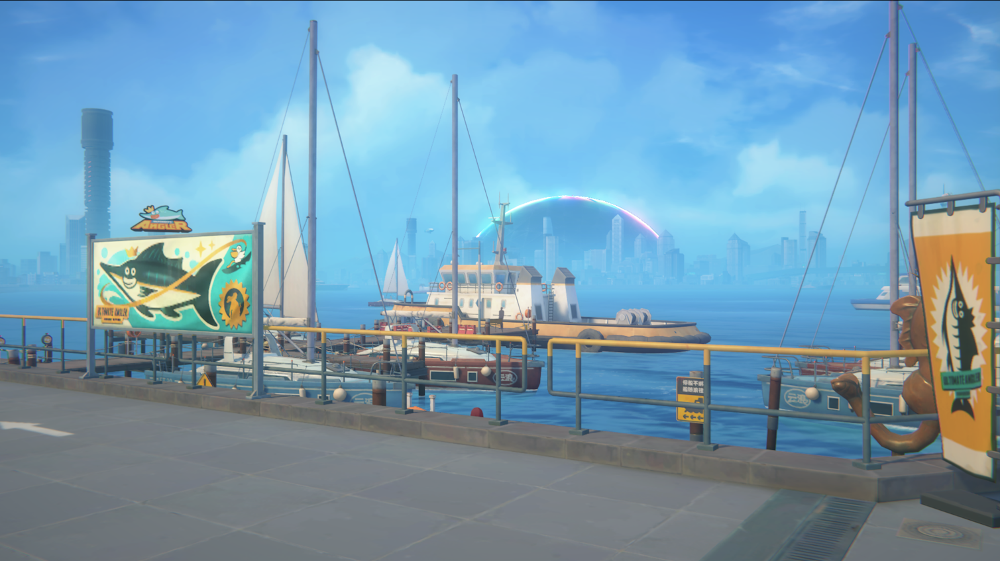

> 场景描述：厄匹斯港海港场景参考。场景用途：海边采风与城市远景；可用于灵感寻找和情绪换气。配色：天蓝、海蓝、白、黄色；晴天海港光。视觉要素：开阔海面、帆船、码头护栏与远处城市天际线；鱼类广告牌、船只、港口设备和浅色滨海步道；横向海天构图，适合大幅 Pan、海风与远景剪影。

#### 咖啡厅二楼

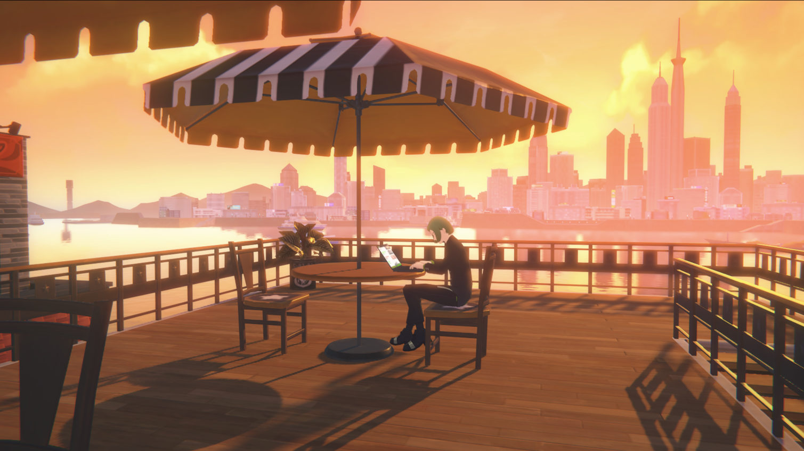

> 场景描述：咖啡厅二楼露台场景参考。场景用途：黄昏创作与对话空间；可用于千夏写歌或三人讨论。配色：橙、金、粉、棕、蓝紫；日落光。视觉要素：木质露台、圆桌、条纹遮阳伞和城市水岸视野；人物座位、栏杆、远处高楼与水面倒影；长阴影和暖色逆光，适合静态近景和慢速推镜。

#### 度假村木栈道

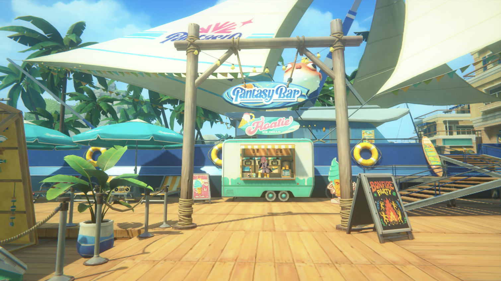

> 场景描述：度假村木栈道场景参考。场景用途：明亮海滨活动与户外舞台前场；可用于轻快蒙太奇。配色：青绿、白、蓝、黄色；晴天海滨光。视觉要素：中央 Fantasy Bar 饮品车；木质栈道与白色遮阳棚；棕榈树、泳圈、菜单黑板、阶梯和热带摊位；开阔明亮、视觉元素丰富，适合快速横移和人物穿行。

#### 沙滩与灯塔

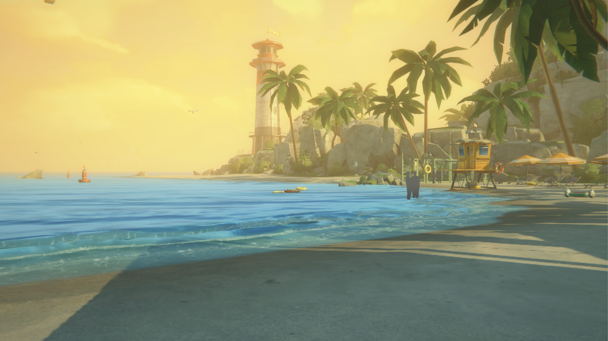

> 场景描述：沙滩与灯塔场景参考。场景用途：海边远景与结尾留白；可用于梦想意象或片尾呼吸镜头。配色：金黄、海蓝、绿色；日落海滩光。视觉要素：宽阔海岸线、平静海面、棕榈树与远处灯塔；救生员小屋、遮阳伞、浅滩和礁石；大面积天空与海面，适合剪影、慢速拉远和金色光晕。

#### 沙滩舞台

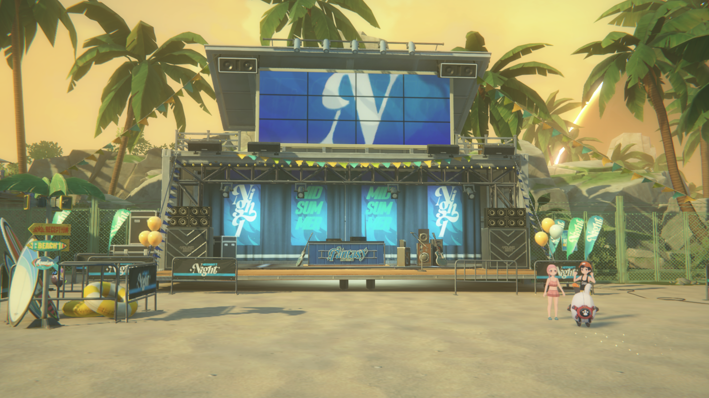

> [AI识图] 绝区零场景·海滩音乐节舞台，横向16:9。金色夕阳天空+两侧棕榈树+彩色三角旗；舞台大屏白色"R"Logo，下方蓝色帷幕横幅"Night""MID SUM MER"（仲夏夜），DJ台+音箱+吉他；左侧冲浪板/救生圈/指示牌(RECEPTION/BEACH)，右侧气球旗帜，远处光轨。注意：画面自带2个小人物NPC（粉发泳装女孩+黑发帽子女孩推行李箱），若不需要须在提示词中排除。氛围：夏日户外偶像演出。用途：场景背景。
