## character

[返回资源总索引](../Resources.md)

### 千夏
#### 通用五官描述

> [English Translation] A softly rounded oval face with a gently tapered yet rounded chin; large, round-almond eyes with slightly upturned outer corners, vivid multicolored irises featuring yellow, orange, pink, teal, and blue highlights, dark pupils, and clearly defined eyelashes; fine, natural eyebrows with a shallow gentle arch, in dark brown or black; a small, delicate nose with a soft bridge and petite tip; small, softly shaped lips in a natural pale-pink tone with a neutral mouth line; an even fair complexion with fine skin texture and a faint rosy flush on the cheeks; an overall bright, cute, lively, and approachable facial presence.

#### 正脸头像
tags: 正面, 头像, 二次元, 3D, 白色背景, 角色身份, 五官参考, 发型参考, 配件参考

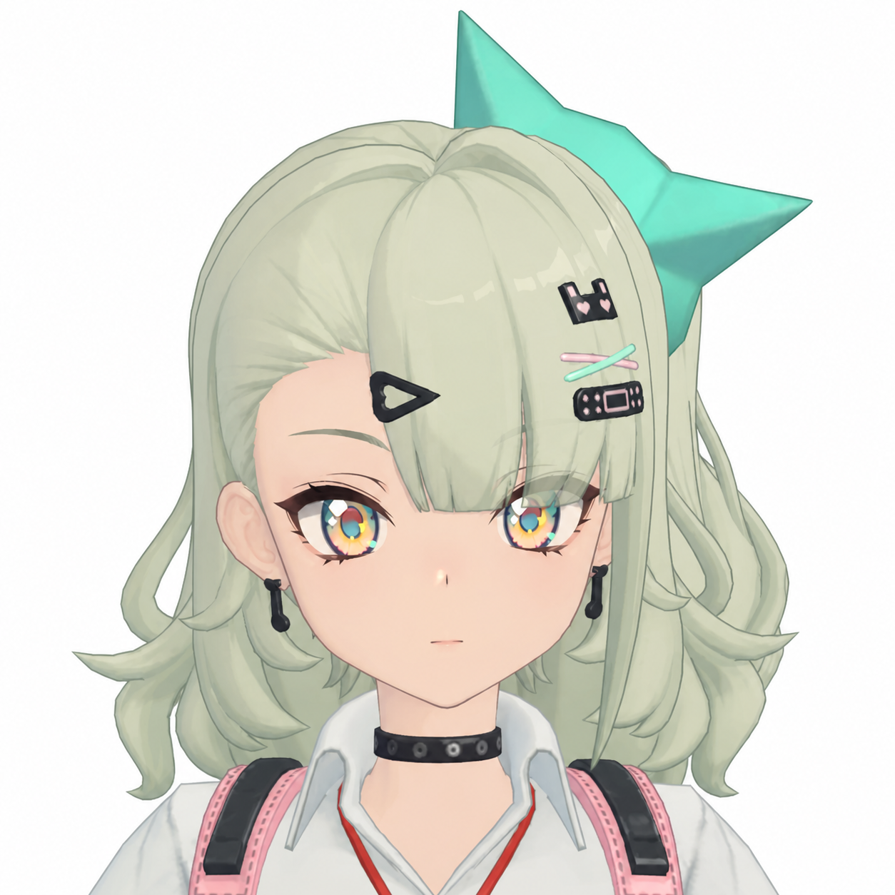

> A 1:1 front-facing 2D-anime 3D character headshot, looking directly at the camera in a centered, symmetrical composition against a pure white background with soft, even lighting. The character has layered medium-length pale mint-green and silver-green hair with a natural part, heavy straight bangs, and softly curled layered ends on both sides. A black geometric hair clip, pink heart detail, crossed pink-and-mint hair ornaments, and a black pixel-style rectangular clip are visible on the right side, along with black dangling earrings. The white shirt collar and red tie at the shoulders are retained as clothing identifiers. Use as a reference for the character's face, hairstyle, hair accessories, and identity.

#### 通用属性

- 音色：[千夏音色6秒.mp3](千夏/千夏音色6秒.mp3)

#### 全身三视图
tags: 三视图, 正面, 侧面, 背面, 白色背景, 角色身份, 服装参考, 身体比例, 配件参考

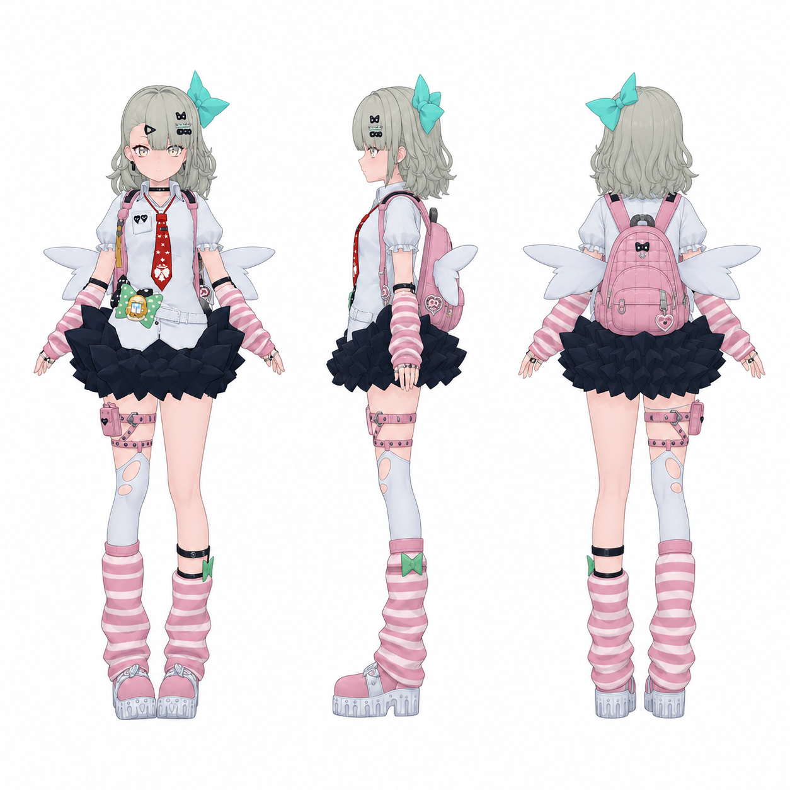

> A character turnaround sheet showing a front half-body view, a side full-body view, and a back full-body view on a white background. The character is Chinatsu, with medium-length silver-gray softly wavy hair, a mint-green bow hair clip and black butterfly-and-cross hair clip on the right side, and light-colored eyes. Outfit: a cute-cool Decora idol style, consisting of a white short-sleeved shirt, a red tie with a heart motif, a black choker, a pair of small white angel wings, and a pink angel-wing backpack on the back; pink-and-white striped fingerless arm warmers extending above the elbows; a black multilayered tutu skirt with a wide white belt; a pink thigh strap and small shoulder bag on the left thigh; white distressed over-the-knee socks; pink-and-white striped leg warmers; pink-and-white platform shoes; and black ankle straps with mint-green bows. Palette: silver gray, white, black, pink, and mint green. Use as a character identity and clothing reference.

#### KFC 联名服
tags: 三视图, 正面, 侧面, 背面, 白色背景, 二次元, 角色身份, 服装参考, 发型参考, 配件参考

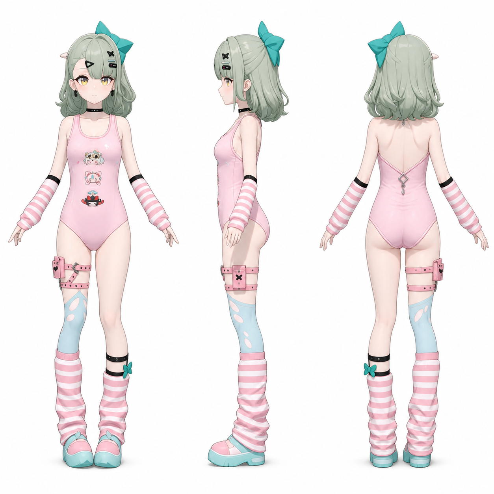

> A Chinatsu KFC collaboration outfit turnaround sheet showing front, side, and back views on a white background. She has pale mint-green hair, a large teal bow, black X-shaped and square hair clips, and yellow eyes. Outfit: a cute Lolita fast-food collaboration style, with a pink bodysuit printed with KFC-style cartoon graphics—a sunglass-wearing cartoon chicken, a small pink animal, and a red cartoon car; pink-and-white striped arm warmers extending above the elbows with black straps; pink thigh straps with metal hardware and heart charms; pale-blue spotted knee-high socks layered with pink-and-white striped thigh-high socks; and pink-and-teal platform shoes with teal bow decorations. Palette: pink, mint green, teal, pale blue, and white. Use as a character identity and clothing reference for the KFC collaboration version.

#### 猫娘版
tags: 三视图, 正面, 侧面, 背面, 白色背景, 二次元, 猫娘, 角色身份, 服装参考, 发型参考, 配件参考

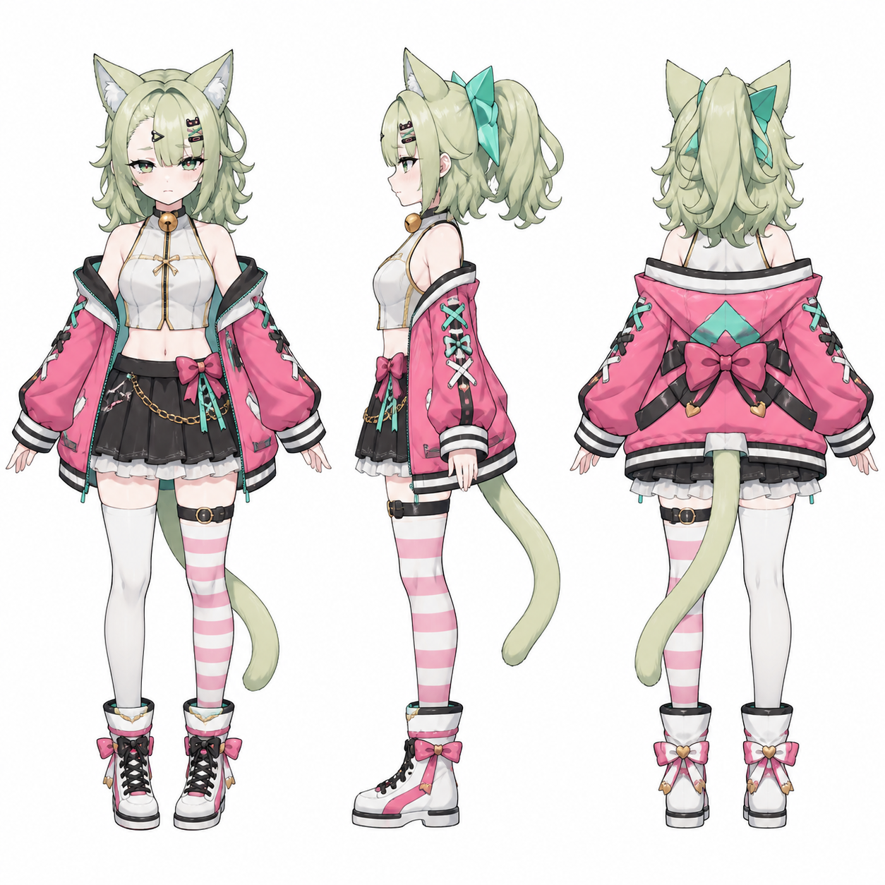

> A Chinatsu catgirl turnaround sheet showing front, side, and back views on a white background. She has pale mint-green hair, straight bangs in front and a high ponytail with a green bow in back, pale-green cat ears with white tips, and green eyes. Outfit: a sporty Lolita catgirl style, with a pink baseball jacket trimmed in black and white, green X-shaped sleeve straps, a large pink bow and green diamond motif on the back; a white V-neck cropped underlayer with a gold zipper bow; a black pleated skirt with white lace trim and a gold chain waist ornament; a pale-green cat tail; a black collar with a gold bell; pink-and-white striped thigh-high socks; and white platform ankle boots with pink bows, black laces, and gold accents. Palette: pink, mint green, white, black, and gold. Use as a character identity and clothing reference for the catgirl version.

#### 裸体三视图（配件保留）
tags: 三视图, 正面, 侧面, 背面, 白色背景, 3D, 角色身份, 裸体参考, 身体比例, 配件参考

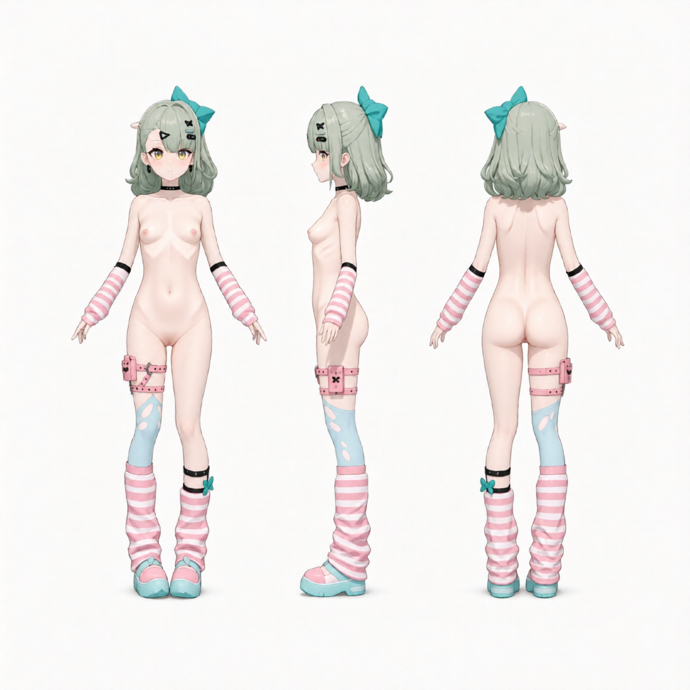

> A 3D-rendered female character turnaround sheet showing front, side, and back views on a white background. The character is Chinatsu, with medium-length silver-gray softly wavy hair, a large mint-green bow, light-colored eyes, and small horns. She is nude, retaining only the following accessories: pink-and-white striped arm warmers with black edging, pink thigh straps with heart and bow decorations, pale-blue spotted over-the-knee socks, pink-and-white striped leg warmers, and pink-and-white platform shoes with mint-green bows. Use as a nude character turnaround, body-proportion, and accessory reference.

#### 猫娘立绘（动态坐姿）
tags: 全身, 动态坐姿, 竖图, 白色背景, 二次元, 猫娘, 动作参考, 角色身份, 服装参考, 发型参考

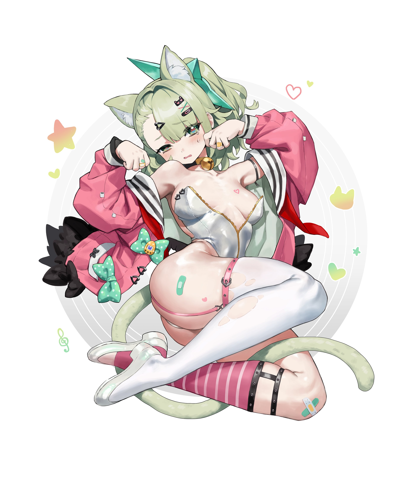

> A full-body vertical illustration of Chinatsu in catgirl form, rendered in an anime style against a white background. She has pale-green cat ears and tail, long pale-green hair in a high ponytail with a mint-green bow, and green eyes. Outfit: a pink baseball jacket with black-and-white trim and a mint-green polka-dot bow, a white bandeau top with a gold zipper, white distressed over-the-knee socks, pink striped leg warmers, black straps, and a gold bell collar, with a green cat tail. She is seated dynamically with both fists raised, looking shy and sweaty. Stars, hearts, and musical notes decorate the background. Use as a catgirl character design reference.

### 南宫羽
#### 通用属性

- 音色：[南宫羽音色6秒.mp3](南宫羽/南宫羽音色6秒.mp3)

#### 全身正视图
tags: 正面, 全身, 竖图, 白色背景, 二次元, 天使, 角色身份, 服装参考

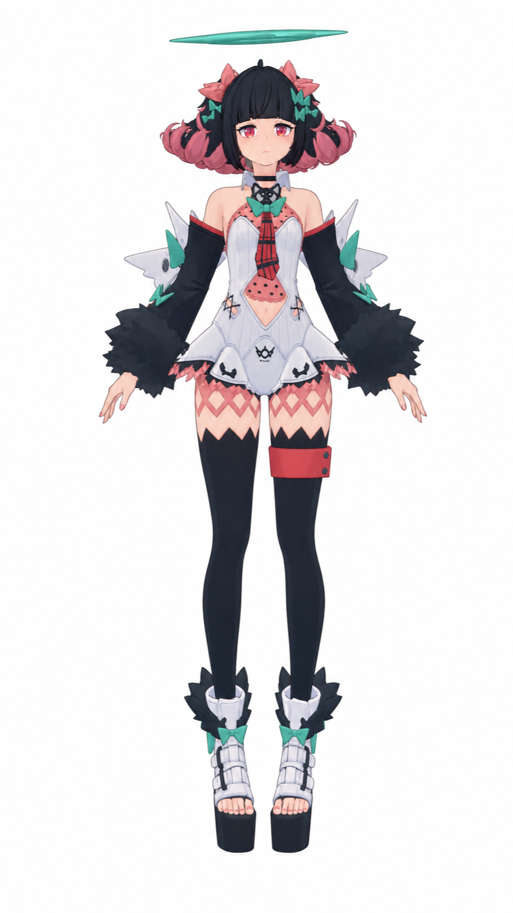

> A full-body front-view portrait of Nangong Yu, shown as a single 9:16 vertical image on a white background. She has short black curly hair with a pink accent, a green angel halo with a pink-and-green bow, and red eyes. Outfit: a gothic angel idol style with a battle-cute edge, consisting of a white off-shoulder top with a red tie and green bow, a black collar, black furry sleeves, white spiked shoulder armor with green details, white jagged shorts with pink diamond prints, red thigh straps, black thigh-high stockings, and white platform sandals with black details and green bows. Palette: black, white, pink, green, and red. Use as a full-body front-view and clothing-proportion reference.

#### 角色三视图
tags: 三视图, 正面, 侧面, 背面, 白色背景, 二次元, 天使, 角色身份, 服装参考, 身体比例

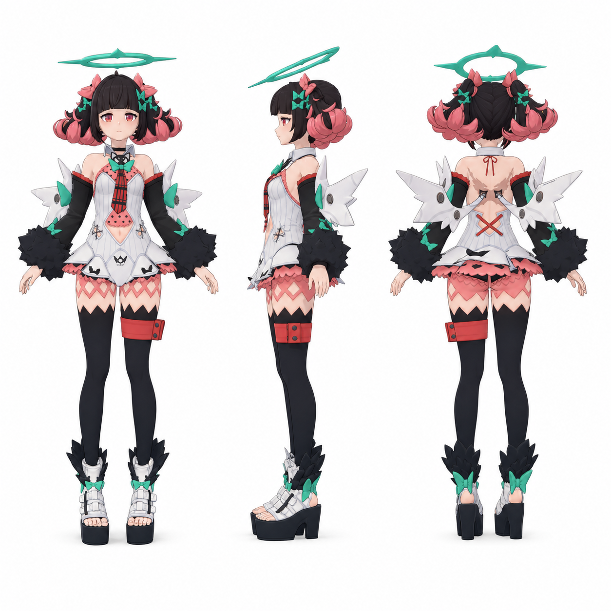

> A character turnaround sheet of Nangong Yu showing front, side, and back views on a white background. She has short black hair with two pink curled side buns, straight bangs, red eyes, and a floating mint-green angel halo above her head. Outfit: a gothic angel idol style with a white fitted corset top, a red striped tie and red polka-dot chest ornament, black long sleeves with fluffy black fur cuffs and mint-green bows, white spiked mechanical shoulder armor with circular holes, red-and-pink jagged-pattern shorts, black over-the-knee socks with red studded garter straps, and black spiked platform sandals with mint-green bows. The back of the top has red X-shaped lacing. Palette: black, white, red, and mint green. Use as a character identity and clothing reference.

#### exec-e658e3d5-6076-41ee-bc9f-d6ca9c6c0063.png
tags: 正面, 半身, 二次元, VTuber, 白色背景, 角色身份, 五官参考, 发型参考, 配件参考

> **Subject:** Front-facing bust portrait of an anime-style female character (VTuber avatar).
> 
> **Appearance:** 
> - **Face:** Pale complexion with large, vivid crimson-red irises featuring four-pointed star highlights; straight, dark bangs across forehead; small ahoge (cowlick) at crown; neutral, slightly serious expression.
> - **Hair:** Jet-black bob cut transitioning into voluminous, coral-pink curled drills/twin-tails on both sides; decorated with oversized salmon-pink bows at the crown of each drill and smaller mint-green ribbon bows trailing down the lengths.
> 
> **Accessories:**
> - **Halo:** A translucent mint-green geometric nimbus (compass-rose design with pointed extensions) floating above the head.
> - **Neckwear:** Thin black choker.
> - **Pendant:** A black cat-faced brooch with angular white eyes and angry expression, accented by a mint-green bow at the base, resting against a high, pointed light-gray collar resembling a lab coat.
> 
> **Pose & Composition:** Symmetrical, centered chest-up shot; subject faces viewer directly with level gaze; shoulders squared.
> 
> **Background:** Solid pure white/transparent void with no environmental detail.
> 
> **Lighting:** Flat, even studio lighting with soft ambient occlusion beneath the chin and hair; minimal shadowing consistent with 2D cel-shaded illustration.
> 
> **Style:** Clean digital anime/manga aesthetic with crisp lineart, saturated colors, and smooth gradient shading characteristic of modern VTuber model references.
> 
> **Visible Text:** None present.

### 爱芮
#### 通用属性

- 音色：[爱芮音色6秒.mp3](爱芮/爱芮音色6秒.mp3)

#### 全身正视图
tags: 正面, 全身, 竖图, 白色背景, 二次元, 角色身份, 服装参考

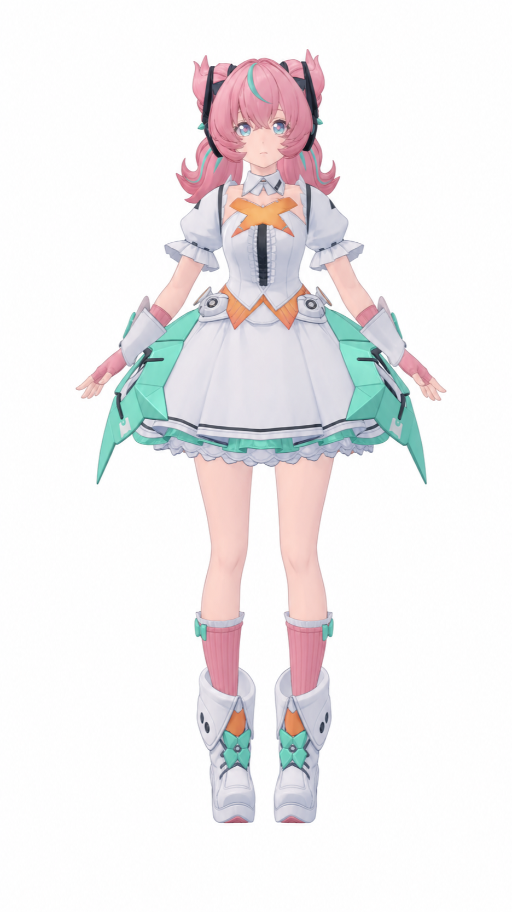

> A full-body front-view portrait of Airei, shown as a single 9:16 vertical image on a white background. She has pink twin-tails with mint-green highlights, a black hairband, and blue eyes. Outfit: a mecha DJ idol style, consisting of a white off-shoulder short dress with a collar, orange X-shaped chest decoration and black vertical stripes, puff sleeves, green wing-like mechanical structures at the sides of the skirt, white wrist guards with green details, pink thigh-high socks, and white high-top shoes with orange details and green accents. Palette: pink, white, mint green, and orange. Use as a full-body front-view and clothing-proportion reference.

#### 角色三视图
tags: 三视图, 正面, 侧面, 背面, 白色背景, 二次元, 角色身份, 服装参考, 配件参考, 天使

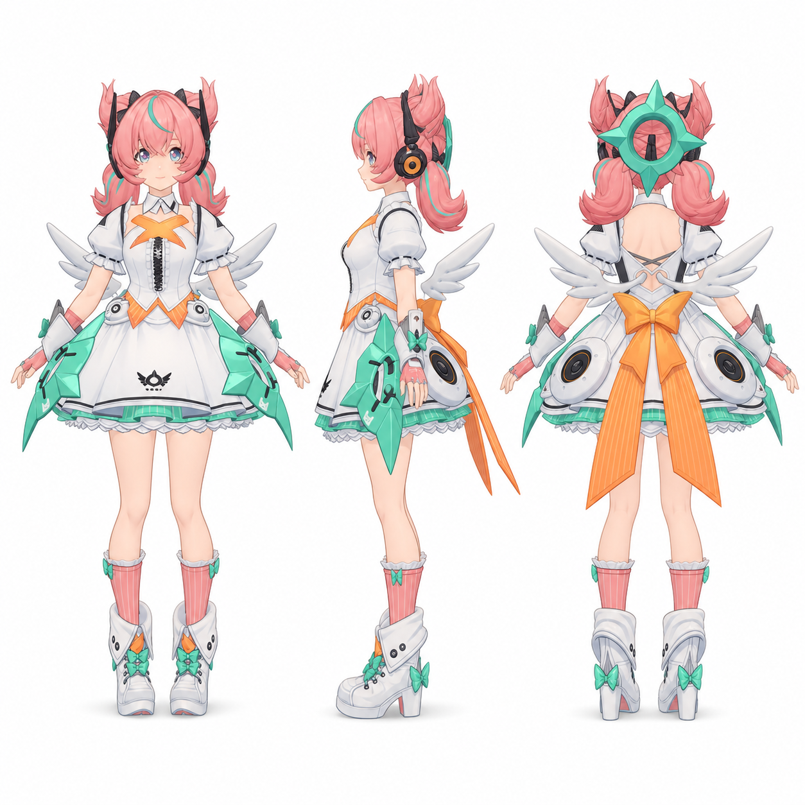

> A character turnaround sheet of Airei showing front, side, and back views on a white background. She has pink twin-tails with a mint-green streak, black horn-shaped hair ornaments, orange-and-black headphones, and blue-violet eyes. Outfit: a mecha DJ idol style with a white puff-sleeved short dress, an orange X-shaped chest ornament and black rows of fasteners, mint-green crystal wrist guards, circular speaker-like mecha components at the sides of the skirt, a pair of white angel wings on the back, a large orange bow with trailing ribbons, and a mint-green star-shaped halo device behind the head; pink vertically striped socks with mint-green bows and white platform ankle boots. Palette: pink, white, mint green, and orange. Use as a character identity and clothing reference.

#### 裸体三视图（配件保留）
tags: 三视图, 正面, 侧面, 背面, 白色背景, 3D, 角色身份, 裸体参考, 身体比例, 配件参考

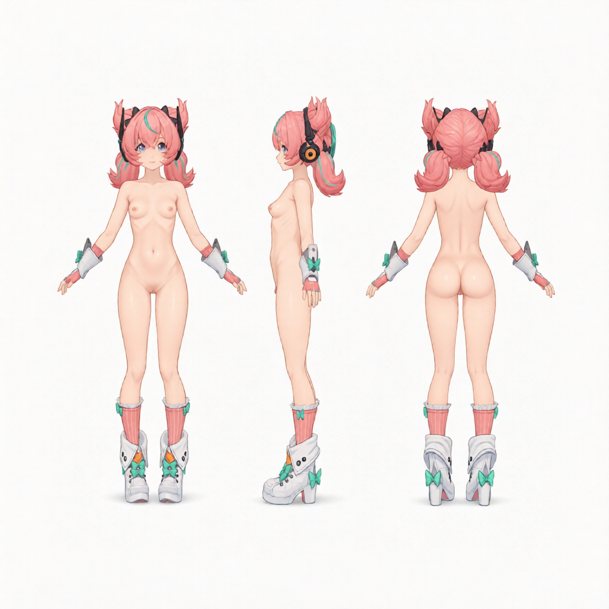

> A 3D-rendered female character turnaround sheet showing front, side, and back views on a white background. The character is Airei, with pink twin-tails featuring a mint-green highlight, black headphones, and blue eyes. She is nude, retaining only the following accessories: silver-white mecha arm sleeves with mint-green bows, pink striped socks with mint-green bows, and white mecha high-heeled boots with mint-green bows and orange laces. Use as a nude character turnaround, body-proportion, and accessory reference.

#### 爱芮-正脸大头照.png
tags: 正面, 头像, 二次元, 角色身份, 五官参考, 发型参考, 配件参考, 服装参考

> **Description:** Front-facing anime portrait of a pink-haired character with large twin ponytails, black striped bows, long black side ornaments, and a turquoise horn-like headpiece. She has bright turquoise star-patterned eyes and wears a white collared outfit with black shoulder straps.

### 蕾米埃尔
#### 角色三视图
tags: 三视图, 正面, 侧面, 背面, 白色背景, 二次元, 天使, 角色身份, 服装参考, 身体比例

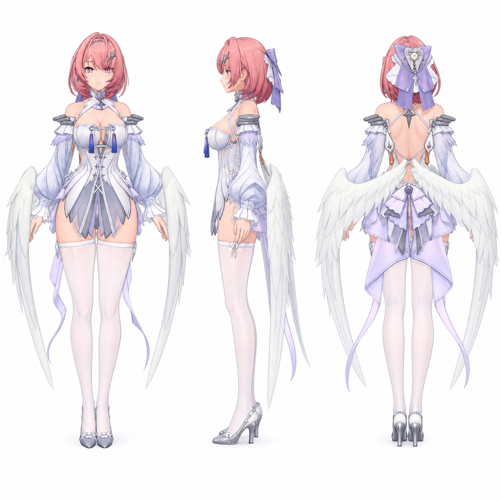

> A character turnaround sheet of Remiel showing front, side, and back views on a white background. She has pale peach-pink short hair with shoulder-length softly curled bangs, purple eyes, a star hair clip on top, a purple bow headband at the side, and a large purple bow headpiece with white pleats and metal details at the back. Outfit: a fantasy angel style with a white-and-pale-purple off-shoulder fitted top, gray layered shoulder armor, loose puff sleeves with blue tassel cuffs; a pale-purple layered asymmetrical mini skirt with an oversized purple bow at the back; large white wings fully spread; white thigh-high socks; and silver stiletto heels. Palette: white, pale purple, pink, and silver. Use as a character identity and clothing reference.

#### 裸体三视图（翅膀+配件保留）
tags: 三视图, 正面, 侧面, 背面, 白色背景, 3D, 天使, 角色身份, 裸体参考, 身体比例, 配件参考

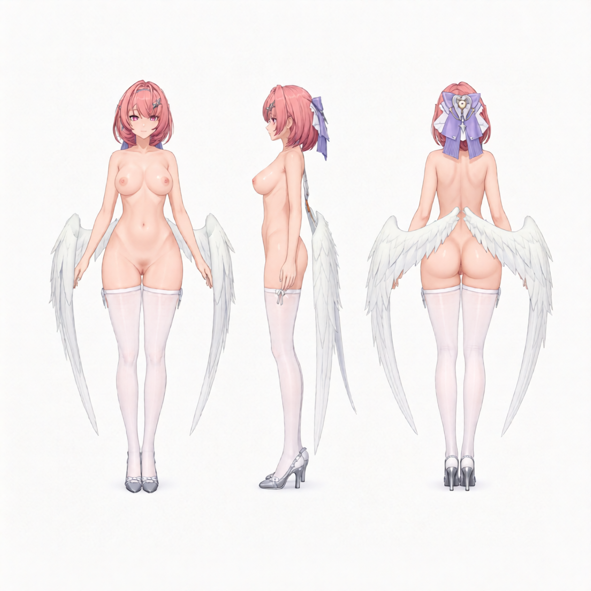

> A 3D-rendered female character turnaround sheet showing front, side, and back views on a white background. The character is Remiel, with medium-length pink hair, purple eyes, a silver star hair clip, and a purple bow headband. She is nude, retaining only the following accessories: white wings on the back, white over-the-knee socks, and silver high heels. The back view shows a purple bow headpiece and white pleated decoration. Use as a nude character turnaround, body-proportion, and accessory reference.

#### exec-e724fa5d-a2fb-4858-b259-213277a73a94.png
tags: 正面, 头像, 二次元, 白色背景, 角色身份, 五官参考, 发型参考, 配件参考

> **Description:** Front-facing anime portrait of a pink-haired woman with a short bob, a gray headband, silver star-shaped hair clips, and large violet eyes with yellow-pink heart highlights. She wears a white frilled collar against a clean white background.

### 铃
#### 角色三视图
tags: 三视图, 正面, 侧面, 背面, 白色背景, 二次元, 角色身份, 服装参考, 发型参考, 配件参考

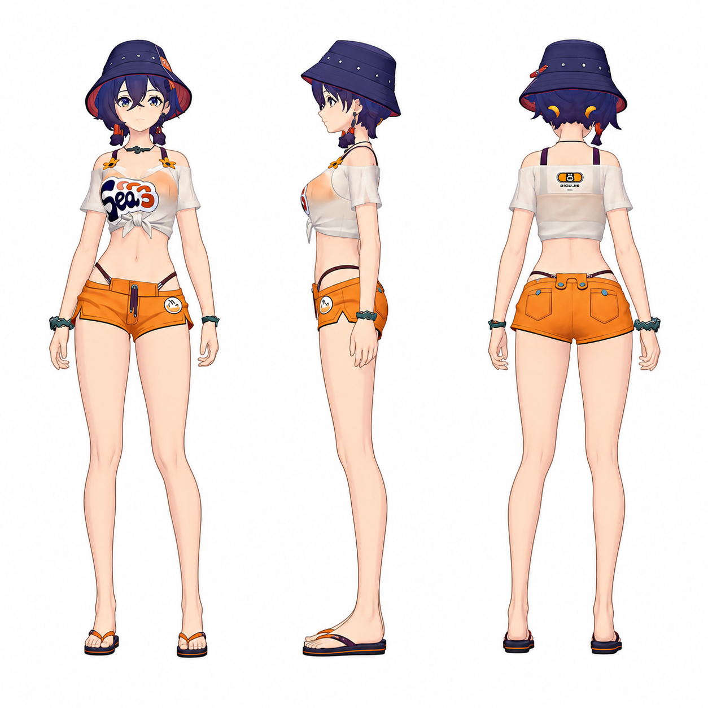

> A character turnaround sheet of Ling showing front, side, and back views on a white background. She has short dark-blue hair, red-orange tassel braids on both sides of her head, and blue eyes; a dark-blue bucket hat with white polka dots and red-orange decorations inside. Outfit: a summer beach-casual style with a white cropped short-sleeved top featuring a "sea3" art print on the front and a yellow rectangular logo on the back; orange high-waisted fitted shorts with a belt, blue buttoned pockets, and a circular badge; a green necklace and matching bracelets on both wrists; and black flip-flops with orange straps, worn barefoot. Palette: dark blue, white, orange, and green. Use as a character identity and clothing reference.

### 原创 JK 制服少女
#### 角色三视图
tags: 三视图, 正面, 侧面, 背面, 白色背景, 二次元, JK制服, 角色身份, 服装参考, 发型参考, 道具参考

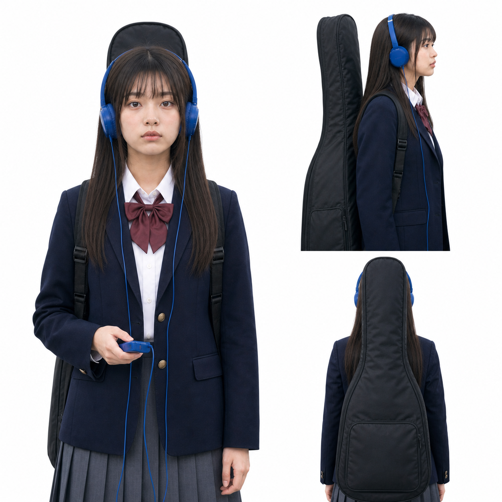

> A character turnaround sheet showing front, side, and back views of an original Japanese school-uniform character on a white background. She has long straight dark-brown hair, dark-brown round eyes, and no hair accessories. Outfit: a Japanese school-uniform style with a fitted navy blazer and gold buttons, a white shirt, a burgundy satin bow tie, and a knee-length gray pleated skirt; she holds a blue music player or headphone controller in her right hand and carries a black backpack and a black guitar case with a zippered pocket. Palette: navy, white, gray, and burgundy. Use as a character identity and clothing reference.

### 初音未来
#### 三视图
tags: 三视图, 正面, 侧面, 背面, 二次元, 虚拟歌姬, 角色身份, 服装参考, 发型参考, 配件参考

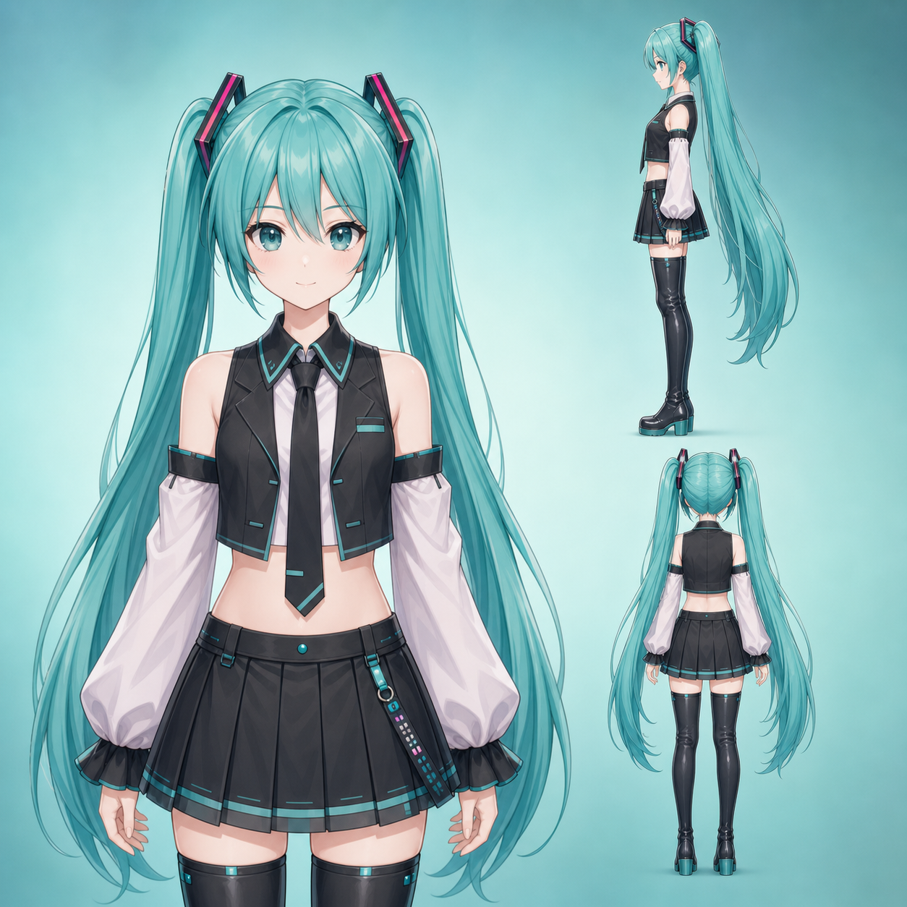

> A three-view character design sheet for the virtual singer Hatsune Miku, showing front, side, and back views. The character has long teal-green twin-tails and black headphone-style hair ornaments with pink accents; she wears a white puff-sleeved blouse, a sleeveless black vest, cyan trim, a black tie, and a black pleated mini skirt, paired with black boots and cyan details. The background is a pale cyan-to-blue-white gradient, with teal green, black, white, and pink as the main colors.

### 塞莱斯汀·罗西耶
#### 构成主义首帧
tags: 首帧, 正面, 站立, 二次元, 场景参考, 服装参考

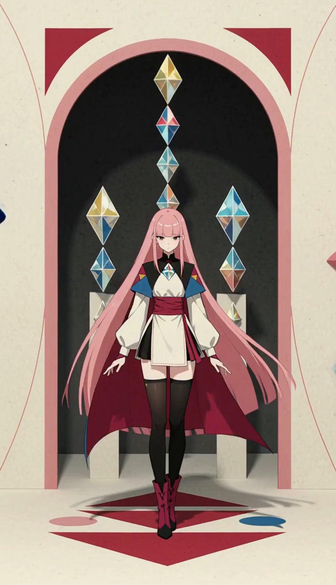

> A flat 2D anime-style character scene. A pink-haired character stands facing the camera, wearing white high-neck clothing, a dark-red cape, black over-the-knee socks, and red boots, with blue-and-red geometric shoulder decorations. The background contains a pink arched doorway, a dark space, colorful hanging crystals, and a red geometric floor pattern. The overall palette is pink, white, dark red, black, and beige.

#### 角色三视图
tags: 三视图, 正面, 侧面, 背面, 二次元, 纯色背景, 角色身份, 服装参考, 身体比例, 配件参考

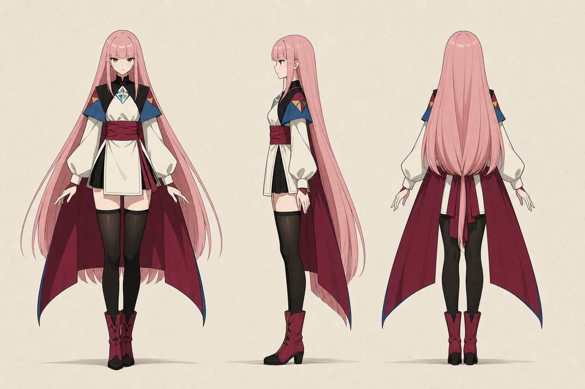

> An anime-style female character turnaround sheet showing front, side, and back views against a beige background. The character is Celestine Rosier, with very long straight pink hair reaching the waist, straight bangs, and large dark-red eyes. Outfit: a white puff-sleeved top, black high-neck layer, blue-and-red diamond-shaped gemstone ornament at the chest, blue shoulder armor, a red belt, a black mini skirt, a dark-red long cape with blue lining, black over-the-knee socks, and burgundy lace-up ankle boots. Palette: pink, white, black, red, and blue. Use as a character identity and clothing reference.

### 苍蓝
#### 绝区零风格三视图
tags: 三视图, 正面, 侧面, 背面, 二次元, 纯色背景, 角色身份, 服装参考, 发型参考, 配件参考

> A Japanese anime-style female character turnaround sheet showing front, side, and back views. The character has extremely long blue-and-white gradient twin-tails with pink highlights at the ends, a white star-shaped hair ornament, and a pink ribbon. She wears a white hooded sweatshirt, a cyan-blue pleated mini skirt, white over-the-knee socks, and cyan-blue-and-pink platform shoes, with cat-ear headphones and dangling charms. The background has a pale gray-white diagonal stripe texture, creating a fresh, cute overall look.

### 波普艺术
#### Weird Girl 波普艺术头像
tags: 头像, 近景, 横图, 二次元, 插画, 波普艺术, 风格参考

> A pop-art female portrait illustration in a horizontal 16:9 composition. She has dark shoulder-length hair with straight bangs and large black eyes. The pink background features black halftone texture and cyan-magenta misregistration, evoking red-and-blue 3D glasses. Visible text includes "weird-girl" in bold black at the upper left, "SHE'S NOT NORMAL AND THAT'S OKAY" on the left, and "STRANGE GIRLS CLUB" arranged vertically on the right. Decorative elements include stars, a disco ball, a barcode marked "09 21 02", an eye close-up, a heart, a spiral, a checkerboard, and three stars. Overall, it has a magazine-cover or album-cover style. Palette: pink, black, and cyan. Use as a pop-art style reference.

### 哲
#### 角色三视图
tags: 三视图, 正面, 侧面, 背面, 全身, 白色背景, 二次元, 3D, 角色身份, 服装参考, 身体比例, 配件参考

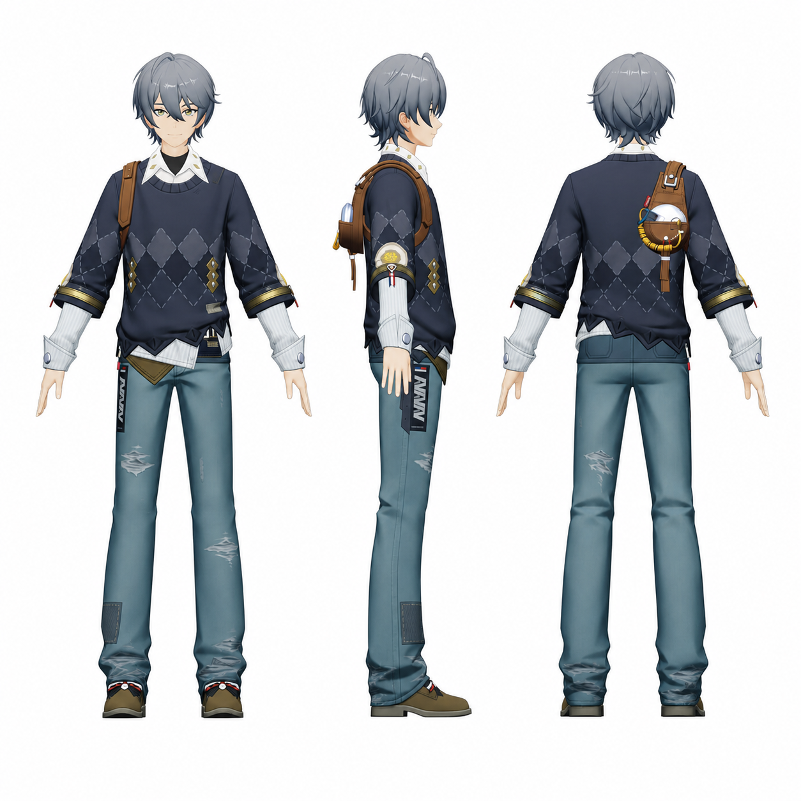

> A 1:1 square character design sheet on a solid white background, with complete front, right-side, and back full-body views arranged horizontally. The proportions are consistent and the character stands in a neutral pose, making the sheet suitable as a reference for identity, clothing structure, and turnaround design. The character is a young male anime figure with short gray-blue fluffy layered hair and bangs, and light gray-green eyes. He wears a dark navy diamond-knit sweater over a white pointed-collar shirt and black turtleneck; the cuffs have white ribbed construction, with subtle gold details at the cuffs and waist. He wears light blue-gray straight-leg jeans with distressed knees and a small unbranded patch, carries a brown canvas or leather shoulder bag with a circular tool container and strap structure visible from the back, and wears olive-brown low-top shoes with dark soles and small red-and-white details. Overall, this is a high-detail anime 3D character design sheet with even lighting and no text, logos, watermarks, or extra scene elements.

#### 大头照
tags: 正面, 头像, 二次元, 3D, 白色背景, 角色身份, 五官参考, 发型参考, 服装参考

> A 1:1 front-facing anime 3D character headshot, centered and looking directly at the camera against a pure white background with soft, even lighting. The character is a young male with short gray-blue fluffy layered hair, natural bangs, and a small tuft at the crown; light gray-green eyes, delicate features, and a gentle expression. He wears a dark navy diamond-knit sweater over a white pointed-collar shirt and black turtleneck, with subtle gold details at the collar. Use as a reference for the face, hairstyle, upper-body clothing, and identity.

### Yasal
#### 通用五官描述

> [English Translation] A round-oval face with smooth, softly rounded contours and a gentle chin without pronounced angles; medium-sized almond-shaped eyes with slightly upturned outer corners, pale blue-gray irises, subtle double eyelids, long natural eyelashes, and soft pink eyeshadow; naturally arched, medium-thickness black eyebrows that are neatly groomed; a straight, slender nose with a defined bridge and a slightly rounded tip; full lips with an M-shaped cupid's bow, pale pink lip gloss, a soft hydrated look, and gently upturned corners; an even fair complexion with smooth, dewy skin; an overall fresh, innocent, cute appearance with minimal makeup.

#### 精灵耳头像
tags: 头像, 近景, 真人, 精灵耳, 五官参考, 发型参考, 配件参考

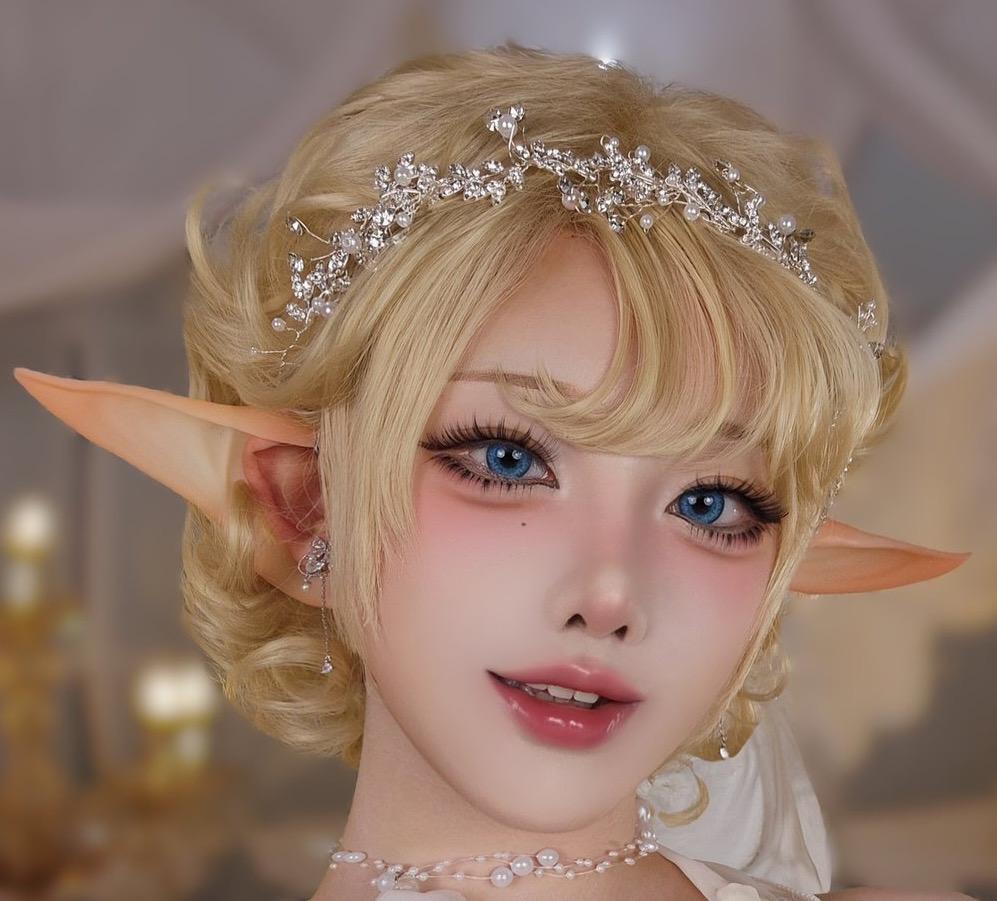

> A realistic close-up portrait of a person with light-blonde curly hair styled in an updo, wearing a silver crystal-and-pearl tiara, a pearl necklace, dangling earrings, and elf-ear accessories with orange-brown tips. The character has blue irises and refined makeup. The background is clean and bright. Use as a reference for the face, hairstyle, and elf-ear accessories.

#### 黑发白衬衫头像
tags: 正面, 半身, 站立, 真人, 纯色背景, 五官参考, 发型参考, 服装参考, 配件参考

> A front-facing realistic half-body portrait. The character has jet-black shoulder-length hair with straight bangs, wears a silver barrette on the right side, and is dressed in a white collared shirt while standing upright and facing the camera. The background is a pale-gray solid plane, with a simple palette of black, white, gray, and natural skin tones.

#### 红发猫耳造型头像
tags: 正面, 半身, 真人, cosplay, 猫娘, 纯色背景, 五官参考, 发型参考, 配件参考

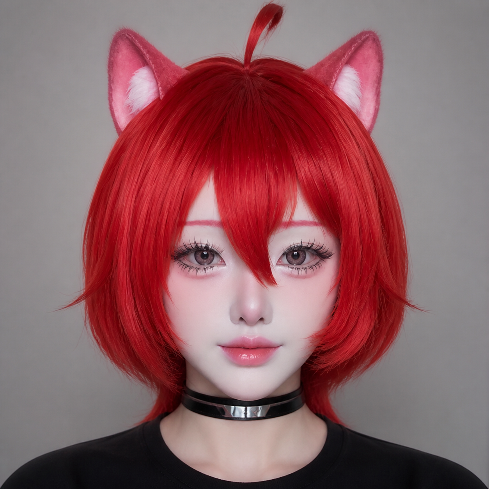

> A front-facing realistic half-body portrait. The character has a red bob haircut with straight bangs, plush cat-ear hair accessories with pink inner lining, a wide black collar, and a black top. The makeup has a Japanese cosplay-inspired style. The background is neutral gray, with red, black, pink, and gray as the main colors.

### Yudiii
#### 通用五官描述

> [English Translation] An oval face with smooth contours, rounded cheekbones, and a softly tapered chin; medium-sized almond-shaped eyes with slightly upturned outer corners, light-blue irises, and a gentle gaze; fine eyebrows that are mostly straight with a slight curve, in dark brown or black; a straight nose with a medium-height bridge and a small, refined tip; medium-full M-shaped lips in a light pink tone with a clearly defined lip line; an even fair complexion with a soft pink blush on the cheeks; an overall fresh, pure, gentle, and approachable appearance.

#### 薄荷色蝴蝶结服装
tags: 正面, 全身, 写实, 白色背景, 制服, 角色身份, 服装参考, 发型参考, 配件参考

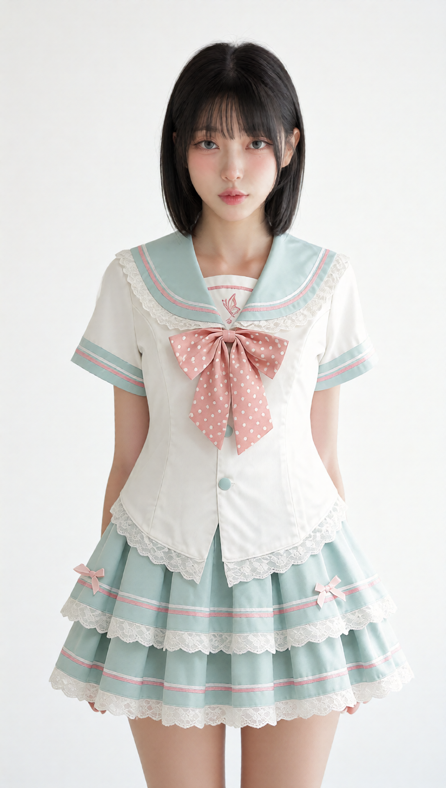

> A realistic digital full-body character illustration. The character has shoulder-length black hair, straight bangs, and light-colored eyes, and wears a mint-and-white sailor-style outfit with a large pink polka-dot bow at the chest, a lace neckline, and a layered skirt. The image uses a white background and a front-facing composition. Use as a reference for the clothing and character appearance.

#### 制服三视图
tags: 三视图, 正面, 侧面, 背面, 写实, 纯色背景, 角色身份, 制服, 服装参考, 身体比例

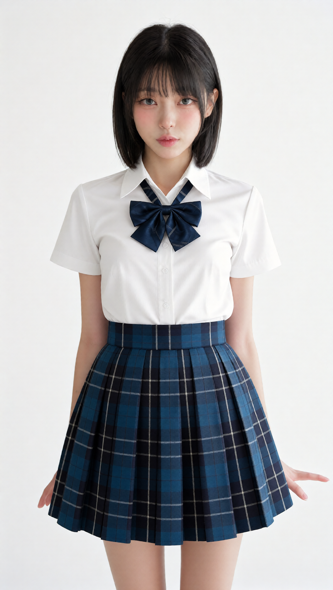

> A realistic character turnaround sheet showing front, side, and back views of the same character. The character has short black hair with straight bangs and wears a white top with a dark school-style skirt. The image uses a simple gray-and-white background with even lighting. Use as a reference for character proportions and clothing structure.

#### 正脸头像
tags: 正面, 头像, 写实, 纯色背景, 角色身份, 五官参考, 发型参考, 服装参考

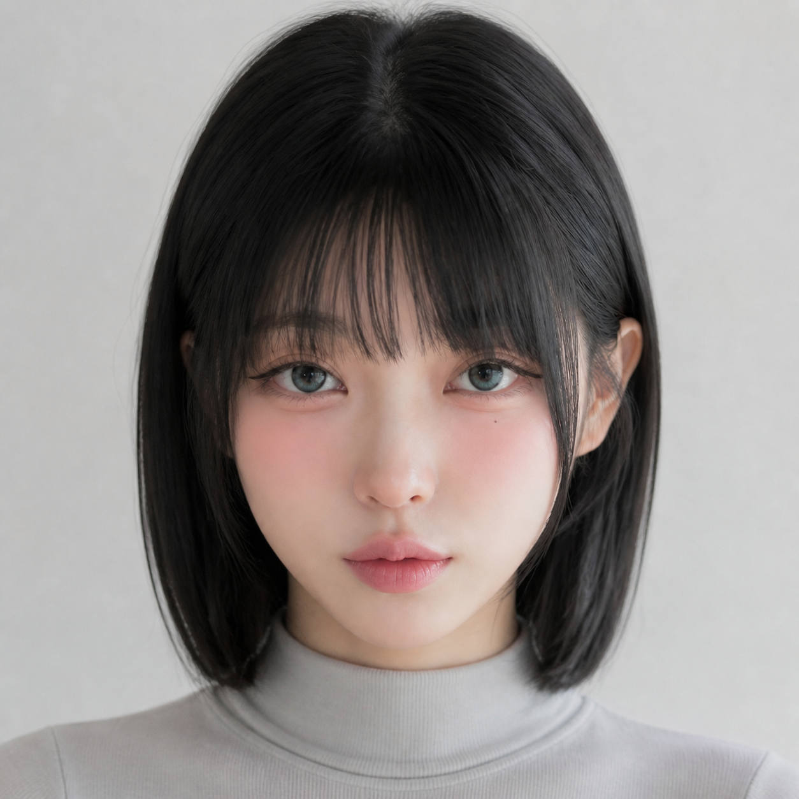

> A front-facing realistic character headshot. The character has straight black shoulder-length hair with eyebrow-length bangs and wears a light-gray turtleneck sweater while looking directly at the camera. The background is a pale gray-white solid plane, with a clean symmetrical composition. Use as a reference for the face, hairstyle, and clothing neckline.

#### 红色十字连体泳衣
tags: 正面, 半身, 竖图, 写实, 泳衣, 服装参考, 发型参考

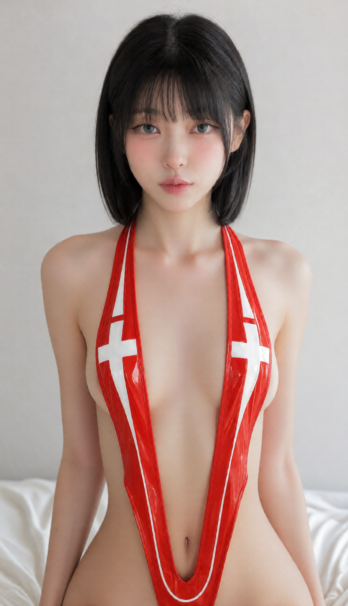

> A realistic half-body front-facing portrait of a woman in a vertical composition, approximately 9:16. She has black shoulder-length hair with straight bangs, light-blue eyes, pink blush, and natural pink lips. She wears a red high-cut one-piece swimsuit with a halter deep-V design: wide red panels on both sides, a white cross motif on each breast, a central deep V extending to the navel, and white piping. The material has a glossy finish. The background is a pale-gray wall with a white bed or sofa, under bright, soft lighting. Use as a clothing and swimsuit-style reference.

#### 红色十字连体泳衣三视图
tags: 三视图, 正面, 侧面, 背面, 横图, 写实, 泳衣, 角色身份, 服装参考, 身体比例

> A realistic character turnaround sheet showing front, side, and back views in a horizontal composition, approximately 16:9. The character is Yudiii, with black shoulder-length hair, straight bangs, and light-blue eyes. She wears a red high-cut one-piece swimsuit: the front has a halter deep-V design, wide red panels with white cross motifs, a central deep V extending to the navel, and white piping; the side view shows the high-cut leg openings and halter structure; the back is almost bare except for a thin red waist strap with a silver buckle. The background is a pale-gray wall with a white bed, under even, soft lighting. Use as a swimsuit turnaround and clothing-structure reference.

#### 红色比基尼
tags: 正面, 全身, 竖图, 写实, 泳衣, 比基尼, 服装参考, 发型参考

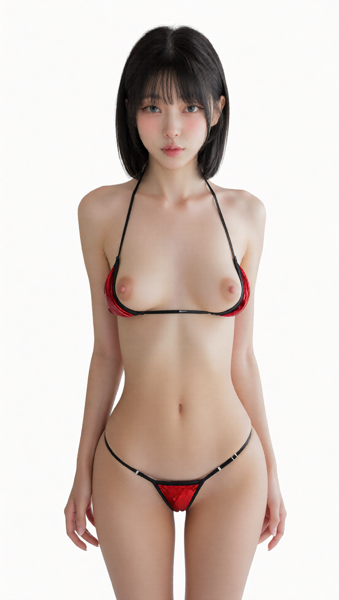

> A realistic full-body front-facing portrait of a woman in a vertical composition, approximately 9:16. She has black shoulder-length hair with straight bangs, light-blue eyes, pink blush, and natural pink lips. She wears a red bikini with a red triangle-cup top and black thin halter straps, and red triangle briefs with black thin side straps and silver metal rings. The material has a glossy finish, and the breasts are naturally quite exposed. The background is pure white with bright, even lighting. Use as a swimwear and bikini-style reference.

#### 红色三角比基尼（带镂空）
tags: 正面, 全身, 竖图, 写实, 泳衣, 比基尼, 服装参考, 发型参考

> A realistic full-body front-facing portrait of a woman in a vertical composition, approximately 9:16. She has black shoulder-length hair with straight bangs, light-blue eyes, pink blush, and natural pink lips. She wears a red triangle bikini with black thin strap edging: the top has red triangle cups, black thin halter straps, and black side cutout straps, with the breasts naturally quite exposed; the bottom is a black triangle brief with a red triangular inset at the center front, black thin side straps, and silver metal rings. A small black tattoo is visible on the left forearm. The background is a pale-gray solid plane with bright, even lighting. Use as a swimwear and bikini-style reference.

### yuan
#### 通用五官描述

> [English Translation] A standard oval face with smooth, gentle contours, a full forehead, and a moderately tapered jawline; large, wide-open eyes with relatively long eye openings, clear blue irises, a direct gaze, and long, curled eyelashes; long, softly shaped eyebrows with an understated arch and a naturally gentle line; a delicate nose with a straight bridge, rounded tip, and subtly tapered nose wings; clearly defined lips with a pronounced M-shaped cupid's bow, a slightly prominent central lip cushion, healthy pale-pink color, and straight corners; an even fair complexion with fine skin texture and a faint rosy flush on the cheeks; an overall fresh, elegant, gentle, and tranquil facial presence.

#### 浅蓝假发头像
tags: 正面, 半身, 纯色背景, 角色身份, 发型参考, 配件参考, 服装参考

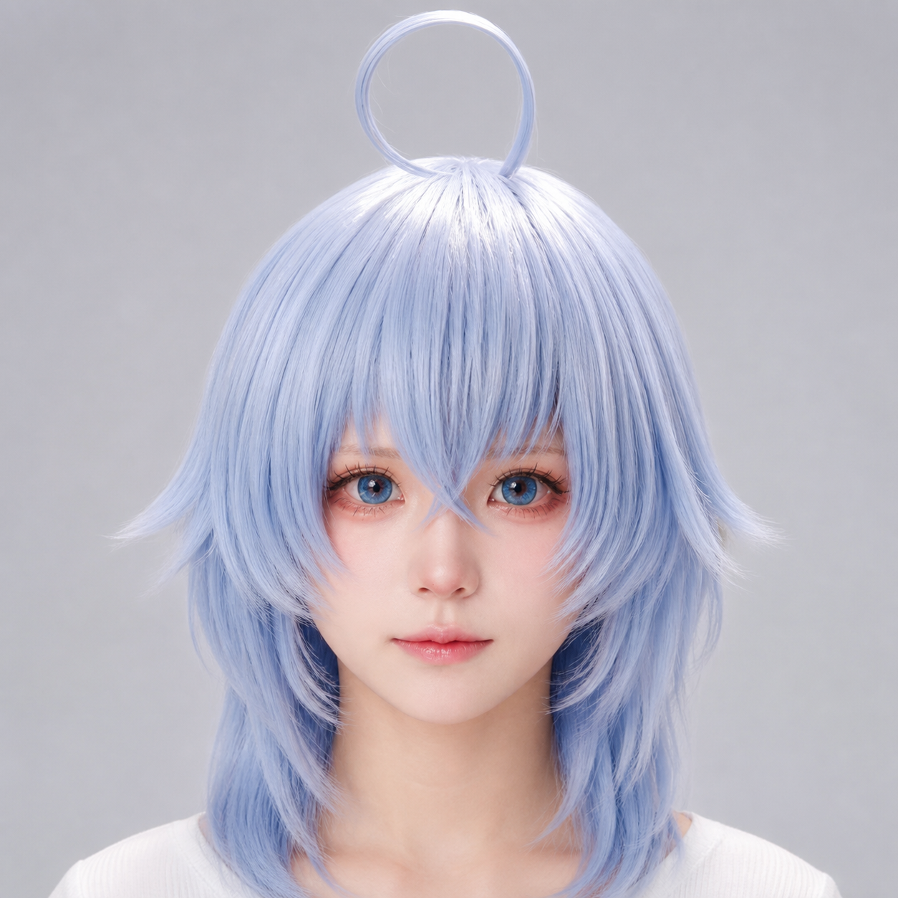

> A front-facing half-body portrait. The character wears a shoulder-length pale blue-gray wig with straight bangs and a white ring-shaped hair ornament, a white crew-neck top, and has blue eyes and a calm expression. The background is evenly lit pale gray. Use as a reference for the wig and character styling.

#### 棕发户外头像
tags: 斜侧面, 半身, 室外, 真人, 角色身份, 发型参考, 服装参考, 配件参考

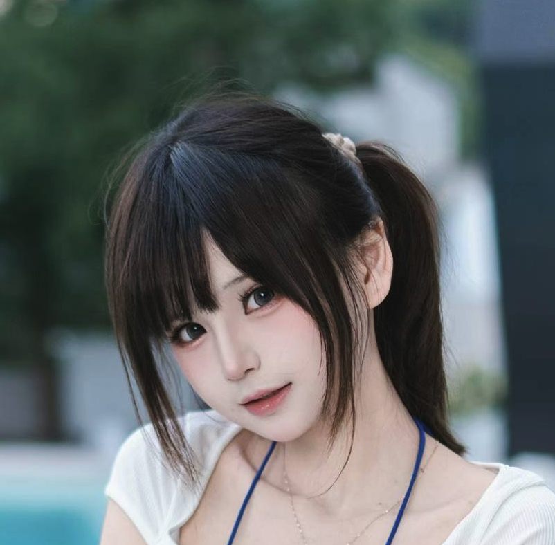

> A realistic female upper-body portrait. The character has dark-brown long hair in a high ponytail with straight bangs, wears a white top with a blue underlayer and a delicate necklace, and turns her head slightly toward the camera. The background shows blurred outdoor greenery and architecture under bright, soft lighting. Use as a reference for the hairstyle and casual clothing.

### 玉靥姬
#### 通用五官描述

> A general facial reference for a female character: a standard oval face with soft, fluid contours and a gently rounded, tapered jawline; a luminous fair complexion with delicate skin texture and a subtle natural flush; large, round, slightly upturned almond-shaped eyes with pale gray or blue-gray irises, bright black pupils, and a clear forward gaze; naturally relaxed eyebrows forming a shallow curve; a straight, slender nose bridge with subtly tapered nose wings and a small, rounded tip; medium-thickness lips with a distinct M-shaped cupid's bow, a natural pale-pink color, and straight corners; an overall fresh, refined, ethereal appearance with harmonious, symmetrical facial proportions.
> [English Translation] A standard oval face with soft, fluid contours and a gently rounded, tapered jawline; a luminous fair complexion with delicate skin texture and a subtle natural flush on the cheeks; large, round eyes with a slightly upturned almond shape, pale gray or blue-gray irises, bright black pupils, and a clear direct gaze; naturally relaxed eyebrows with no pronounced arch, forming a gentle shallow curve; a straight, slender nose bridge with subtly tapered nose wings and a small, rounded tip; medium-thickness lips with a distinct M-shaped cupid's bow, a natural pale-pink color, and straight corners; an overall fresh, refined, ethereal appearance with harmonious, symmetrical facial proportions.

#### 正脸头像
tags: 正面, 头像, 半身, 真人, 角色身份, 五官参考, 发型参考

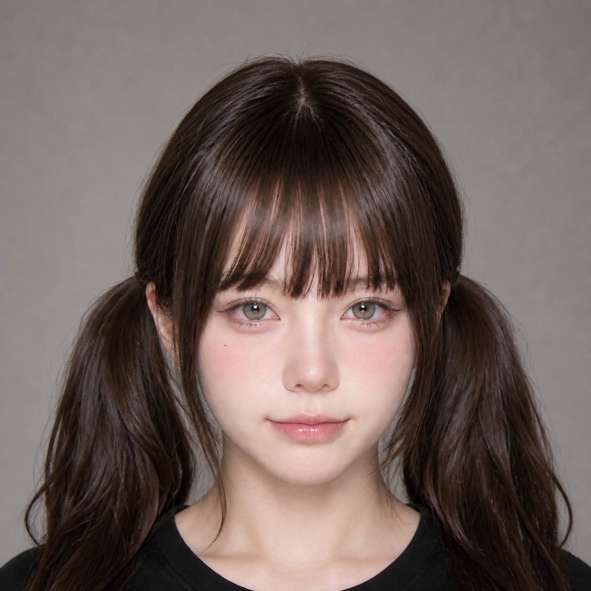

> A front-facing half-body realistic portrait. The character has dark brown-black long straight hair styled in symmetrical twin-tails with straight bangs and looks directly at the camera. The composition is a centered headshot against a clean, bright background. Use as a reference for the hairstyle, face, and front-facing expression.

### 菌烨
#### 通用五官描述

> [English Translation] A slightly rounded oval face with smooth contours, balanced width-to-height proportions, and an overall harmonious, soft appearance; medium-sized almond-shaped eyes with dark-brown irises, natural double eyelids, slightly upturned outer corners, and medium-length eyelashes; fine, naturally arched dark-brown eyebrows that are neatly groomed; a medium-sized nose with a straight, slightly high bridge and proportionate nostrils; medium-full lips in a natural pink tone, with a subtly M-shaped upper lip and a soft, full appearance; an even fair complexion with a healthy glow and a faint blush on the cheeks; an overall fresh, gentle, elegant appearance.

#### 汉堡场景人物
tags: 正面, 半身, 真人, 室内, 角色身份, 场景参考, 服装参考, 道具参考

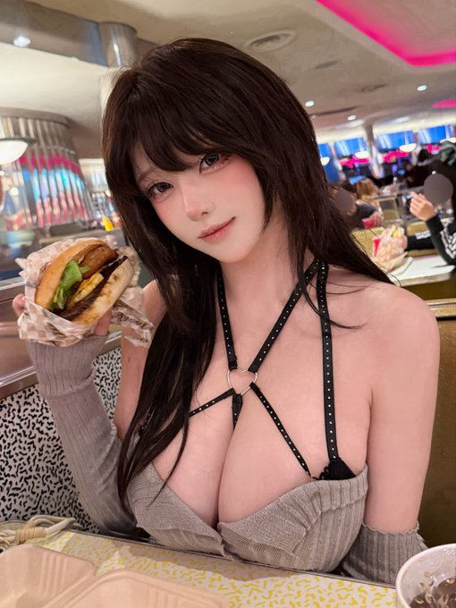

> A realistic half-body character scene. The character has dark-brown long straight hair with straight bangs, wears a gray knit top with gray long sleeves, and holds a double-patty hamburger while facing the camera. The background is an indoor dining space with visible leopard-print decoration, using brown, gray, black, and natural skin tones as the main colors.

#### 银灰礼服人物
tags: 半身, 真人, 礼服, 角色身份, 服装参考, 配件参考

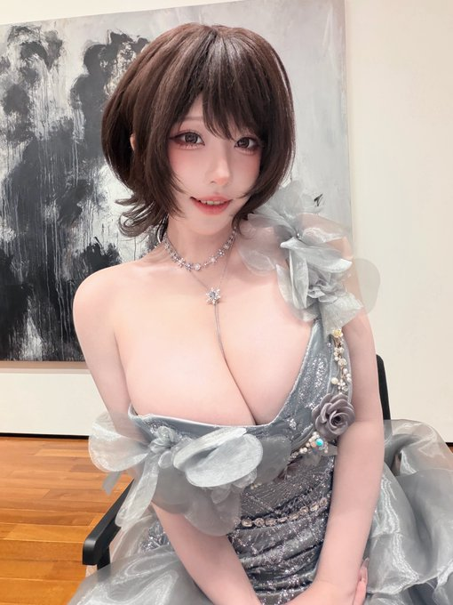

> A realistic half-body character portrait. The character has a dark-brown short curly bob with the ends curling inward and wears a silver-gray one-shoulder gown with translucent petals, sequins, and dimensional embellishments at the shoulder and chest. The background is simple, with silver gray, dark brown, and multicolored decorations as the main palette. Use as a formalwear and styling reference.

#### 蓝紫服装人物
tags: 近景, 真人, 泳衣, 服装参考, 发型参考, 配件参考

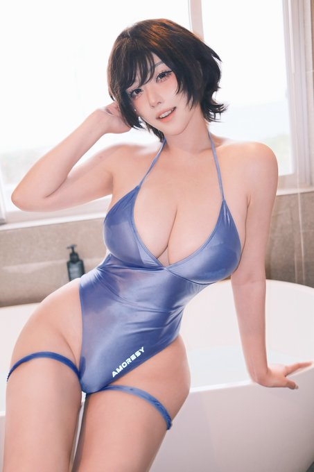

> A realistic character clothing reference. The character has dark-brown short hair with layered bangs and wears a metallic blue-purple one-piece swimsuit in a stage outfit that combines dark and bright colors. The image uses a close-up composition. Use as a reference for clothing material, color palette, and character styling.

#### 棕色短发头像
tags: 正面, 头像, 真人, 纯色背景, 角色身份, 五官参考, 发型参考, 服装参考

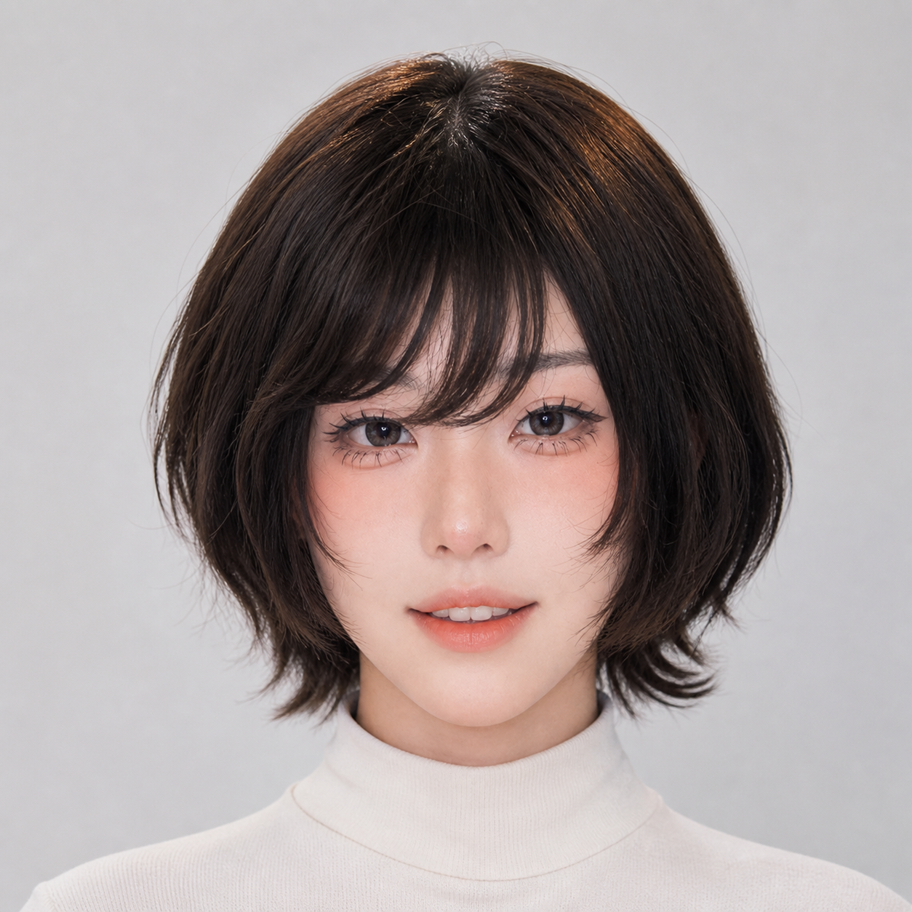

> A front-facing realistic portrait. The character has a dark brown-black inward-curled bob with airy bangs, wears a white turtleneck sweater, and looks directly at the camera. The background is a pale-gray solid plane under even, soft lighting. Use as a reference for the face, hairstyle, and sweater neckline.

#### 浴室裸体写真
tags: 半身, 竖图, 前倾, 室内, 浴室, 真人, 裸体参考, 身体比例, 人体参考, 场景参考

> A realistic vertical upper-body portrait of a woman, approximately 9:16. She has dark-brown short curly hair with airy bangs, light-colored eyes, and a smiling expression. She is nude with a full figure and fair skin. Her body leans slightly forward; her right hand is raised near the head and neck, while her left hand supports her balance on the edge of a bathtub. The setting is a bathroom with a white bathtub, pale-gray stone or tiled walls, and a window providing natural light. Use as a body-proportion and body-shape reference.

#### 大理石浴室半身写真
tags: 半身, 竖图, 室内, 浴室, 真人, 裸体参考, 身体比例, 服装参考, 场景参考

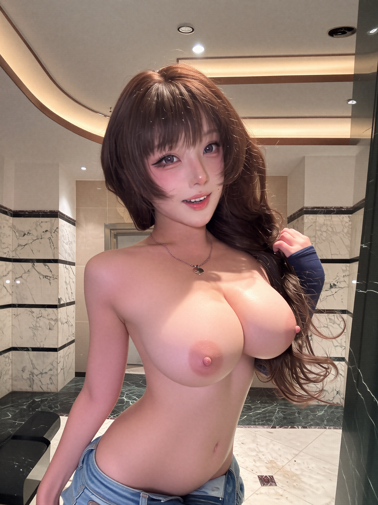

> A realistic vertical half-body portrait of a woman, approximately 3:4. She has dark-brown medium-length curly hair with straight bangs, blue eyes, a smiling expression, and a silver heart-pendant necklace. **Her breasts are extremely full, larger than a D-E cup, with very large volume, pink areolas, prominent nipples, natural downward sag, and deep cleavage. The breast skin is smooth and fine with glossy highlights from the light. She gently touches her right-side hair with her left hand while her right arm hangs naturally. She wears light-blue jeans, partially lowered to the thighs. The setting is a marble bathroom or corridor with white marble walls, black decorative lines, green marble baseboards, and warm recessed downlights. Use as a bust and indoor portrait reference.**

### 小菜刀夫斯基
#### 通用五官描述

> [English Translation] A round face with softly curved contours, a slightly rounded chin, and full cheeks, creating a youthful and approachable appearance; medium-sized almond-shaped eyes with slightly upturned outer corners, vivid blue irises, dark pupils, and soft pink-purple eyeshadow; fine, naturally arched eyebrows in light brown or black, neatly groomed; a small nose with a slightly upturned tip, a low bridge, and narrow nostrils; naturally pink M-shaped lips, with a slightly thinner upper lip and fuller lower lip, soft and gently glossy; an even fair complexion with a faint pink blush on the cheeks; an overall sweet, innocent, approachable appearance.

#### JK 制服头像
tags: 正面, 半身, 纯色背景, JK制服, 制服, 服装参考, 发型参考, 配件参考

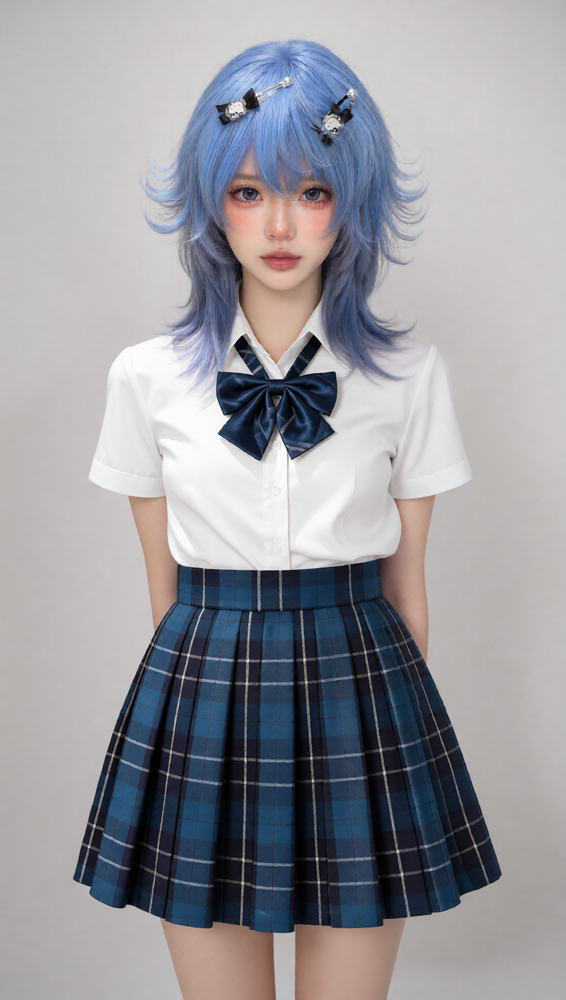

> A front-facing half-body portrait. The character has blue-gray medium-length hair with straight bangs, wears a black-and-white bow hair clip, a white collared shirt, a large dark-blue bow, and a blue-black plaid pleated skirt. The background is a pale-gray solid plane, creating a Japanese school-uniform style.

#### 浅蓝发头像
tags: 正面, 半身, 纯色背景, 角色身份, 五官参考, 发型参考, 配件参考, 服装参考

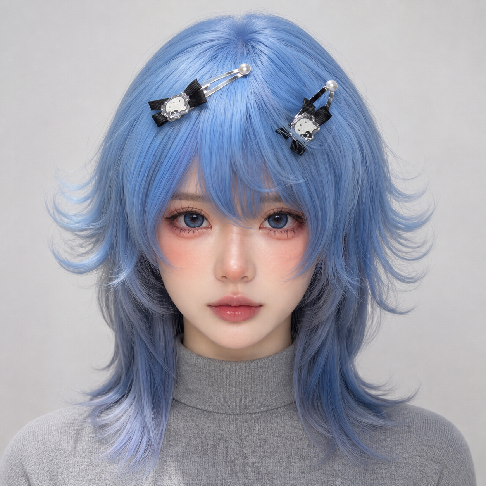

> A front-facing half-body portrait. The character has pale-blue medium-length hair with straight bangs and slightly curled ends, wears black bow hair clips on both sides, and is dressed in a gray turtleneck knit top. The background is a pale-gray solid plane, creating a soft character-portrait style.

#### 棕发头像
tags: 正面, 半身, 真人, 纯色背景, 角色身份, 五官参考, 发型参考, 服装参考

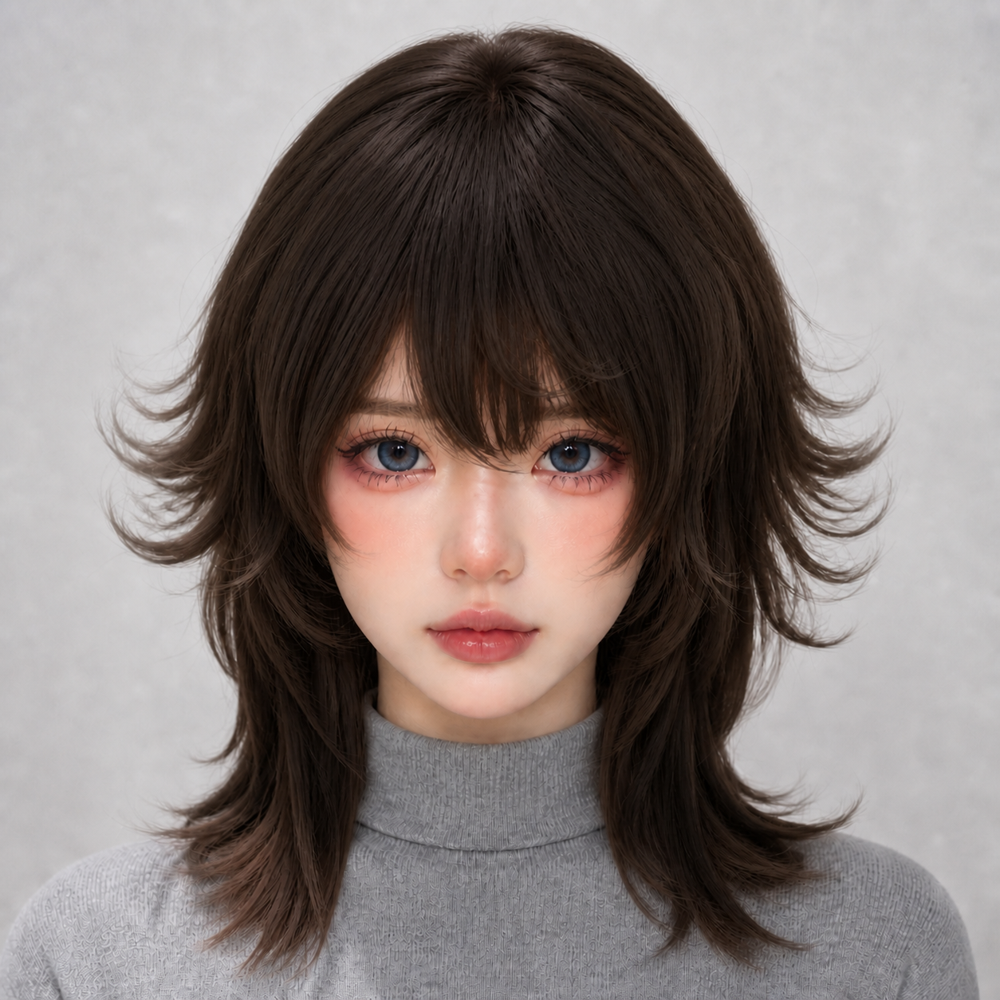

> A front-facing chest-up realistic portrait. The character has dark brown-black shoulder-length hair with airy bangs and naturally curled ends, wears a white turtleneck sweater, and looks directly at the camera. The background is a pale gray-white solid plane under even, soft lighting. Use as a reference for the face, hairstyle, and sweater neckline.

#### 制服三视图
tags: 三视图, 正面, 侧面, 背面, 3D, 纯色背景, 角色身份, JK制服, 服装参考, 身体比例

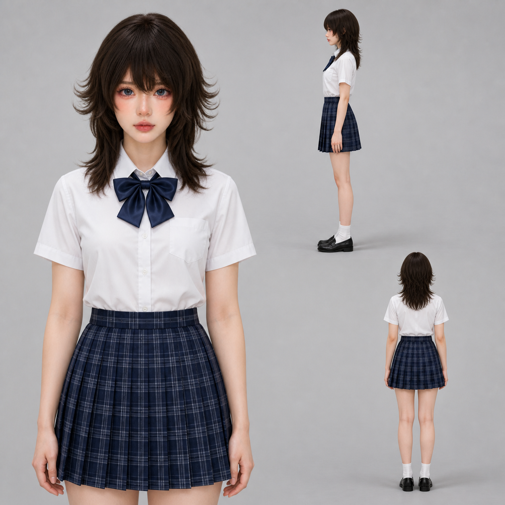

> A 3D-rendered female character turnaround sheet showing front, side, and back views. The character has dark-brown shoulder-length hair with straight bangs and wears a white short-sleeved collared shirt, a large dark-blue bow, a blue-black plaid pleated skirt, white socks, and black leather shoes. The background is a gray gradient. Use as a reference for a Japanese school-uniform silhouette and proportions.

#### 蓝发渔夫帽服装三视图
tags: 三视图, 正面, 侧面, 背面, 头像, 全身, 3D, 纯色背景, 角色身份, 服装参考, 发型参考, 配件参考

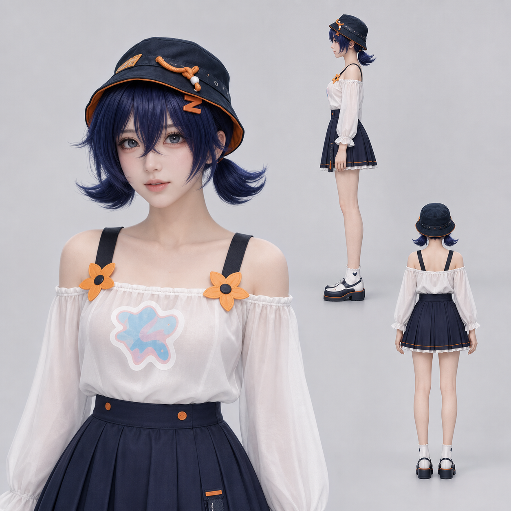

> A 3D-rendered female character turnaround sheet with a front close-up, side full-body view, and back full-body view against a pale-gray background. The character has dark-blue short twin-tails, a black bucket hat with an orange cord decoration, and blue eyes. Outfit: a white off-shoulder top with black straps, an orange flower shoulder ornament, and an abstract star print on the front; a dark-blue pleated skirt with orange buttons and orange trim; white ankle socks; and black-and-white platform shoes. Palette: white, dark blue, and orange. Use as a character clothing turnaround reference.

#### 辣妹装三视图
tags: 三视图, 正面, 侧面, 背面, 头像, 全身, 3D, 纯色背景, 角色身份, 服装参考, 发型参考

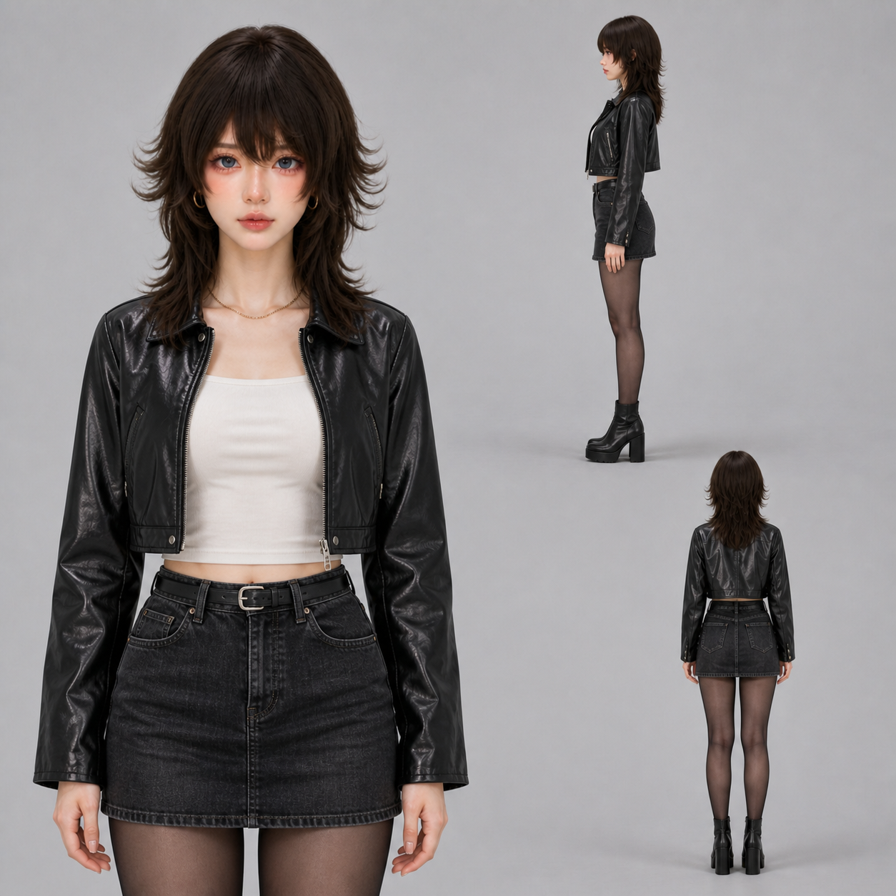

> A 3D-rendered female character turnaround sheet with a front close-up, side full-body view, and back full-body view against a pale-gray background. The character has dark-brown medium-length hair with straight bangs, large blue eyes, gold hoop earrings, and a delicate necklace. Outfit: a black leather cropped jacket with a zipper, a fitted white cropped underlayer, a dark-gray denim mini skirt with a black belt and silver buckle, black sheer tights, and black platform ankle boots. Palette: black, white, and dark gray. Use as a character styling and clothing turnaround reference.

#### 粉发三视图
tags: 三视图, 正面, 侧面, 背面, 3D, 纯色背景, 角色身份, 服装参考, 发型参考, 身体比例

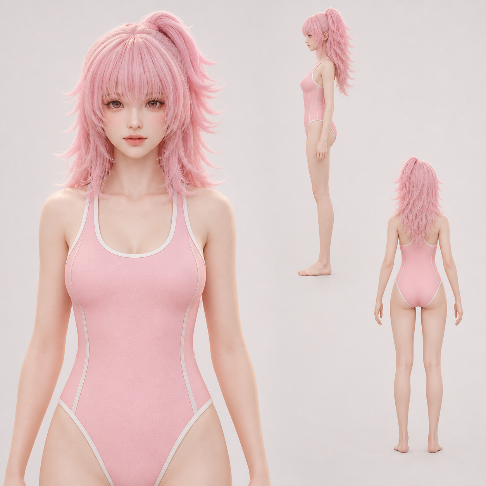

> A 3D-rendered female character turnaround sheet showing front, side, and back views. The character has a pink high ponytail with straight bangs and wears a pink one-piece outfit. The image emphasizes the hairstyle, body proportions, and clothing silhouette against a simple gray background. Use as a character design reference.

#### 粉发裸体三视图
tags: 三视图, 正面, 侧面, 背面, 头像, 全身, 3D, 纯色背景, 角色身份, 裸体参考, 身体比例, 发型参考

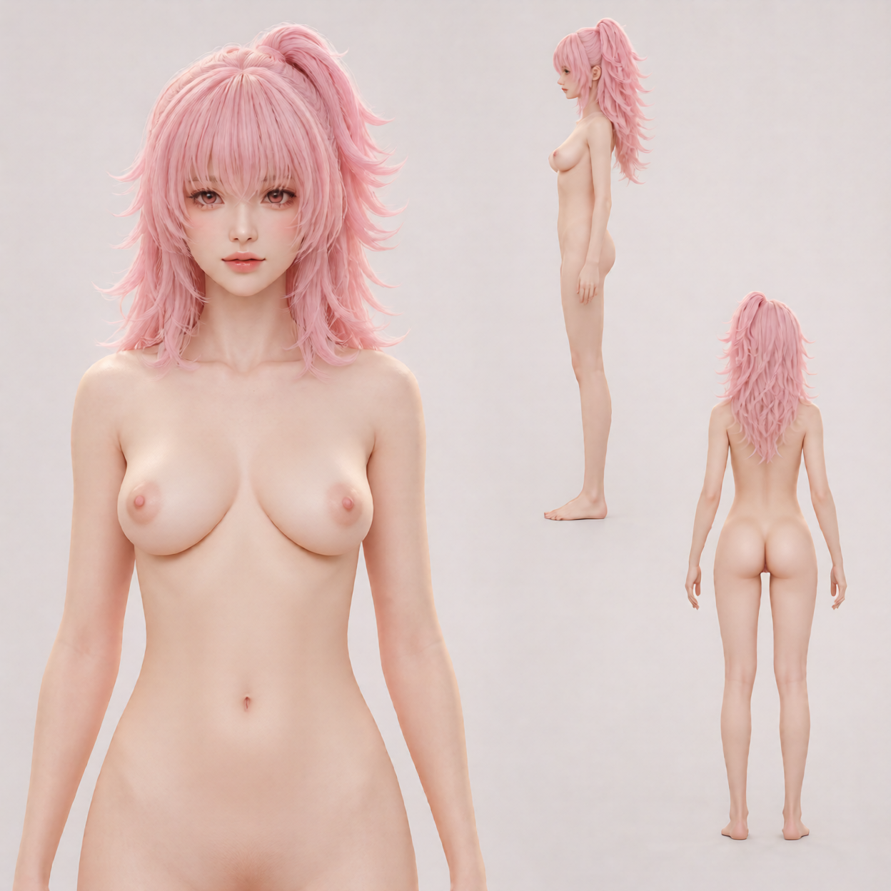

> A 3D-rendered female character turnaround sheet with a front close-up, side full-body view, and back full-body view against a pale-gray background. The character has long pink hair in a high ponytail with straight bangs and brown eyes. She is nude, with the image emphasizing her face, body proportions, and hairstyle. Use as a nude character turnaround and body-proportion reference.

#### 蓝发渔夫帽裸体三视图
tags: 三视图, 正面, 侧面, 背面, 头像, 全身, 3D, 纯色背景, 角色身份, 裸体参考, 身体比例, 发型参考, 配件参考

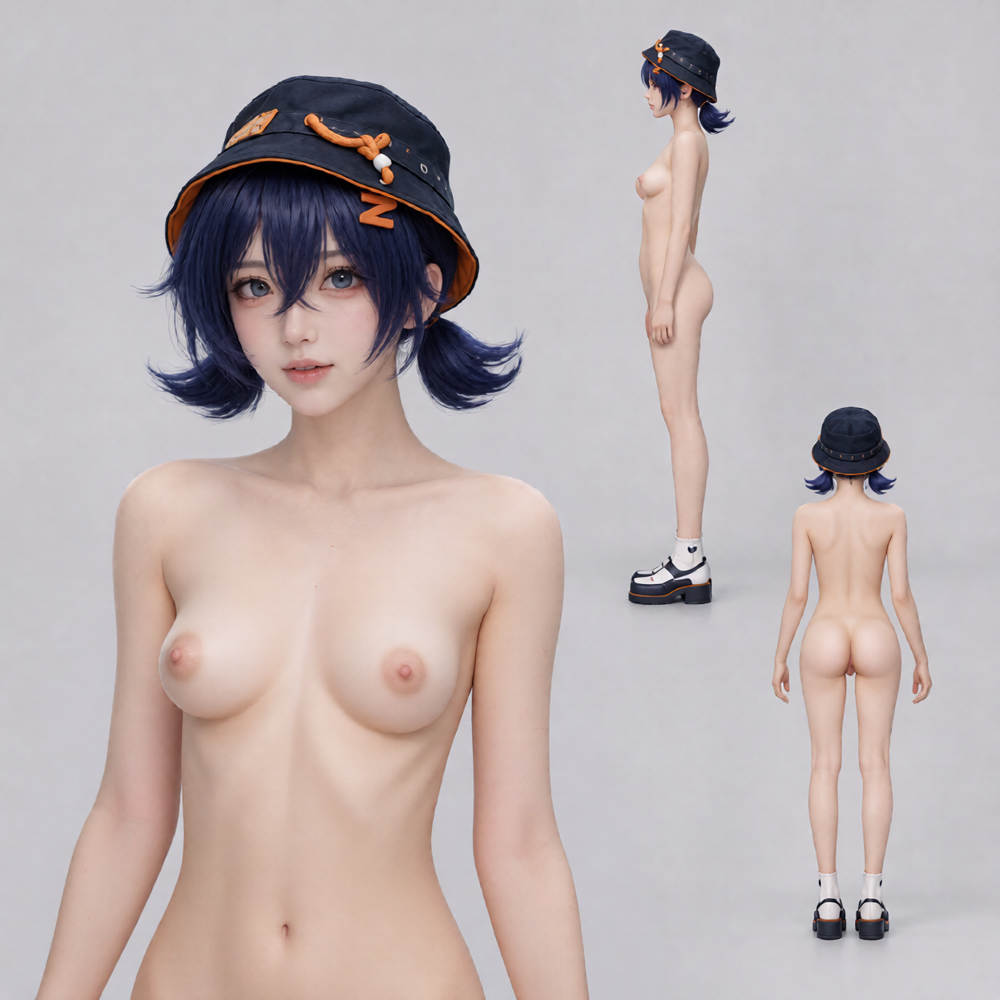

> A 3D-rendered female character turnaround sheet with a front close-up, side full-body view, and back full-body view against a pale-gray background. The character has dark-blue short twin-tails, a black bucket hat with an orange cord decoration, and blue eyes. She is nude; the side and back views show white ankle socks and black-and-white platform shoes. Use as a nude character turnaround, body-proportion, and accessory reference.

### 幼女脸
#### 通用五官描述

> [English Translation] Softly rounded facial contours, generally close to an oval face, with a naturally rounded chin and subtle cheekbones; medium-to-large almond-shaped eyes with slightly upturned outer corners, gray-brown irises, dark pupils, and naturally long eyelashes; fine, naturally arched dark-brown eyebrows, partly obscured by the bangs; a small nose with a straight bridge, rounded tip, and subtly tapered nose wings; medium-full lips with a soft M-shaped cupid's bow, a slightly thinner upper lip and fuller lower lip, natural pink color, and a slight sheen; an even fair complexion with fine skin texture and a faint pink flush on the cheeks; an overall youthful, gentle, delicate, approachable appearance.

#### 正脸头像（无头饰）
tags: 正面, 头像, 真人, 白色背景, 五官参考, 发型参考

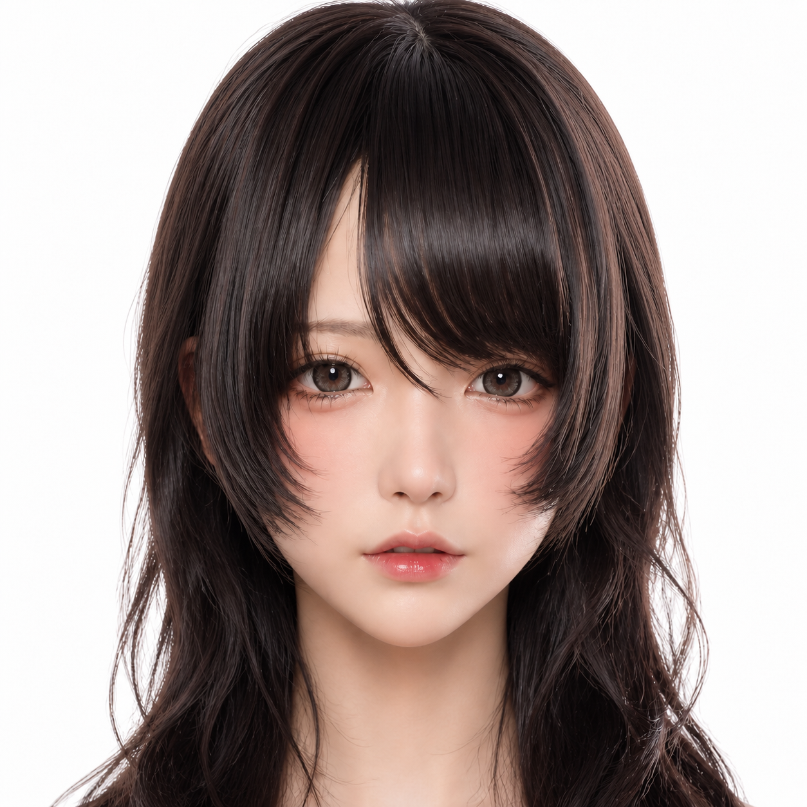

> A 1:1 front-facing realistic character headshot, looking directly at the camera in a centered, symmetrical composition against a pure white background with soft, even lighting. The character has dark-brown medium-length to long hair with abundant volume, a natural part at the crown, heavy straight bangs, and layered wispy strands on both sides; the ends curl naturally and fall below the shoulders and in front of the chest. The current image has no headwear, hair clips, earrings, or other accessories. Use as a reference for the face and hairstyle.

### 其他

#### 微信图片_20260831001415_156_80.jpg
tags: 近景, 人体局部, 裸体参考

> **Description:** Extreme close-up of pale skin and body folds, with a small pink-and-white striped triangular detail partially visible near the lower center. The crop is highly abstract, with soft lighting and no visible text.

#### 人体_外阴特写.jpg
tags: 近景, 真人, 人体局部, 解剖参考, 裸体参考

> **Description:** Macro close-up of adult female external genital anatomy, centered in the frame. The image shows pink skin and natural surface texture under soft, diffuse lighting, with no surrounding environment or visible text.

#### 人体体型参考（浴缸中景）
tags: 中景, 竖图, 前倾, 低角度, 室内, 浴室, 真人, 身体比例, 人体参考, 裸体参考, 场景参考

> A realistic vertical medium shot of a nude adult female torso, approximately 9:10, cropped above the chin. She has an even fair complexion with a natural warm tone and a very full hourglass figure. **Her breasts are extremely full, C-D cup or larger, with large volume, visibly natural sag, pink areolas, prominent pink nipples, and a symmetrical appearance.** Her body leans slightly forward; her right hand is raised near the head and neck, while her left hand supports her balance on the edge of a freestanding white bathtub. The bathroom has pale-gray stone or tiled walls, black pump bottles on the counter, and a window providing natural side light. The overall tone is warm off-white, with fine skin texture and natural light transitions. A slight low angle emphasizes the body curves. Use as a realistic body-proportion and body-shape reference.

#### 紫发耳机造型
tags: 半身, 竖图, 真人, 哥特, 裸体参考, 服装参考, 发型参考, 配件参考, 道具参考

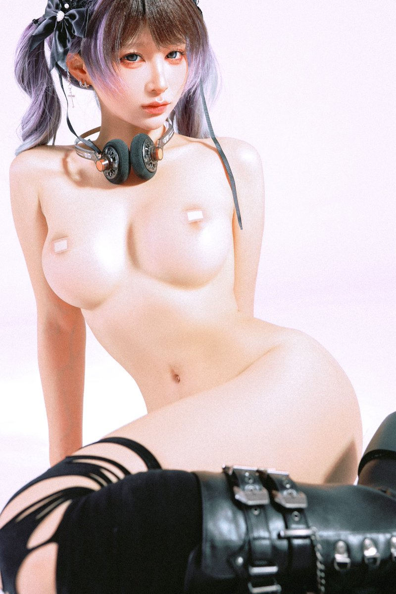

> A realistic vertical upper-body portrait of a woman, approximately 2:3. She has long light-purple twin-tails, a black lace bow headband with black ribbons, black over-ear headphones resting around her neck with a gold control knob, silver cross earrings, blue-gray eyes, orange eyeshadow, pink blush, and pink lips. **Her breasts are full and prominent with large volume; the areolas are covered by two white square stickers, one on each side, with the sticker edges visible at the nipple positions and a natural downward curve. Her body is nude, with black leather thigh straps decorated with multiple metal buckles and chains, and black cutout thigh-high stockings.** The background is pure white with bright lighting and a slight pink halo. Use as a character styling and gothic headphone-outfit reference.

#### 人体体型参考 1（室内中景）
tags: 中景, 竖图, 室内, 真人, 身体比例, 人体参考, 裸体参考, 场景参考

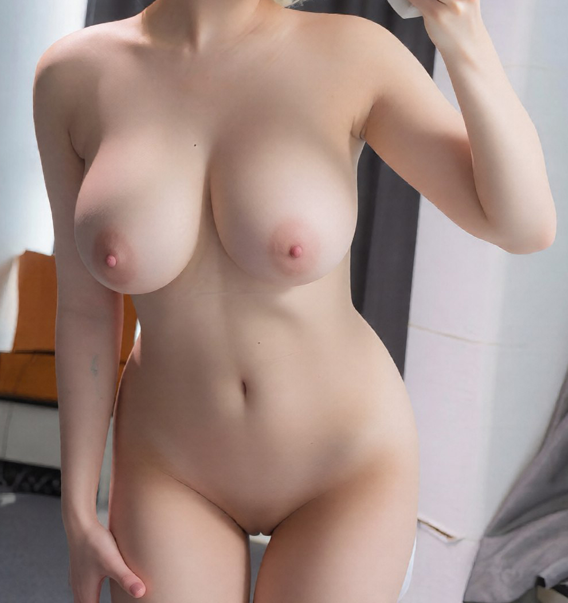

> A realistic vertical medium shot of a nude adult female torso, approximately 9:10, with the head cropped out. She has fair skin and a full hourglass figure. **Her breasts are extremely full, larger than a D cup, with very large volume, noticeably natural sag, large pink areolas, prominent nipples, close-set breasts forming deep cleavage, and smooth, fine skin.** Her abdomen is flat and her navel is small. She stands naturally with her right arm hanging down and her left hand raised near her head. The indoor background has gray curtains and an orange sofa. Use as a realistic body-proportion and body-shape reference.

#### 人体体型参考 2（全身镜面自拍）
tags: 全身, 竖图, 室内, 真人, 身体比例, 人体参考, 裸体参考, 道具参考, 场景参考

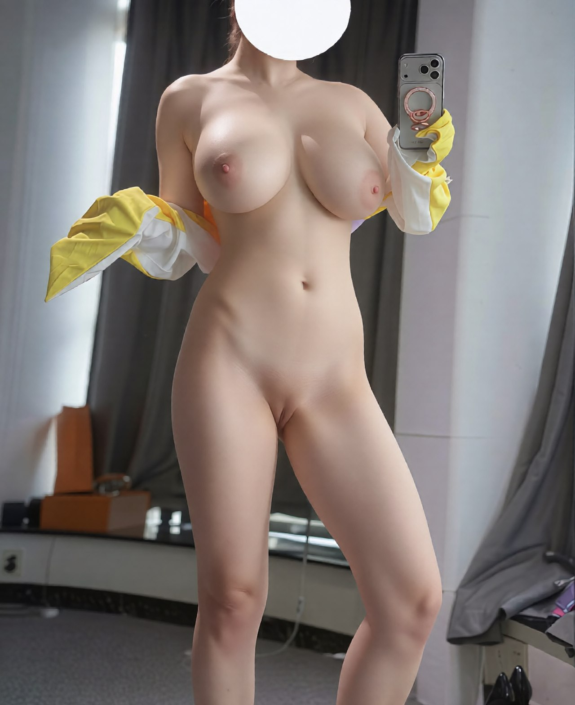

> A realistic full-body nude mirror selfie of a woman in a vertical composition, approximately 9:16. Her head is obscured by a white circle. She holds a yellow garment with fluffy cuffs in each hand, and a silver smartphone with a pink ring grip in her left hand. She has a full figure and fair skin. **Her breasts are full and prominent, approximately C-D cup, with large volume, pink areolas, prominent nipples, natural downward sag, and deep cleavage. The vulva is visible, with full labia majora, slightly protruding labia minora, neatly trimmed pubic hair, and a faintly visible clitoris.** The indoor background includes gray curtains, a windowsill, an orange decorative box, and black high heels. Use as a full-body and body-shape reference.

#### 二次元海滩天使角色
tags: 半身, 竖图, 室外, 海滩, 二次元, 插画, 天使, 裸体参考, 服装参考, 道具参考, 场景参考

> A 2D anime-style upper-body female illustration in a vertical composition, approximately 9:16. She has short pink hair, white wings, and a nude body. **Her breasts are extremely full in an exaggerated anime style, with huge volume, pink areolas, prominent nipples, and the breasts pressed closely together to form deep cleavage; the skin has a sheen of water droplets or sweat.** She holds a blue popsicle in each hand and has blue fingernails. The background is a beach with blue sky, white clouds, sand, and ocean, and water droplets or sweat are visible on the body. Use as a character styling and visual-style reference.

#### 人体外阴特写
tags: 正面, 近景, 真人, 人体局部, 解剖参考, 裸体参考

> A realistic front-facing close-up of a female vulva in a small image, 206 × 236 px. **The vulva is shown directly from the front, with full symmetrical labia majora, naturally protruding pink labia minora, clearly visible folds, a covered clitoral hood, a narrow vaginal opening, fair fine surrounding skin, and neatly trimmed pubic hair. The overall anatomy is natural with an even skin tone.** Use as an anatomical detail reference.

#### 银色胶带束缚造型
tags: 全身, 跪姿, 前倾, 竖图, 纯色背景, 真人, 裸体参考, 人体参考, 动作参考, 场景参考

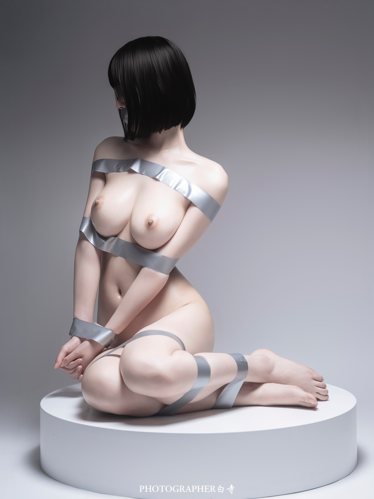

> A realistic full-body kneeling female portrait in a vertical composition, approximately 3:4. She has black shoulder-length hair with straight bangs, her face partly obscured by hair, and her head lowered in a downward-looking pose. **Her breasts are extremely full, larger than a D cup, with very large volume, light-brown areolas, prominent nipples, natural downward sag, and deep cleavage. Her breasts are bound with silver satin tape crossing the shoulders and upper chest; her arms and torso are also fixed with tape.** **In a side-seated kneeling pose, the vulva's outline is faintly visible, with full labia majora, slightly protruding labia minora, and neatly trimmed pubic hair.** Her knees rest on a white circular pedestal; her thighs and calves are also wrapped and fixed with silver tape, and her hands are clasped in front of her knees with her wrists bound. The background is a solid gray gradient, with a watermark reading "PHOTOGRAPHER Baisi" at the bottom. Use as a bondage-art and body reference.

#### 绳缚仰卧特写
tags: 近景, 躺姿, 横图, 真人, 裸体参考, 人体局部, 解剖参考, 动作参考

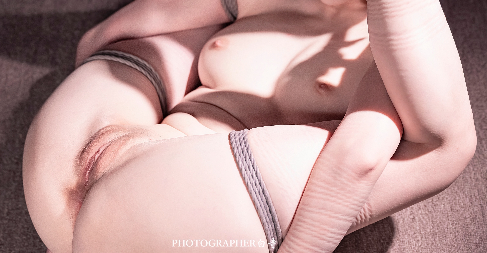

> A realistic close-up of a female in a prone or supine pose, in a horizontal composition approximately 16:9. **One breast is visible, full and prominent, with a pale-pink areola and prominent nipple; the side of the breast is bound with gray braided rope.** **The vulva has full symmetrical labia majora, distinctly protruding deep-pink labia minora, a clearly visible clitoral hood, a narrow vaginal opening, neatly trimmed pubic hair, and a pronounced crease between the buttocks and thighs.** Gray braided rope runs from the inner thigh to the buttocks, creating a bondage composition. The background is gray carpet or fabric, with sunlight from above casting striped shadows. A bottom watermark reads "PHOTOGRAPHER Baisi". Use as a rope-bondage art and anatomical-detail reference.

#### 银发十字架束缚造型
tags: 近景, 半身, 竖图, 室内, 真人, 裸体参考, 配件参考, 场景参考

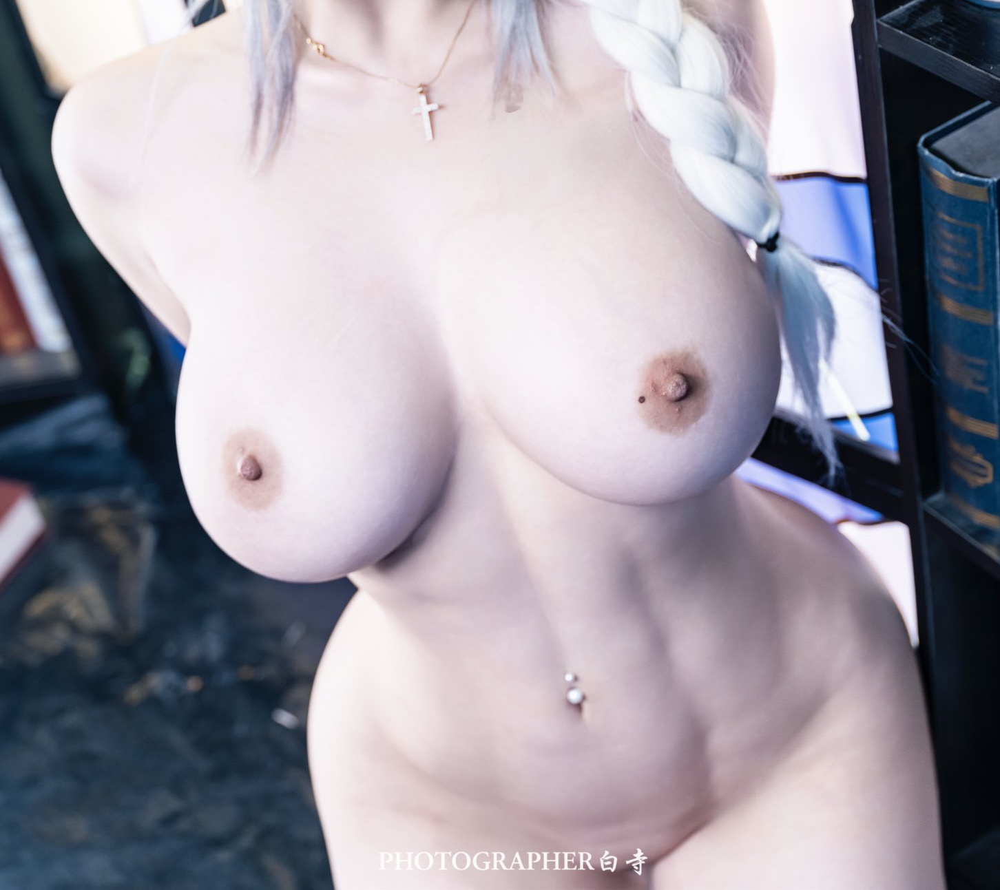

> A realistic vertical upper-body close-up of a woman, approximately 9:10. She has long pale silver-blue hair with a side braid, a gold cross necklace, and a pearl navel piercing. **Her breasts are extremely full, larger than a D-E cup, with very large volume, large dark-brown areolas, prominent nipples, natural downward sag, and very deep cleavage; a small black mole is visible on the side of the left breast. Her breasts are pressed outward by the pose, creating an exaggerated sense of volume.** Her abdomen is flat and her navel is small, with white pearl and silver metal navel jewelry. The indoor background has a bookshelf filled with dark books, and light comes from the left. A bottom watermark reads "PHOTOGRAPHER Baisi". Use as a bust and bondage-art reference.

#### 人体外阴特写（网状布料）
tags: 正面, 近景, 真人, 人体局部, 解剖参考, 裸体参考

> A realistic front-facing close-up of a female vulva in a small image, 234 × 294 px. **The vulva is shown directly from the front, with full symmetrical labia majora, distinctly protruding pink labia minora, clearly visible folds, a covered clitoral hood, a narrow vaginal opening, fair surrounding skin, and neatly trimmed pubic hair. White mesh fabric is pulled aside from both sides, revealing the full vulva.** Use as an anatomical detail reference.

### 其他角色
#### 1.jpg
tags: 全身, 斜侧面, 坐姿, 低角度, 室内, 真人, cosplay, 天使, 服装参考, 配件参考, 道具参考, 场景参考

> **Subject:** A cosplayer portraying a pink-haired anime-style female character with angelic features.
> 
> **Appearance:** The subject has short, voluminous bubblegum-pink hair styled with two small silver star-shaped hair clips. She has pointed elf-like ears, pale skin, and wears subtle makeup with defined eyeliner and soft pink lipstick. Her expression is neutral-to-slightly smiling with direct eye contact toward the camera.
> 
> **Clothing & Accessories:** She wears an elaborate white costume featuring:
> - Large, layered white feathered angel wings attached to the back
> - A white corset-style bodice with puff sleeves, off-the-shoulder design, and a prominent white bow at the collar with lavender/purple ribbon accents
> - An asymmetrical short white skirt with sheer paneling
> - A long, flowing piece of sheer lavender fabric draped from the waist
> - White thigh-high stockings and silver-grey high-heeled pumps with bow details
> - A delicate silver garter strap on the left thigh
> 
> **Pose:** The subject is reclining against a sport motorcycle in a three-quarter seated position—her right leg is bent with foot resting on the motorcycle seat, while her left leg extends downward to touch the red carpeted floor. Her right hand is raised gracefully near shoulder height with fingers elegantly splayed; her left hand rests lightly against her upper chest. Her torso twists slightly toward the camera.
> 
> **Composition:** Full-body shot captured from a slightly low angle, emphasizing the legs and creating a dynamic diagonal line. The subject dominates the foreground, with the motorcycle serving as both prop and seating. The wings spread outward, framing the composition.
> 
> **Background:** An indoor exhibition hall or convention center environment with a red carpet marked with white geometric lines. Behind the subject is a black and red sport motorcycle (visible gold-rimmed wheels, chain drive, and "DUNLOP" tire lettering). The distant background features blurred overhead lighting fixtures, dark ceiling panels, and indistinct booth signage with partially visible text including Chinese characters and English letters (possibly "TOYOTA" or similar automotive branding). Other attendees are visible as out-of-focus shapes in the deep background.
> 
> **Lighting:** Bright, even artificial lighting from overhead ceiling fixtures creates minimal shadows, highlighting the texture of the feathered wings and the sheen of the costume fabric. Professional photography lighting ensures the white costume remains well-exposed without blowing out details.
> 
> **Style:** High-quality cosplay photography with vibrant color saturation, sharp focus on the subject, and shallow depth of field blurring the background. The aesthetic combines fantasy/angelic elements with modern motorsport context.
> 
> **Visible Text:** 
> - Motorcycle tire: "**DUNLOP**" and "**

#### 6197204369078424307.jpg
tags: 躺姿, 室内, 真人, 内衣, 服装参考, 场景参考

> **Description:** Adult woman with a short wavy brown bob reclining on a white bed in black lace lingerie. One bare foot is prominent in the foreground, while cream curtains form the background. Warm indoor lighting, a soft photographic look, and a watermark in the lower-right corner are visible.

#### exec-19040326-50c1-428e-9cb6-4159bd82bb78.png
tags: 正面, 半身, 二次元, 白色背景, 插画, 哥特, 角色身份, 服装参考, 发型参考, 配件参考

> **Subject:** Bust portrait of an anime-style female character presenting as a "dark maid" or gothic lolita archetype.
> 
> **Appearance:** The character has a youthful face with pale skin and a neutral, slightly stern expression. She has short, choppy black hair with vibrant red underlayers visible at the nape and sides. Her eyes are large and vivid red with detailed orange-yellow iris patterns and prominent white catchlights; a small dark mole sits beneath her left eye (viewer's right).
> 
> **Clothing & Accessories:** She wears a hybrid of maid attire and dark armor: a traditional white frilled maid headdress with voluminous ruffles is overlaid with an aggressive black metallic crown-like headpiece featuring sharp, geometric spikes and angular filigree. Mechanical-looking silver clasps frame her ears. Her outfit consists of a black high-collared garment with a spiked, armored choker at the throat, crossed black leather straps across the chest, and oversized white ruffled bows or epaulets at the shoulders.
> 
> **Pose & Composition:** Front-facing, centered bust shot with direct eye contact; the figure is symmetrically framed from mid-chest up against negative space.
> 
> **Background:** Pure white, isolated background with no environmental detail—characteristic of a model sheet or reference image.
> 
> **Lighting:** Even, diffuse studio lighting with soft shadows beneath the chin and hair, emphasizing the three-dimensional form without dramatic directional source.
> 
> **Style:** Clean digital anime/manga illustration with crisp lineart, cel-shading combined with soft gradient rendering on skin and hair, and high-contrast color palette (black, white, red).
> 
> **Text:** No text or typography is visible in the image.

#### exec-9b5b05c4-50bf-47c3-aa1c-7321a687e400.png
tags: 正面, 半身, 二次元, 白色背景, 插画, 兽耳, 角色身份, 服装参考, 发型参考, 配件参考

> **Subject:** Front-facing bust portrait of an anime-style female character with lupine (wolf/dog) features.
> 
> **Appearance:** Long, straight black hair cut with blunt bangs across the forehead; hair appears styled into side braids or low buns behind the ears. She has large, erect triangular black animal ears with gray inner fur positioned atop her head. Her eyes are a vivid red-orange with detailed pupils and highlights, set against pale skin with a neutral, calm expression and minimal facial detail.
> 
> **Clothing & Accessories:** She wears formal attire consisting of a crisp white collared dress shirt, a slim black necktie, and a dark blue structured jacket featuring shoulder epaulets with metallic button details. A golden-yellow scarf or sash is draped around her neck over the jacket, bearing partial white text or insignia (appearing as a stylized "U" or similar character).
> 
> **Pose & Composition:** Symmetrical, centered chest-up portrait facing directly forward with level gaze; shoulders squared to the viewer.
> 
> **Background:** Solid, clean white void with no environmental details—typical of character reference sheet formatting.
> 
> **Lighting:** Soft, even frontal illumination with subtle ambient occlusion under the chin and hair shadows, creating gentle dimension without harsh contrast.
> 
> **Style:** Digital anime/manga illustration with clean lineart, cel-shading combined with soft gradient rendering on skin and hair, and a polished, game-character-design aesthetic.
> 
> **Visible Text:** Partial white alphanumeric marking visible on the left side of the yellow scarf (resembling "U" or "C").

#### exec-a98880ce-4f45-4a04-aa35-06311f73d26b.png
tags: 正面, 半身, 二次元, 白色背景, 插画, 猫娘, 角色身份, 服装参考, 发型参考, 配件参考

> **Subject:** Bust-up portrait of an anime-style female character (Diona from *Genshin Impact*).
> 
> **Appearance:** She has long, flowing pastel-pink hair styled in twin tails with loose strands framing her face. Two large, pointed golden-yellow cat ears protrude from the top of her head, each secured at the base with a rectangular bronze-colored buckle. Her eyes are large and expressive with green-to-yellow gradient irises and prominent upper eyelashes; a small dark mole sits beneath her left eye. On the right side of her face (viewer's left), three miniature bow-shaped hair clips are pinned vertically in black, lime-green, and yellow. She wears ornate gold circular earrings with embossed designs.
> 
> **Clothing & Accessories:** She wears a structured blue collar or shoulder armor piece featuring gold diamond-shaped studs along the edges and white ruffled fabric visible underneath at the shoulders. Around her neck is a wide black choker with gold trim, attached to a heavy gold chain that holds a large, geometric diamond-shaped pendant with an interlocking square design in the center.
> 
> **Pose & Composition:** Front-facing, centered portrait with the subject looking directly at the viewer, offering a subtle, gentle closed-mouth smile. The framing cuts off at mid-chest level, emphasizing facial features and upper costume details against a clean background.
> 
> **Background:** Solid plain white/empty background with no environmental details.
> 
> **Lighting:** Soft, even studio lighting with minimal shadowing, creating a flat but polished look typical of character reference assets. Subtle shading defines hair volume and facial contours without dramatic contrast.
> 
> **Style:** Clean anime/manga digital illustration style characteristic of modern gacha games (miHoYo/HoYoverse aesthetic), featuring crisp line work, cel-shading with soft gradient transitions, and vibrant saturated colors.
> 
> **Visible Text:** None present in the image.

#### 1.jpg
tags: 竖图, 站立, 室内, 浴室, 真人, 裸体参考, 场景参考, 道具参考

> **Description:** Adult nude woman with long brown hair taking a mirror selfie in a bright bathroom. She holds a smartphone in front of her face; a freestanding gray bathtub, black-framed window, cloudy sky, and horizontal wooden privacy screen appear behind her. Natural daylight illuminates the scene.

#### 17.jpg
tags: 近景, 躺姿, 抬腿, 低角度, 室内, 真人, 裸体参考, 动作参考

> **Description:** Adult nude woman reclining on a black sofa with both legs raised toward the camera. Pale lace-trimmed stockings or garters frame the lower legs, creating a strong foreground perspective. The image uses a close, low-angle composition with cool indoor lighting.

#### 18.jpg
tags: 躺姿, 抬腿, 室内, 真人, 裸体参考, 道具参考, 场景参考

> **Description:** Adult woman with long black hair and a red bunny-ear headband reclining nude on a green pool table. One leg is raised toward the camera, while warmly lit shelves of liquor bottles fill the softly blurred bar background. The image has a saturated red-orange color palette and shallow depth of field.

#### 19.jpg
tags: 室内, 真人, 裸体参考, 服装参考, 配件参考, 场景参考

> **Description:** Adult woman with long black hair posing nude in front of a wooden bar, wearing a glossy red bunny-ear headband and white wrist cuffs. A red bow accessory appears near one thigh, with bottles and bar fixtures behind her. Warm amber lighting and a slightly tilted portrait composition define the scene.

#### 2.jpg
tags: 躺姿, 室外, 海滩, 二次元, 插画, 兽耳, 角色身份, 场景参考

> **Description:** Anime-style female character with long dark hair, large black wolf-like ears, and reddish eyes reclining on a sandy beach. A small black round creature with antennae sits to the left, while starfish, shells, a coin-like object, and shallow turquoise water appear in the background. The illustration uses soft pastel shading and bright highlights.

#### 22.jpg
tags: 躺姿, 室内, 真人, 裸体参考, 道具参考, 场景参考

> **Description:** Adult woman with long black hair and a large red bow or bunny-ear headpiece lying across a green pool table. Her bent legs and arms create a diagonal overhead composition, with billiard balls, a cue, and a smartphone scattered around her. Warm wooden bar elements appear at the edges of the frame.

#### 3.jpg
tags: 坐姿, 室内, 二次元, 插画, 兽耳, 角色身份, 配件参考, 场景参考

> **Description:** Anime-style blonde female character with large fox- or cat-like ears, red-and-gold eyes, and long hair tied with red ribbons. She sits in a bright, softly lit interior with a neutral expression; a round badge with small Asian characters is attached near her left ear. The pastel illustration has warm highlights and soft linework.

#### 5.jpg
tags: 室外, 泳池, 真人, cosplay, 服装参考, 发型参考, 配件参考, 道具参考, 场景参考

> **Description:** Cosplay-style adult woman with blonde hair and long mint-green extensions posing beside a large yellow inflatable ring in a swimming-pool setting. She wears a large white flower hair accessory, a shell necklace, and a white thigh strap. Sunlight reflects across the tiled pool area, with colorful inflatables visible in the background.

#### 6314334204619068160.jpg
tags: 头像, 近景, 室内, 真人, 精灵耳, 角色身份, 发型参考, 配件参考, 场景参考

> **Description:** Adult elf-themed woman shown in a close portrait, with a short pastel-pink bob, a pointed prosthetic ear, pink-red eyes, and a small metallic hair ornament. She wears a pale lavender collar with white trim and a star-shaped pendant. Warm indoor lighting and a softly blurred room create a portrait-photography look.

#### 6327895898863636821.jpg
tags: 头像, 近景, 室内, 真人, 兽耳, 精灵耳, 角色身份, 发型参考, 配件参考, 场景参考

> **Description:** Adult elf- or fox-themed woman with long white hair, fluffy pointed ears, golden decorative headpieces, amber eyes, and red facial markings. She poses in a close selfie-style portrait with one hand raised near her shoulder; a gold-and-red chest ornament and thin necklace are visible. The background is a softly blurred blue-gray interior.

#### 无标题.jpg
tags: 半身, 室内, 二次元, 插画, 角色身份, 配件参考, 场景参考

> **Description:** Anime illustration of a pink-haired woman with dark curved horns, a red bunny-ear headband, and a white collar with a burgundy bow. She poses indoors in front of large windows showing blue sky and city buildings; small white sound-effect marks are visible around her.

#### 无标题_副本.jpg
tags: 坐姿, 真人, cosplay, 角色身份, 服装参考, 发型参考, 配件参考, 场景参考

> **Description:** Cosplay photograph of a pale green-haired woman with colorful hair clips, a teal bow, and a black choker, seated on a light floor near a window. Pink-and-white striped leg warmers, a white ruffled garment, and pink platform shoes are arranged around her.

### 喵喵球球
#### 4 X 上的 喵喵球球指挥官 httpst.couaz94D8ZYG X.mp4

[视频素材](<喵喵球球/4 X 上的 喵喵球球指挥官 httpst.couaz94D8ZYG X.mp4>)

#### 4 X 上的 喵喵球球这套我觉得假发不是很好所以没有发 httpst.coUE71kBdy11 X.mp4

[视频素材](<喵喵球球/4 X 上的 喵喵球球这套我觉得假发不是很好所以没有发 httpst.coUE71kBdy11 X.mp4>)

#### 4.jpg
tags: 头像, 近景, 真人, cosplay, 兽耳, 抬手, 发型参考, 配件参考

> **Description:** Close-up cosplay portrait of a woman with long silver hair, fluffy white animal ears, blue-gray eyes, and ornate gold hair and neck accessories. She poses against a brightly colored red-and-yellow backdrop with one hand near her face.

#### 4_1.jpg
tags: 正面, 头像, 近景, 真人, cosplay, 兽耳, 抬手, 服装参考, 发型参考, 配件参考, 场景参考

> **Subject:** A cosplayer portraying a fantasy game character (visually consistent with Ganyu from *Genshin Impact*) in a close-up portrait.
> 
> **Appearance:** The subject has fair skin with subtle shimmer highlighting the nose and cheekbones, large blue contact lenses with defined black eyeliner and glitter accents, and silver-white hair styled in a bob cut with wispy bangs across the forehead. Prominent, fluffy white goat-like horns protrude from atop the head.
> 
> **Clothing & Accessories:** The costume includes ornate gold floral hair clips (resembling orchids) securing a flowing blue ribbon on the left side; a gold choker necklace with blue gemstone detailing at the throat; and hints of a light blue garment with gold trim at the collar. The subject’s right hand displays a French-tip manicure with dark red or burgundy polish on accent nails.
> 
> **Pose:** Front-facing, head-and-shoulders composition with the subject’s right hand raised delicately near the jawline, fingers slightly curled in a gentle gesture.
> 
> **Composition:** Tightly cropped portrait centered on the face, filling most of the frame with the subject’s head and upper torso, creating an intimate, direct-to-camera perspective.
> 
> **Background:** A softly blurred, colorful backdrop featuring bold red geometric shapes (partial letters or graphics) against warm yellow and orange tones, suggesting a convention booth or promotional event setting.
> 
> **Lighting:** Bright, diffused frontal lighting typical of studio cosplay photography, creating soft shadows under the chin and catchlights in the eyes, with additional sparkle effects on the skin suggesting cosmetic glitter or digital enhancement.
> 
> **Style:** High-detail anime-inspired cosplay photography with polished makeup aesthetics emphasizing large, expressive eyes and ethereal coloring.
> 
> **Visible Text:** No legible text is present within the image frame; only abstract graphic elements appear in the background.

#### HQYb65KaUAA4oqH.jpg
tags: 半身, 坐姿, 竖图, 室内, 真人, cosplay, 猫娘, 兽耳, 比基尼, 服装参考, 发型参考, 配件参考

> **Subject:** A female cosplayer portraying an anthropomorphic cat-girl character.
> 
> **Appearance:** She has long, straight black hair with purple undertones and blunt bangs. Her face features distinctive red whisker markings on her cheeks, winged eyeliner, and red lipstick. She wears large, fluffy black cat ears with purple inner fur atop her head. A black ribbon choker encircles her neck. Her fingernails are painted dark blue or black.
> 
> **Clothing & Accessories:** She wears a black bikini set; the top is triangular with thin straps, featuring a shimmering metallic texture and ornate black lace appliqués at the center. The matching bottoms have decorative geometric-patterned embellishments on the hip sides. A long, furry tail in dark brown/black with purple tips extends behind her.
> 
> **Pose:** Reclining relaxedly in a wooden lounge chair, she leans back with her right arm raised overhead (hand resting near the cat ears) and left hand lifted toward her shoulder/chest area, fingers slightly curled. Her body is angled slightly to her left with legs extended forward.
> 
> **Composition:** Medium vertical shot framing from mid-thigh upward, centered on the subject with the wooden chair back visible behind her.
> 
> **Background:** An indoor setting with plain beige/cream walls, natural wood-toned bamboo or wooden furniture, and minimal greenery visible at the far left edge. The environment appears to be a studio or softly lit room with neutral tones.
> 
> **Lighting:** Warm, directional natural light streaming from the right side, creating soft shadows and highlighting the contours of her figure and the shimmer of the bikini fabric.
> 
> **Style:** Professional cosplay/glamour photography with anime-aesthetic influences, characterized by high contrast, warm color grading, and polished presentation.
> 
> **Visible Text:** None.

#### exec-62efdd58-4260-40a2-96a0-48924ffef9c1.png
tags: 正面, 头像, 近景, 真人, 兽耳, 角色身份, 发型参考, 配件参考, 白色背景

> **Subject:** A front-facing portrait of a youthful female figure with anthropomorphic animal features.
> 
> **Appearance:** The subject has pale, fair skin with a smooth, porcelain-like texture and delicate facial features. She possesses large, expressive blue-gray eyes with prominent upper eyelashes, thin arched eyebrows, a small nose, and closed lips forming a subtle, gentle smile. Her hair is silver-white or pale gray, cut in a shoulder-length bob with wispy, layered ends and straight-across bangs that frame her forehead.
> 
> **Accessories:** Large, white, fluffy animal ears—resembling those of a fox, wolf, or cat—are positioned atop her head, standing erect and extending upward and outward beyond the hairline. The ears appear soft and furry with a realistic texture.
> 
> **Pose & Composition:** The subject faces directly forward in a centered, symmetrical head-and-shoulders composition. Her gaze is level and directed at the viewer. The ears create a triangular silhouette against the background, while the hair falls naturally around her face and drapes over her shoulders.
> 
> **Background:** A pure, seamless white backdrop with no discernible texture, shadows, or environmental elements, suggesting a studio isolation or digital cutout.
> 
> **Lighting:** Bright, even, diffuse frontal lighting eliminates harsh shadows, creating a soft, ethereal glow on the skin with subtle highlights on the nose, cheekbones, and hair. The illumination is clinical and high-key, emphasizing the white color palette.
> 
> **Style:** The image exhibits an anime/manga-inspired aesthetic with hyper-stylized features—particularly the oversized eyes and idealized proportions—blending photographic realism with illustrative elements. The overall presentation suggests a character reference sheet, cosplay wig display, or digital avatar design with a "kawaii" (cute) visual sensibility.
> 
> **Visible Text:** None present in the image.

#### 截图_20260831-222151.png
tags: 斜侧面, 半身, 近景, 前倾, 室内, 真人, cosplay, 猫娘, 兽耳, 比基尼, 服装参考, 发型参考, 配件参考, 场景参考

> **Subject:** A female cosplayer portraying an anthropomorphic character (likely feline or vulpine).
> 
> **Appearance:** Long, straight dark purple-black hair with blunt bangs; large, upright black animal ears with purple inner fur and white tips positioned atop the head; fair complexion; green eyes; and distinctive red-pink whisker-style markings drawn across both cheeks.
> 
> **Clothing & Accessories:** A black, sparkly/glitter-textured triangle bikini top or bralette with thin spaghetti straps and black lace trim along the lower edge; a black lace choker collar around the neck.
> 
> **Pose:** Three-quarter view facing slightly toward camera; torso angled forward with shoulders back; both hands raised to chest level, fingers delicately grasping or adjusting the straps of the top near the collarbone; head tilted slightly with direct eye contact toward the viewer.
> 
> **Composition:** Medium close-up framing focusing on upper torso and head; subject centered in frame; shallow depth of field keeping focus sharp on the face and foreground while blurring background elements.
> 
> **Background:** Soft-focus interior setting featuring out-of-focus tropical green foliage (resembling palm fronds) to the left; warm beige or peach-toned wall surface; indistinct vertical structural elements (possibly bamboo or wood) to the right; ambient warmth suggesting an indoor space with natural light access.
> 
> **Lighting:** Warm, golden-hour directional lighting originating from the upper left, creating soft highlights on the left shoulder, collarbone, and cheekbones while casting gentle shadows on the right side; rim lighting illuminating the edges of the hair and ears; overall luminous, ethereal quality with high-key exposure on skin tones.
> 
> **Style:** Professional cosplay portrait photography with anime-aesthetic influences; soft bokeh background; polished retouching emphasizing smooth skin texture and vibrant color contrast between dark costume elements and warm background tones.
> 
> **Visible Text:** None present in the image.

#### 截图_20260901-010221.png
tags: 半身, 真人, cosplay, 服装参考, 配件参考, 道具参考, 场景参考

> **Description:** Event photograph of a blonde cosplayer wearing a white veil, pale blue and gold fantasy costume, white gloves, and a large decorative pendant. A seated audience or staff member is blurred in the background, with a white table and phone at the lower edge.

#### 截图_20260901-010242.png
tags: 半身, 跪姿, 前倾, 竖图, 室内, 真人, cosplay, 兽耳, 服装参考, 配件参考, 场景参考

> **Subject:** A female-presenting individual in detailed cosplay attire depicting a fantasy character with animal features.
> 
> **Appearance:** Long, dark brown-black hair with straight across bangs and loose waves; large, upright dark-furred animal ears (resembling rabbit or vulpine) positioned atop the head; fair skin; makeup featuring defined eyeliner and bold red lipstick; fingernails painted dark blue with glitter accents.
> 
> **Clothing & Accessories:** 
> - **Top:** White, deep-plunging halter-neck bralette with thin spaghetti straps and red-and-black piping along edges
> - **Neckwear:** Wide black choker collar
> - **Armwear:** Sheer, flowing white detached sleeves tied at the upper arms with red satin ribbons; black fingerless gloves with leather-like texture and buckle straps across the backs of hands
> - **Waist:** Elaborate wide obi/sash combining gold brocade, black fabric, and red cording with a prominent white knot detail
> - **Lower:** White skirt or shorts beneath the sash; red ribbon strap with gold rectangular ornament encircling the right thigh
> - **Head:** Ears adorned with a red cord and small golden bell hair accessory positioned at the left temple
> 
> **Pose:** Kneeling on both knees with torso leaning slightly forward; arms raised to chest level with elbows bent outward; hands held open with fingers loosely curled in a playful, presenting gesture; direct gaze toward camera with slight smile.
> 
> **Composition:** Vertical medium close-up framing from mid-thigh upward; subject centrally positioned occupying approximately 80% of the frame; shallow depth of field keeping focus sharply on the subject while blurring surroundings.
> 
> **Background:** Indistinct modern interior space featuring curved architectural elements (possibly an atrium or office lobby); soft green foliage visible on the left periphery; bright, overexposed areas suggesting windows or strong artificial lighting in the distance.
> 
> **Lighting:** High-key, diffused illumination originating from the

#### 截图_20260901-031148.png
tags: 斜侧面, 半身, 近景, 室内, 真人, cosplay, 兽耳, 服装参考, 发型参考, 配件参考, 道具参考, 场景参考

> **Subject:** Female cosplayer portraying an anime-inspired character (resembling *Azur Lane*'s Amagi).
> 
> **Appearance:** Long, dark chestnut-brown hair with straight-cut bangs and loose waves; large, fluffy black rabbit ears with greyish-pink inner fur attached via headband; decorative white floral hair ornament with red cord and gold bell dangling at temple; fair complexion; defined dark eyeliner; red lipstick; slim black choker collar.
> 
> **Clothing & Accessories:** Off-white, off-the-shoulder top featuring a deep V-neckline with contrasting red and black piping; translucent, billowing white sleeve on the left arm; wide black ribbon cuff/bracelet on left wrist; elaborate black and gold obi-style sash visible at waist with red cord detailing.
> 
> **Pose:** Three-quarter view facing the camera, head tilted slightly to her left (viewer’s right); right hand raised to shoulder level holding a small cylindrical object with a blue cap; direct, engaging gaze toward the lens.
> 
> **Composition:** Medium close-up (bust-up) vertical portrait; subject centrally framed with ample headroom.
> 
> **Background:** Shallow depth of field (bokeh) showing indistinct indoor environment—soft green foliage on the left, blurred circular architectural elements (possibly lighting fixtures) in the mid-ground, and bright window light source on the right.
> 
> **Lighting:** Soft, diffused natural or studio lighting from the front-right, creating gentle shadows beneath the chin and nose, with specular highlights on the hair and skin suggesting a glossy finish.
> 
> **Style:** Polished cosplay photography with professional color grading and sharp focus on facial features against a creamy background blur.
> 
> **Visible Text:** None present in the image.

#### 截图_20260901-031207.png
tags: 正面, 中景, 站立, 室内, 真人, cosplay, 兽耳, 服装参考, 发型参考, 配件参考, 场景参考, 道具参考

> **Subject:** A cosplayer portraying a stylized anime-style female character, photographed from the thighs up in a medium shot.
> 
> **Appearance:** The subject wears heavy white foundation makeup with pink blush on the cheekbones and red lipstick. They have a short, layered bob haircut with blunt bangs, featuring a silver-grey base color with pale blue streaks framing the face. Large hoop earrings and scattered light-blue beaded hair ornaments are visible.
> 
> **Headwear & Accessories:** Prominent oversized white animal ears (resembling cat or rabbit ears) adorned with voluminous deep-purple fabric bows on either side and a fuzzy purple pom-pom at the center crown. Dark-lensed reflective sunglasses rest atop the hairline. A purple satin choker with a matching bow tie encircles the neck.
> 
> **Clothing:** The outfit consists of a purple-and-white halter-style crop top featuring a sweetheart neckline, thin shoulder straps, and decorative crisscross lace-up detailing across the bust. Below, black hot pants are partially obscured by a translucent white fabric apron or skirt overlay tied at the hips, with loose ribbon ends and small purple floral accents dangling from the hem.
> 
> **Pose:** The subject stands facing the camera directly with arms slightly raised and bent at the elbows, hands held open near chest level in a presenting gesture. The posture is upright and engaging.
> 
> **Background:** An indoor setting with plain off-white walls and light flooring. Background elements include a black equipment cart holding blue items, visible electrical cables, wooden stairs ascending to the right, a circular wall fixture to the left, and a blue neon-light shape mounted on the rear wall behind the subject's head.
> 
> **Lighting:** Bright, diffused frontal illumination creating minimal shadows, likely from studio lighting or overhead room lights, with clear reflections visible in the sunglasses lenses.
> 
> **Style:** Modern cosplay photography with a "kawaii" aesthetic, characterized by the combination of cute animal motifs, vibrant purple color palette, and revealing costume design typical of contemporary anime/gaming character interpretations.
> 
> **Visible Text:** None.

#### 截图_20260901-031327.png
tags: 坐姿, 真人, cosplay, 比基尼, 服装参考, 配件参考, 道具参考, 场景参考

> **Description:** Cosplay photograph of a brown-haired woman seated on a pink-and-white inflatable ring. She wears a white bikini-style outfit with purple bows and white lace accessories, with a tropical beach-themed backdrop, palm leaves, and bright indoor lighting.

#### 截图_20260901-031818.png
tags: 真人, 舞台, 猫娘, 服装参考, 道具参考, 场景参考

> **Description:** Low-resolution stage photograph showing two performers: a cat-eared performer in a black-and-white costume and a singer in a pale lavender dress holding a microphone. A large colorful Chinese sign is visible along the top edge of the stage.

#### 截图_20260901-040607.png
tags: 半身, 室内, 真人, cosplay, 服装参考, 配件参考, 场景参考

> **Description:** Indoor cosplay portrait of a dark-haired woman wearing tall blue bunny ears, a blue-and-white lace-trimmed costume, a blue bow tie, and matching arm accessories. She poses in front of a dining area with plates and furniture in the background.

#### 截图_20260901-041304.png
tags: 半身, 室外, 泳池, 真人, cosplay, 兽耳, 服装参考, 配件参考, 道具参考, 场景参考

> **Description:** Poolside event photograph of a dark-haired cosplayer with large black furry animal ears, a red-and-white costume, and a black choker. A camera or phone partially blocks the foreground; a swimming pool, staff members, and a yellow float are visible behind her.

#### 截图_20260901-043747.png
tags: 头像, 近景, 真人, 兽耳, 服装参考, 发型参考, 配件参考, 场景参考

> **Description:** Close-up event photograph of a silver-haired woman with large fluffy white animal ears, blue-gray eyes, and an ornate gold-and-blue hair ornament. She wears a dark choker with a white-and-blue costume and poses against a warm red architectural background.

#### 截图_20260901-045400.png
tags: 半身, 室外, 真人, cosplay, 猫娘, 服装参考, 配件参考, 场景参考

> **Description:** Outdoor cosplay portrait of a mint-green-haired woman wearing black-and-orange cat-ear headphones, a glossy black strappy outfit, and a fingerless glove. Green foliage and bright daylight create a soft background; the chest panel visibly reads “AZUR LANE.”

#### 截图_20260901-045414.png
tags: 半身, 坐姿, 室内, 真人, cosplay, 猫娘, 服装参考, 配件参考, 场景参考

> **Description:** Seated cosplay portrait of a mint-green-haired woman wearing black-and-orange cat-ear headphones, a glossy black strappy outfit, and long black gloves. She looks up toward the camera in a warmly lit indoor event space.

#### 截图_20260901-045425.png
tags: 半身, 坐姿, 室内, 真人, cosplay, 猫娘, 歪头, 服装参考, 配件参考, 场景参考

> **Description:** Close seated portrait of the mint-green-haired cat-ear-headphone cosplayer. She wears a glossy black harness-style outfit and gloves, tilts her head toward the camera, and poses in a warm indoor setting with colorful event objects blurred behind her.

#### 截图_20260901-045434.png
tags: 半身, 坐姿, 室外, 真人, cosplay, 猫娘, 服装参考, 配件参考, 场景参考

> **Description:** Cosplay portrait of a mint-haired cat-themed woman wearing black-and-orange cat-ear headphones, a glossy black strappy outfit, and long black gloves. She sits outdoors on a white lounge chair with greenery and colorful decorations behind her; “AZUR LANE” is printed on the outfit.

#### 截图_20260901-045450.png
tags: 正面, 坐姿, 头像, 近景, 室内, 真人, cosplay, 猫娘, 服装参考, 配件参考, 场景参考

> **Description:** Close-up cosplay portrait of a mint-haired woman wearing black-and-orange cat-ear headphones, a glossy black halter-style outfit, and black gloves. She sits in a warmly lit indoor setting and looks directly toward the camera.

### 星之迟迟
#### 6.jpg
tags: 躺姿, 室内, 真人, cosplay, 服装参考, 配件参考, 场景参考

> **Description:** Cosplay photograph of a blonde fantasy character with a large black bow, blue forehead ornament, and purple choker with a red pendant. She reclines on a white bed under cool purple lighting and wears gray thigh-high stockings with purple trim.

#### 6055228620176822354.jpg
tags: 跪姿, 真人, cosplay, 天使, 服装参考, 配件参考, 道具参考, 场景参考

> **Description:** Fantasy cosplay portrait of a pink-haired woman with a blue-purple halo and horn-like hair ornament, kneeling in a luminous icy sci-fi set. She wears a white, blue, and gold costume with wing-like pieces and holds a long blue-and-white sword.

#### 6055228620176822355.jpg
tags: 近景, 躺姿, 抬腿, 室内, 真人, cosplay, 服装参考, 配件参考, 场景参考

> **Description:** Close-up cosplay portrait of a pink-haired fantasy character with small horn-like ornaments and a blue-purple halo accessory. She wears a white costume with blue and gold trim and a black-and-gold collar, reclining against pink-violet curtains with one leg raised in the foreground.

#### 6055228620176822358.jpg
tags: 坐姿, 室内, 真人, cosplay, 服装参考, 配件参考, 道具参考, 场景参考

> **Description:** Cosplay portrait of a pink-haired fantasy character with horn-like ornaments, a blue-purple halo, and a white costume with blue and gold details. She is seated on a reflective floor in a purple-lit set, with white thigh-high footwear and a blue glowing prop visible in the foreground.

#### 7.jpg
tags: 坐姿, 室内, 真人, cosplay, 服装参考, 发型参考, 配件参考, 场景参考

> **Description:** Cosplay portrait of a woman with split black-and-white hair, red eyes, red horn accessories, and oversized black-and-white bows. She sits in a carved leather chair wearing gray thigh-high stockings, surrounded by dark bookshelves, wine bottles, a patterned rug, and a flower arrangement.

#### 8.jpg
tags: 全身, 真人, cosplay, 白色背景, 服装参考, 发型参考, 配件参考, 道具参考

> **Description:** Full-body cosplay reference of a woman with split black-and-white twin tails and red horn accessories. She holds a cluster of red balloons while wearing a red-and-black jacket draped around her arms; the image is photographed against a bright white background.

### 樱井宁宁
#### 1.jpg
tags: 躺姿, 室内, 真人, 内衣, 服装参考, 发型参考, 场景参考

> **Description:** Photograph of a woman with long dark hair tied in a ponytail and straight bangs, reclining on a brown plaid sofa in a white lace camisole. A large light-blue plush character and other soft toys are visible behind her.

#### 2.jpg
tags: 背面, 坐姿, 室内, 真人, 内衣, 服装参考, 发型参考, 场景参考

> **Description:** Rear-view photograph of the same dark-haired woman with a long ponytail, seated on a plaid sofa in white lace lingerie. The background includes coffee-themed wall signs, plush toys, and a light-blue cushion.

#### 3.jpg
tags: 坐姿, 室内, 真人, 内衣, 服装参考, 发型参考, 场景参考

> **Description:** Photograph of a dark-haired woman with straight bangs, seated on a stone floor in front of a tall mirror. She wears a white strappy lingerie top, with a wood-paneled wall and tiled floor visible around her.

#### 4.jpg
tags: 躺姿, 室内, 真人, 服装参考, 发型参考, 配件参考, 场景参考

> **Description:** Photograph of a dark-haired woman wearing a pale pink cap and a white ruffled costume with straps, reclining inside a dark vehicle-like interior. White wrist accessories and translucent watermarks are visible in the image.

#### 5.jpg
tags: 坐姿, 室内, 真人, 服装参考, 发型参考, 配件参考, 场景参考

> **Description:** Photograph of a dark-haired woman with straight bangs and a pale flower hair accessory, seated on a staircase in a floral lace outfit. Her feet are prominent in the foreground, and the image contains translucent watermarks.

#### exec-b6866240-45ed-4394-baf1-86caeda61155.png
tags: 正面, 头像, 近景, 真人, 白色背景, 角色身份, 五官参考, 发型参考

> **Description:** Front-facing close-up facial reference of a woman with long dark-brown hair, straight bangs, gray-brown eyes, softly flushed cheeks, and glossy pink lips against a clean white background.

#### 6.jpg
tags: 坐姿, 室内, 真人, 比基尼, 服装参考, 发型参考, 场景参考

> **Description:** Portrait of a dark-haired woman with twin ponytails and straight bangs, seated on a light sofa in a blue-and-white striped bikini-style outfit with dark-blue straps. She looks toward the camera with a slight smile.

#### 7.jpg
tags: 近景, 躺姿, 真人, 服装参考, 动作参考

> **Description:** Close-up photograph of a person reclining on a black leather seat, wearing pale blue and white ruffled clothing. Bent legs and hands occupy the frame, with translucent watermarks across the image.

#### 8.jpg
tags: 躺姿, 室内, 真人, 服装参考, 发型参考, 场景参考

> **Description:** Portrait of a dark-haired woman with straight bangs reclining on a black sofa. She wears a pale gray camisole and gray lace thigh-high stockings in a softly lit indoor setting.
 
### 蜜汁猫裘
#### 10.jpg
tags: 坐姿, 室内, 真人, cosplay, 哥特, 服装参考, 发型参考, 配件参考, 场景参考

> **Description:** Cosplay photograph of a blonde woman with a floral hair ornament and a long green earring, seated in a warm red-toned interior. A white feathered wrap and black lace-top thigh-high stockings frame the pale costume styling.

#### 11.jpg
tags: 坐姿, 真人, cosplay, 兽耳, 服装参考, 发型参考, 配件参考, 场景参考

> **Description:** Fantasy cosplay portrait of a silver-haired fox-themed woman with tall white furry ears, seated against large white feathered tails. She wears a pale blue-and-white costume with long white stockings in a cool blue draped set.

#### 12.jpg
tags: 正面, 坐姿, 室内, 真人, cosplay, 兽耳, 服装参考, 发型参考, 配件参考, 场景参考

> **Description:** Front-facing cosplay portrait of a silver-haired fox-themed woman with tall white ears and blue eyes. She wears a white collar and white thigh-high stockings while seated in a cool blue set with barred windows and sheer curtains.

#### 13.jpg
tags: 坐姿, 室内, 真人, cosplay, 兽耳, 服装参考, 发型参考, 配件参考, 场景参考

> **Description:** Cosplay portrait of a silver-haired fox-themed woman with tall white ears and blue eyes, seated in a blue-lit room with barred windows, pale curtains, and a circular bright opening behind her. White thigh-high stockings and a matching collar are visible.

#### 14.jpg
tags: 坐姿, 真人, cosplay, 兽耳, 服装参考, 配件参考, 场景参考

> **Description:** Seated cosplay portrait of a silver-haired fox-themed woman with tall white ears, blue eyes, and pale translucent arm coverings. White fluffy tails and cool blue lighting fill the background.

#### 15.jpg
tags: 坐姿, 近景, 低角度, 室内, 真人, cosplay, 兽耳, 服装参考, 发型参考, 配件参考, 场景参考

> **Description:** Close low-angle cosplay portrait of a silver-haired fox-themed woman with tall white ears and blue eyes. She wears a white collar and white thigh-high stockings, seated in front of barred windows and blue drapery.

#### 16.jpg
tags: 坐姿, 真人, cosplay, 兽耳, 服装参考, 发型参考, 配件参考, 场景参考

> **Description:** Cosplay portrait of a silver-haired fox-themed woman with tall white ears and multiple white tails, seated on a fluffy surface in front of a painted folding screen. Cool blue illumination creates a nocturnal fantasy atmosphere.

#### 6228844632938844415.jpg
tags: 头像, 近景, 室内, 真人, cosplay, 兽耳, 内衣, 服装参考, 发型参考, 配件参考, 场景参考

> **Description:** Close-up cosplay portrait of a silver-haired fox-themed woman with tall white ears, blue eyes, and colorful heart-shaped chest ornaments. She wears pale lingerie and white thigh-high stockings in the same blue-lit barred-window set.

#### 6305121993690386649.jpg
tags: 头像, 近景, 室内, 真人, cosplay, 兽耳, 抬手, 发型参考, 配件参考, 场景参考

> **Description:** Tight facial cosplay portrait of a silver-haired fox-themed woman with tall white furry ears and bright blue eyes. She raises one hand near her cheek, with blue drapery and dark window bars softly blurred behind her.

#### 9.jpg
tags: 坐姿, 室内, 真人, cosplay, 哥特, 服装参考, 发型参考, 配件参考, 场景参考

> **Description:** Cosplay photograph of a blonde woman with a floral hair ornament, seated on a red-draped set beside white fur. Black lace-top thigh-high stockings and warm amber lighting contrast with the dark wood and red background.

#### exec-7b52f577-b459-4f67-9454-174537be5ab7.png
tags: 正面, 头像, 二次元, 白色背景, 角色身份, 兽耳, 五官参考, 发型参考, 配件参考

> **Description:** Front-facing anime portrait of a silver-haired fox-themed woman with very large white furry ears, pale blue eyes, soft pink cheeks, and long wavy hair against a clean white background.

### 蠢沫沫
#### HONuxe6a8AEpV80.jpg
tags: 跪姿, 白色背景, 真人, 服装参考, 发型参考, 配件参考

> **Description:** Studio portrait of a blonde-haired woman kneeling against a white background. She wears a gray sailor-style hoodie with a lace collar over a white lace top, plus white socks and white platform shoes.

#### HOOy36XaAAAEBbh.jpg
tags: 斜侧面, 白色背景, 真人, 精灵耳, 服装参考, 发型参考, 配件参考

> **Description:** Three-quarter studio portrait of a blonde-haired woman with an elf-like pointed ear, wearing a gray hooded garment and white lace styling. She turns back toward the camera against a plain white background.

#### HOT4hjAbUAAt-20.jpg
tags: 全身, 真人, 服装参考, 发型参考, 配件参考

> **Description:** Full-body studio reference of a blonde-haired woman lifting a gray cropped hoodie over a white lace top. She wears white scrunched socks and white platform shoes, with a small white tail-like accessory behind her.

#### HOh5l8TbIAAE6-X.jpg
tags: 头像, 近景, 真人, 发型参考

> **Description:** Close-up portrait of a blonde-haired woman with twin ponytails in warm directional light. Dark straps are visible near the lower frame, while the background remains mostly black.

#### HOx61c8aoAAW6QE.jpg
tags: 头像, 近景, 躺姿, 倒置构图, 真人, 发型参考, 配件参考

> **Description:** Upside-down close-up portrait of a blonde-haired woman with twin ponytails, reclining in a dark setting. A black lace glove and strong blue-and-gold light create a dramatic high-contrast composition.

#### HPCK143a4AAfr9q.jpg
tags: 头像, 近景, 白色背景, 真人, 服装参考, 发型参考, 配件参考

> **Description:** Close-up studio portrait of a silver-haired woman wearing a black horn-shaped headband and a black choker connected to a long gold chain. She is posed against a clean white background.

#### HP_q0hVaAAA7LZJ.jpg
tags: 头像, 近景, 纯色背景, 真人, 发型参考, 配件参考

> **Description:** Close-up portrait of a woman with brown-and-purple twin ponytails, a large black bow headpiece, and over-ear headphones resting around her neck. The pale background has a soft pink tint.

#### HPg2kULaYAABKTq.jpg
tags: 半身, 室内, 真人, 发型参考, 道具参考, 场景参考

> **Description:** Mirror-selfie portrait of a long-haired brown-haired woman in a warmly lit interior. She holds a colorful smartphone, with a tufted headboard, sofa, curtains, and a wood floor visible behind her.

#### HPrhXH5bkAA-B_9.jpg
tags: 侧面, 半身, 举臂, 白色背景, 真人, 服装参考, 发型参考, 配件参考, 道具参考

> **Description:** Side-profile portrait of a woman with brown-and-purple twin ponytails and an ornate black bow headpiece. She raises both arms above her head; the bright white background and over-ear headphones emphasize the stylized fashion reference.

#### HPv5mvga8AAIYSh.jpg
tags: 半身, 坐姿, 纯色背景, 真人, 服装参考, 发型参考, 配件参考

> **Description:** Portrait of a woman with brown-and-purple twin ponytails, a black beaded headpiece, and headphones around her neck. She sits against a pale background wearing black thigh-high boots with buckles and strap details.

#### HQ5ay_bbMAA6DWA.jpg
tags: 头像, 近景, 真人, 发型参考, 服装参考

> **Description:** Close-up portrait of a brown-haired woman with twin ponytails and large gray-brown eyes. She wears a black-and-red strappy top with a black outer layer; a plaid textile and lace garment are visible in the background.

#### HQ9yskQbUAAX40I.jpg
tags: 头像, 近景, 室内, 真人, 服装参考, 发型参考, 配件参考, 场景参考

> **Description:** Close-up portrait of a light-brown-haired woman wearing a white collar and white strappy costume with chain accessories. She poses on a wood floor beside a dark shelving unit.

#### HQVnl5HbkAA7Cnp.jpg
tags: 半身, 室内, 真人, cosplay, 猫娘, 服装参考, 发型参考, 配件参考, 场景参考

> **Description:** Cosplay portrait of a black-haired woman in twin ponytails, wearing a white cat-ear headband, a glossy black bodysuit, a white jacket, and black thigh-high stockings. The scene has a cool blue illuminated technical interior.

#### HQfddKjbkAAWa7a.jpg
tags: 头像, 近景, 真人, 服装参考, 发型参考, 配件参考, 场景参考

> **Description:** Close-up portrait of a dark-haired woman with a ponytail and bangs, wearing a white choker, chain necklace, pale gray jacket, and white strappy outfit. Dark leather seating and a round table appear behind her.

#### HQuwFcmbUAAKckm.jpg
tags: 半身, 室内, 真人, 内衣, 服装参考, 发型参考, 道具参考, 场景参考

> **Description:** Mirror-selfie portrait of a dark-haired woman with a ponytail, wearing a gray cropped hoodie with a lace collar over a white lingerie-style top. A colorful phone case, studio equipment, mirror, and another person are visible in the dressing-room background.

#### HQz9wAMa8AAfTdp.jpg
tags: 半身, 室内, 真人, 服装参考, 发型参考, 道具参考, 场景参考

> **Description:** Mirror-selfie portrait of a dark-haired woman with a ponytail, wearing a gray cropped hoodie, white lace collar, and white strappy top. A large mirror, bed, bags, and a hanging rope are visible in the dark studio-like room.

#### HRJAIPzbMAADwQw.jpg
tags: 头像, 近景, 躺姿, 室内, 真人, 服装参考, 发型参考, 配件参考, 场景参考

> **Description:** Close-up portrait of a brown-haired woman with a ponytail, wearing a black-and-yellow jacket, black choker, and black strappy top. She reclines on a light sofa in a softly lit indoor setting.

#### exec-23220e79-5c2e-4215-b1a0-7cb6b7ba9cd7.png
tags: 正面, 头像, 近景, 真人, 白色背景, 角色身份, 五官参考, 发型参考

> **Description:** Front-facing facial reference of a brown-haired woman with twin ponytails, straight bangs, large dark eyes, soft blush, and a gentle closed-mouth smile against a clean white background.

#### exec-f95b3b2f-a067-4270-8dcc-23779ab29018.png
tags: 正面, 半身, 真人, 白色背景, 角色身份, 服装参考, 发型参考

> **Description:** Front-facing upper-body reference of the same brown-haired woman with twin ponytails and straight bangs. She wears a white halter-style top and is centered against a plain white background.

### 水淼Aqua
#### 6170484488471777261.jpg
tags: 躺姿, 低角度, 真人, cosplay, 服装参考, 配件参考, 场景参考

> **Description:** Low-angle cosplay photograph of a blonde woman in a white-and-gold fantasy costume with ornate jewelry, reclining on a gold-draped set. Decorative stained-glass panels, pearl-like fabric, and warm soft lighting fill the background.

#### 6170484488471777263.jpg
tags: 近景, 低角度, 室内, 真人, cosplay, 服装参考, 配件参考, 场景参考

> **Description:** Close low-angle portrait of a blonde woman with green eyes, ornate gold jewelry, and a white-and-gold costume. She reclines against an opulent interior with bright windows and gilded furniture.

#### 6170484488471777265.jpg
tags: 躺姿, 室内, 真人, cosplay, 服装参考, 发型参考, 配件参考, 场景参考

> **Description:** Reclining cosplay portrait of a blonde woman in a white-and-gold fantasy costume with elaborate jewelry and gold cords. She rests on an ornate gold chair with white fur, under warm indoor lighting.

#### 6170484488471777267.jpg
tags: 抬腿, 室内, 真人, cosplay, 服装参考, 配件参考, 场景参考

> **Description:** Cosplay photograph of a blonde woman in a white-and-gold costume, posing with both legs raised in the foreground. Bright arched windows, pale drapery, gilded furniture, and warm decorative lighting create an ornate interior setting.
