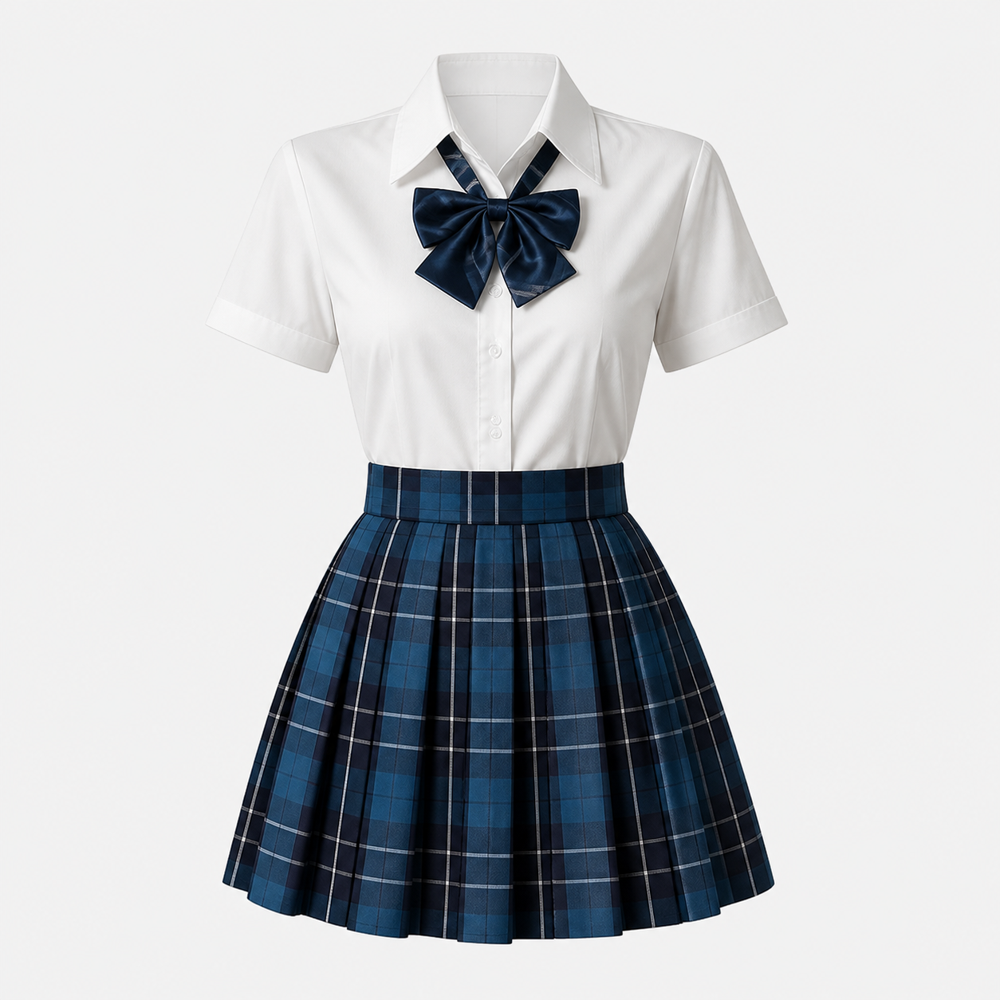
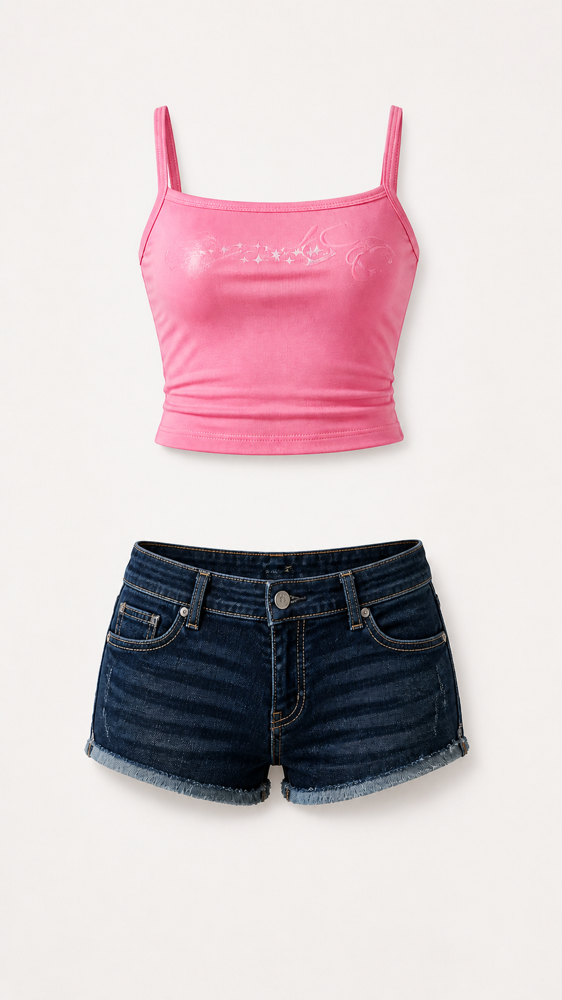
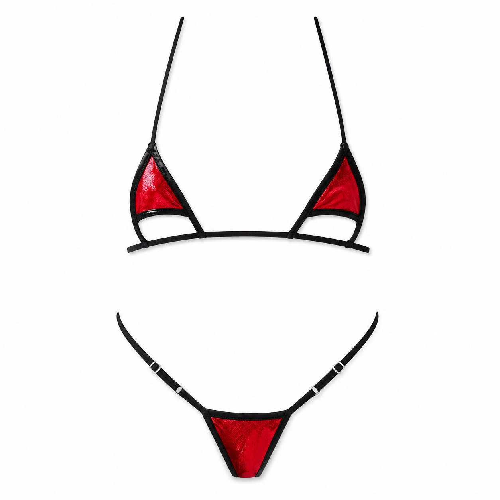
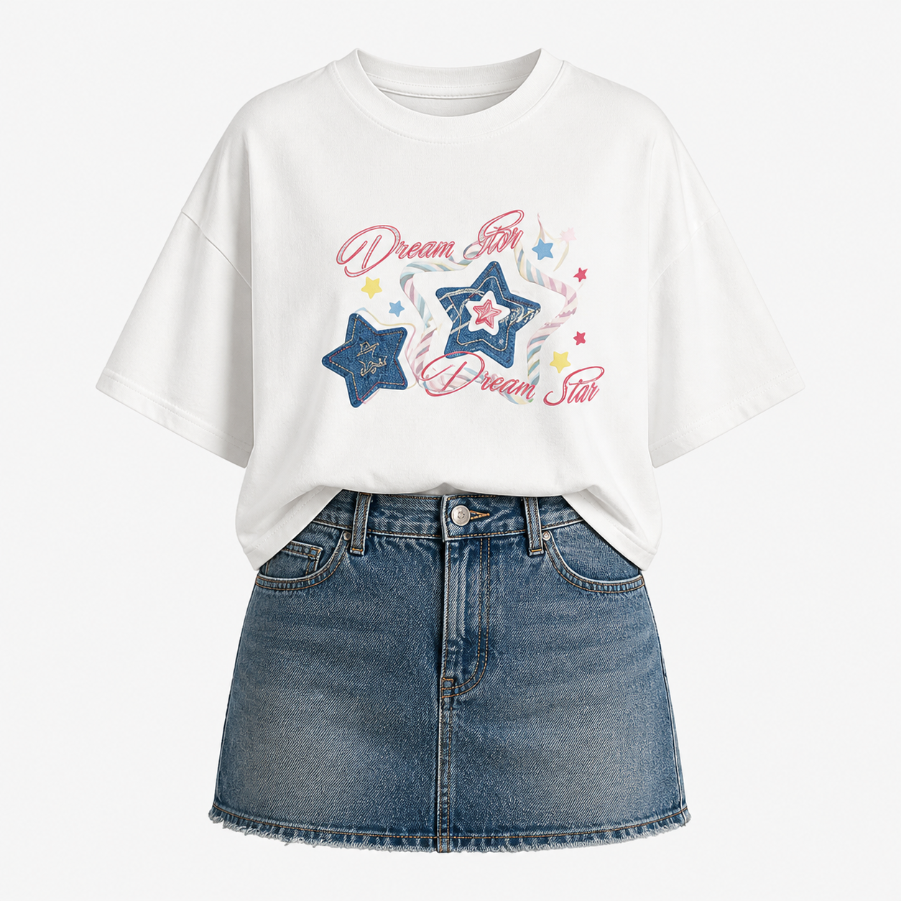
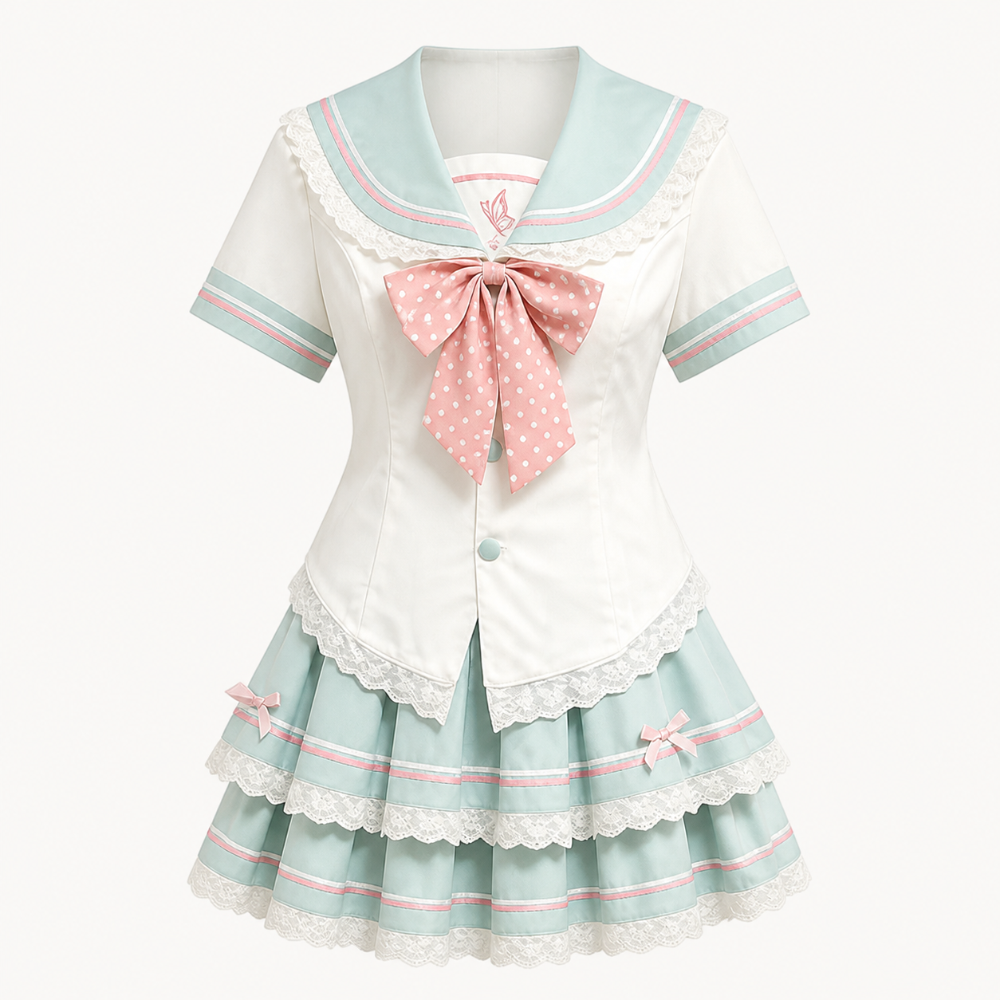

## clothes

[返回资源总索引](../Resources.md)

### 服装参考

#### 日系学院风短袖制服套装

> A front-view display of a Japanese school-style short-sleeved uniform set. The top is a white short-sleeved collared shirt with a fitted cut, several round buttons down the front, and standard-length short sleeves. A large dark navy bow tie at the neck has a distinct satin sheen. The bottom is a high-waisted pleated skirt with a plaid pattern in alternating dark blue and black, crossed by thin light-colored lines in white or pale gray that form a regular grid; the hem falls into a natural A-line shape. The outfit is displayed on a headless mannequin, photographed straight on at eye level against a clean solid light-gray background, with a centered composition showing the garment from the torso to mid-thigh and no additional decorations or distractions.

#### 粉色背心与深蓝牛仔短裤

> A flat-lay display of two garments arranged vertically against a pure white background. The top is a pink cropped camisole with thin shoulder straps and a square neckline; it ends above the waist and has a soft cotton or knit texture with subtle horizontal ribbing. The chest features a decorative pattern of pale stars and abstract curves. The bottom is a pair of dark navy high-waisted denim shorts with a classic five-pocket design, a metal button fly at the center front, curved side pockets, and a fitted cut through the legs. The hems have a frayed, faded finish, giving the denim a washed and distressed appearance. Both pieces are shown separately from the front without a model, under even soft lighting that emphasizes their silhouettes, construction details, and colors.

#### 红黑撞色两件套

> A flat-lay display of a red-and-black color-blocked two-piece lingerie set, consisting of a triangle-cup bra and minimalist panties. The bra has triangular cups made from glossy red material, outlined with black binding. Two thin black shoulder straps extend upward from the tops of the cups, while a horizontal black band under the bust creates cutout sections at both sides. The panties use the same glossy red material and black binding, with a low-rise triangular cut; wider black straps at the sides connect to the back waist, each fitted with two silver metal adjusters. The set is arranged vertically in a centered, symmetrical front view against a pure white background, with no model.

#### 红色高叉深V连体紧身衣

> A front-view display of a red high-cut deep-V bodysuit. The garment has a minimalist design, a vivid true-red color, and a smooth high-gloss surface suggestive of latex, PVC, or coated stretch fabric, with pronounced mirror-like reflections. Its features include thin shoulder straps, an ultra-deep V neckline extending to the waist, and high-cut leg openings; the overall cut follows the body's curves closely. A white Nordic cross motif appears on each side of the bust, while thin white lines trace the V-neck edge and side seams for contrast. The piece is centered against a clean pale-beige background as a flat lay or 3D render without a model, using a vertically symmetrical composition that fully shows the front construction and graphic placement.

#### Dream Star T恤与牛仔短裙

> A centered, front-facing product display of a casual top-and-bottom outfit against a pure white background. The top is a white crew-neck short-sleeved T-shirt with a loose drop-shoulder cut and a smooth cotton texture. Its front has a decorative print featuring the pink handwritten words "Dream Star" and two dark navy five-pointed star appliques arranged in the center; the right star contains a smaller white star with a pink border. Miniature yellow, red, and blue stars and pale spiral ribbon motifs are scattered around them. The bottom is a high-waisted denim mini skirt in classic indigo washed denim, with a single metal button and zipper fly at the center front, curved pockets on both sides, and a naturally worn frayed hem. The lighting is even and soft, with no person present; the garments' natural drape shows their silhouettes, construction, and finishing details.

#### 薄荷色水手领连衣裙

> A Japanese school-style or Lolita-inspired dress set, shown from the front as a flat lay or on a dress form against a pure white background. The top is a white short-sleeved fitted jacket-style piece with a wide mint-colored sailor collar trimmed with white lace and pink-and-white piping. The sleeve cuffs use matching color blocking with pink stripe accents. A large pink bow tie with a white polka-dot pattern is the focal point at the chest. A white crew-neck base layer is visible underneath, featuring a pink line-art butterfly on the chest. The bottom is a high-waisted tiered cake skirt in mint, constructed from three layers of ruffles, each edged with white lace and accented between layers by thin horizontal pink stripes; a small pink satin bow decorates each side of the hem. The fabric has a crisp cotton or poly-cotton-blend feel, and the white, mint, and pink palette creates a sweet, fresh youthful look.
