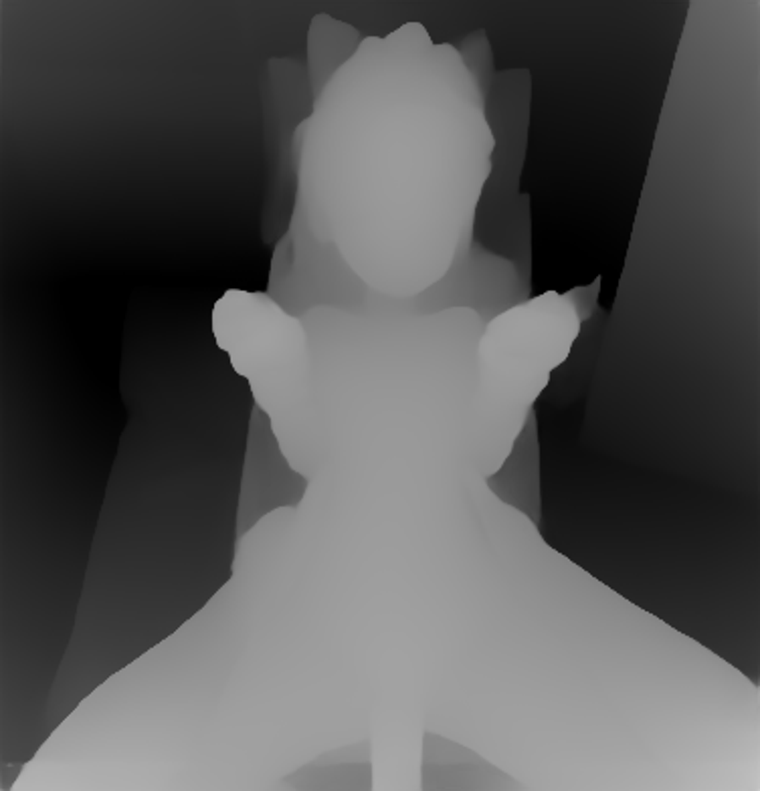

# Case11 — Yasal 30 秒横屏末班地铁偷情（写实 · 3 × 10s 工作流）

> **角色**：Yasal —— 写实真人风格：黑直短发（齐刘海、透明发夹）、灰蓝眼睛、白衬衫+深色裙+平底鞋
> **总时长**：30 秒 = 3 个 workflow × 10 秒（24fps，1280×720，16:9 横屏）
> **分镜**：6 个镜头，每个 4-6 秒（6+4 / 5+5 / 4+6）
> **场景**：末班车空荡摇晃的地铁车厢（车窗映城市灯火、顶灯、扶手杆）（纯文字描述，不使用场景参考图，保持写实）
> **剧情**：末班空车厢，他解开她衬衫→她跨坐他腿上蛙式→翻倒在座椅→报站开门乘客上车撞见→匆忙收拾、列车驶离（车窗倒影收尾）
> **动作**：纯文字 5 镜 + pose 深度图 1 镜（女上位-坐姿蛙式）

## 全局约束（三个工作流共同遵守）

- **画风锁定**：电影级写实真人风格（真实皮肤质感、自然胶片颗粒、自然光、浅景深、35mm 手持感），**不是动漫、不是卡通**——每条提示词 detailed_description 开头声明
- 脸部与发型完全由 `<Picture 1>` 锁定，提示词不额外描述面部/发饰细节
- Yasal 服装：白衬衫 + 深色裙 + 平底鞋；脱衣后为裸体
- 男性**全程不露脸**（出画/阴影/背对镜头）、**全片无男性声音**（只有车声、座椅声、衣物声等物理声）
- 乘客=虚化剪影、面部不清晰；报站声=模糊不可辨（不引入说话人 ID、不用 `<d>`）；避免生成多余清晰人脸
- 她的声音：压低的呻吟、喘息（女性声音，允许）
- 场景纯文字描述（写实风格不使用动漫场景参考图）；pose 深度图只用于有图的分镜
- 无音乐（车厢摇晃/顶灯/报站均为环境声；`non_diegetic_music: N/A`）

## 固定参考图（Picture 1，三个工作流完全相同）

- Yasal 面部参考（Picture 1）


## 分镜总表（6 shots）

| # | 工作流 | 时间（全片） | 时长 | 动作来源 | 内容（剧情节拍） |
|---|--------|--------------|------|----------|------------------|
| 1 | W1 | 0-6s | 6s | 纯文字 | 空车厢：她靠窗、他对面，他解开她衬衫，她瞟车窗（倒影里两人） |
| 2 | W1 | 6-10s | 4s | 纯文字 | 她跨坐他腿上背对车窗，裙摆掀起，节奏合上车厢摇晃 |
| 3 | W2 | 0-5s | 5s | 女上位-坐姿蛙式_正面_竖图 深度图（0.4） | 腿上蛙式骑乘（正面，车窗灯火轮廓光） |
| 4 | W2 | 5-10s | 5s | 纯文字 | 翻倒在座椅、腿勾扶手、车身一晃一顶、车窗倒影双人 |
| 5 | W3 | 0-4s | 4s | 纯文字 | 报站+车门开，站台灯光灌入，乘客剪影上车扫视→两人定格 |
| 6 | W3 | 4-10s | 6s | 纯文字 | 乘客坐远端背对镜头；她扶立杆喘息裙摆还乱，列车驶离（英雄镜头：车窗倒影+空座椅） |

---

## Workflow 1: 空车厢解衬衫 → 跨坐腿上（0-10s）

> **场景**：末班车空荡摇晃的车厢（顶灯、扶手、车窗映城市灯火）
> **分镜**：2 个 — Shot 1（6s）→ Shot 2（4s），全部纯文字动作

##### English Prompt

```txt
subject_definitions:
<Subject 1> is the woman's face and hair, defined by <Picture 1>. Preserve her face and hair exactly as in <Picture 1> throughout the video; do not inherit the background, clothing, or body pose from it.
<Subject 2> is the man, defined by text only (no reference image): a tall adult male in a dark shirt and jeans. His face is never visible in any shot — he stays out of frame, in shadow, or with his back to the camera — and his voice is never heard. Preserve his body and clothing consistency throughout the video.

summary:
[reference generation] The target video is a 10-second horizontal (16:9) two-shot cinematic photorealistic last subway train scene at night, featuring a realistic young woman (face from <Subject 1>) in a white shirt and dark skirt, and a man whose face is never visible (<Subject 2>). [Shot 1] is a medium shot inside the empty swaying carriage: she sits by the window and he sits across from her, unbuttoning her shirt from the top while she glances at the window, where the reflection of the two of them is visible. [Shot 2] cuts to the same carriage: she stands and straddles his lap with her back to the window, the dark skirt hiked up over her hips, the two of them swaying with the rocking of the carriage. No male voice appears anywhere in the video.

retention_analysis:
<Subject 1> (appears in [Shot 1], [Shot 2]): fully_preserved - the woman's face and hair from <Picture 1> are retained in both shots.
<Subject 2> (appears in [Shot 1], [Shot 2]): fully_preserved - the man in the dark shirt is retained in both shots, with his face never visible.

detailed_description:
The target video is a cinematic photorealistic live-action style scene: realistic human skin texture, natural film grain, naturalistic lighting, shallow depth of field, and a 35mm handheld camera feel — not anime, not cartoon. The setting is the empty, swaying carriage of a last subway train at night with overhead fluorescent lights, handrails, and dark windows reflecting the passing city lights, with a horizontal 16:9 frame. The man's face is never visible in any shot.

[Shot 1] The empty, swaying carriage of the last subway train at night: overhead fluorescent lights, vertical handrails, and dark windows reflecting the passing city lights. The woman (face and hair from <Subject 1>) sits on the seat by the window in her white shirt and dark skirt. The man sits across from her, only his torso and arms in frame, his head out of frame. He reaches across and slowly unbuttons the white shirt from the top; her eyes widen, and she glances at the window, where the reflection of the two of them is visible. The camera is static throughout [Shot 1], at a medium distance, at a level angle.

[Shot 2] At 00:06.000, the same carriage. She stands up and straddles the man's lap, her back to the window; he lifts the dark skirt up over her hips, and her fingers dig into his shoulders. The train rocks, and the two of them sway in rhythm with the rolling of the carriage, the city lights streaking across the window behind them. The camera is static throughout [Shot 2], at a medium side angle.

overall_soundscape:
A train ambience continues throughout the video: the rhythmic clatter of the rails, the hum of the overhead lights, and the hush of the empty carriage. In [Shot 1], the slow click of each button, her quickened breathing, and the swaying of the carriage. In [Shot 2], the creak of the seat, the rustle of the skirt lifting, her muffled moans, and the rolling rhythm of the train. No male voice is audible at any point in the video.

non_diegetic_music:
N/A
```

---

## Workflow 2: 腿上蛙式 → 翻倒座椅（10-20s）

> **场景**：同一车厢（车窗灯火轮廓光）
> **分镜**：2 个 — Shot 1（5s，女上位坐姿蛙式 深度图）→ Shot 2（5s，纯文字）

- 女上位坐姿蛙式（Picture 2，magapixels = 0.4）



##### English Prompt

```txt
subject_definitions:
<Subject 1> is the woman's face and hair, defined by <Picture 1>. Preserve her face and hair exactly as in <Picture 1> throughout the video; do not inherit the background, clothing, or body pose from it.
<Subject 2> is the man, defined by text only (no reference image): a tall adult male in a dark shirt and jeans. His face is never visible in any shot — he stays out of frame, in shadow, or with his back to the camera — and his voice is never heard. Preserve his body and clothing consistency throughout the video.
<Subject 3> is the sex position and camera angle reference, defined by <Picture 2>. Use this depth map to lock the cowgirl seated frog position body layout (seated on his lap, frog legs spread, facing the camera) and the frontal camera angle for [Shot 1]. Do not inherit the character's face, hair, clothing, or scene from <Picture 2>.

summary:
[reference generation] The target video is a 10-second horizontal (16:9) two-shot cinematic photorealistic last subway train scene at night, featuring a realistic young woman (face from <Subject 1>) and a man whose face is never visible (<Subject 2>). [Shot 1] is a frontal close shot: the woman sits on the man's lap on the train seat in a frog position, her knees apart and bent downward, her vulva facing the camera, riding steadily while city lights streak across the window behind them. [Shot 2] cuts to a low side view: she is flipped over onto the seat, her legs hooked over the armrest, and the man thrusts into her from above as the carriage sways. No male voice appears anywhere in the video.

retention_analysis:
<Subject 1> (appears in [Shot 1], [Shot 2]): fully_preserved - the woman's face and hair from <Picture 1> are retained in both shots.
<Subject 2> (appears in [Shot 1], [Shot 2]): fully_preserved - the man in the dark shirt is retained in both shots, with his face never visible.
<Subject 3> (appears in [Shot 1]): partially_preserved - the cowgirl seated frog position body layout and the frontal camera angle are retained for [Shot 1].

detailed_description:
The target video is a cinematic photorealistic live-action style scene: realistic human skin texture, natural film grain, naturalistic lighting, shallow depth of field, and a 35mm handheld camera feel — not anime, not cartoon. The setting is the empty, swaying carriage of a last subway train at night with overhead fluorescent lights and dark windows reflecting the passing city lights, with a horizontal 16:9 frame. The man's face is never visible in any shot.

[Shot 1] The train seat by the window, the carriage lights flickering with the rocking of the train. Following the posture of <Subject 3>, the woman (face and hair from <Subject 1>) sits on the man's lap in a frog position, her legs spread out in a frog-like position, her knees are apart and bent downward, and her vulva is facing the camera. Her upper body is reclined backward against the window, her arms are bent and placed on both sides of her body, her left and right elbows are pressing against her waist, and her forearms are raised and slightly extended outward. The man's penis is thrusting into the vagina, and the man's hands are holding the woman's waist. She rides steadily, her hips moving up and down over the inserted penis in a smooth vertical rhythm, while the passing city lights streak across the window behind them. The camera stays static throughout [Shot 1], shooting from a frontal angle at a close range.

[Shot 2] At 00:05.000, the camera cuts to a low side view. The man flips the woman over onto the seat; she lies on her back on the seat, her dark skirt bunched up over her waist, her legs hooked over the seat armrest, and the man straddles her and thrusts into her from above, his face never visible, his lower body filling the frame. With every thrust the carriage sways, and in the window the reflection of the two of them shimmers and blurs. The camera stays static throughout [Shot 2].

overall_soundscape:
The train ambience continues throughout the video: the rhythmic clatter of the rails, the hum of the overhead lights, and the hush of the carriage. In [Shot 1], the creak of the seat, wet thrusting sounds, her muffled moans pressed low against the window, and the streaking of city lights. In [Shot 2], the creak of the seat, the sway of her legs over the armrest, wet thrusting sounds, and the two of them swaying in rhythm with the carriage. No male voice is audible at any point in the video.

non_diegetic_music:
N/A
```

---

## Workflow 3: 乘客上车撞见 → 驶离车窗倒影（20-30s）

> **场景**：同一车厢 → 站台开门 → 远端座椅
> **分镜**：2 个 — Shot 1（4s，纯文字）→ Shot 2（6s，纯文字，英雄镜头收尾）

##### English Prompt

```txt
subject_definitions:
<Subject 1> is the woman's face and hair, defined by <Picture 1>. Preserve her face and hair exactly as in <Picture 1> throughout the video; do not inherit the background, clothing, or body pose from it.
<Subject 2> is the man, defined by text only (no reference image): a tall adult male in a dark shirt and jeans. His face is never visible in any shot — he stays out of frame, in shadow, or with his back to the camera — and his voice is never heard. Preserve his body and clothing consistency throughout the video.

summary:
[reference generation] The target video is a 10-second horizontal (16:9) two-shot cinematic photorealistic last subway train scene at night, featuring a realistic young woman (face from <Subject 1>) and a man whose face is never visible (<Subject 2>). [Shot 1] is a medium shot from the doorway: the train chimes, the doors open, platform light floods in, and a silhouetted passenger boards, glances at the two of them, and walks past as they freeze mid-thrust. [Shot 2] cuts to the same carriage: the passenger sits at the far end with his back to the camera; the man pulls the white shirt back over the woman's head, she grips a vertical pole, breathing hard, her dark skirt still hiked up, and the train pulls away. No male voice appears anywhere in the video.

retention_analysis:
<Subject 1> (appears in [Shot 1], [Shot 2]): fully_preserved - the woman's face and hair from <Picture 1> are retained in both shots.
<Subject 2> (appears in [Shot 1], [Shot 2]): fully_preserved - the man in the dark shirt is retained in both shots, with his face never visible.

detailed_description:
The target video is a cinematic photorealistic live-action style scene: realistic human skin texture, natural film grain, naturalistic lighting, shallow depth of field, and a 35mm handheld camera feel — not anime, not cartoon. The setting is the swaying carriage of a last subway train at night with overhead fluorescent lights and dark windows, with a horizontal 16:9 frame. The man's face is never visible in any shot, and the passenger is only a silhouette with no clear face.

[Shot 1] The swaying carriage of the last subway train at night. The train chimes and the doors open, and the light of the platform floods into the carriage. A passenger, a silhouette with no clear face, steps aboard; the man and the woman (face and hair from <Subject 1>) freeze mid-thrust, their breathing held. The passenger glances at the two of them, then walks past toward the far end of the carriage. The camera is static throughout [Shot 1], at a medium distance, from the doorway.

[Shot 2] At 00:04.000, the same carriage. The passenger sits at the far end of the carriage with his back to the camera. The man quickly pulls the white shirt back over the woman's head; she grips a vertical pole, her chest heaving, her dark skirt still hiked up around her thighs, her face flushed and damp. The doors close, and the train pulls away. The camera stays static throughout [Shot 2], at a medium distance, at a level angle, the reflection of the two of them visible in the window, the empty seat behind her.

overall_soundscape:
The train ambience continues throughout the video: the rhythmic clatter of the rails and the hush of the carriage. In [Shot 1], the chime of the doors, the rush of platform light and air, a muffled, indistinct station announcement, the passenger's footsteps, and the held breath of the two of them. In [Shot 2], the rustle of the shirt being pulled back on, her ragged breathing, the clatter of the doors closing, and the train pulling away over the rails. No male voice is audible at any point in the video.

non_diegetic_music:
N/A
```

---

## 提交说明

- **画布/帧**：1280×720（16:9，宽高为 32 的倍数），24fps；10 秒 ≈ 243 帧（17n+5 对齐）
- **每个工作流的 Load Image 顺序**（必须与提示词标签一致）：
  - W1：`ref/character/Yasal/exec-10bf9109-04b1-4aba-810b-6f89b3793cc9.png` → `<Picture 1>`（1 张图，两镜均为纯文字动作）
  - W2：Yasal 脸 → `<Picture 1>`；`ref/pose/depth/女上位-坐姿蛙式_正面_竖图_depth.png` → `<Picture 2>`
  - W3：`ref/character/Yasal/exec-10bf9109-04b1-4aba-810b-6f89b3793cc9.png` → `<Picture 1>`（1 张图，两镜均为纯文字动作）
- **magapixels**（沿用历史工作流参数备注；当前 `ref/pose/pose.json` 不记录此字段）：W2 女上位蛙式 = 0.4；其余未标注用默认值
- **跨工作流一致性**：`<Subject 1>`（脸）与 `<Subject 2>`（无脸男）的锁定文字在三个提示词中保持完全一致；末班空车厢（顶灯+扶手+车窗灯火）在 W1-W3 保持一致；她的服装状态按剧情递进（完整→衬衫解开+裙摆撩起→衬衫拉回、裙摆还乱）
- **剪辑衔接**：三个 10 秒成片按 W1→W2→W3 顺序硬切拼接；每段内部切点（00:06.000 / 00:05.000 / 00:04.000）
- **声音设计**：车厢摇晃节奏（轨道节奏贯穿全片，与动作同节奏）+ 顶灯嗡鸣 + 报站（模糊不可辨）+ 车门叮咚；乘客=剪影+脚步（无词）；无音乐
- **写实约束**：不使用任何动漫场景参考图（场景纯文字），乘客/站台人物=虚化剪影、面部不清晰，避免生成多余清晰人脸
