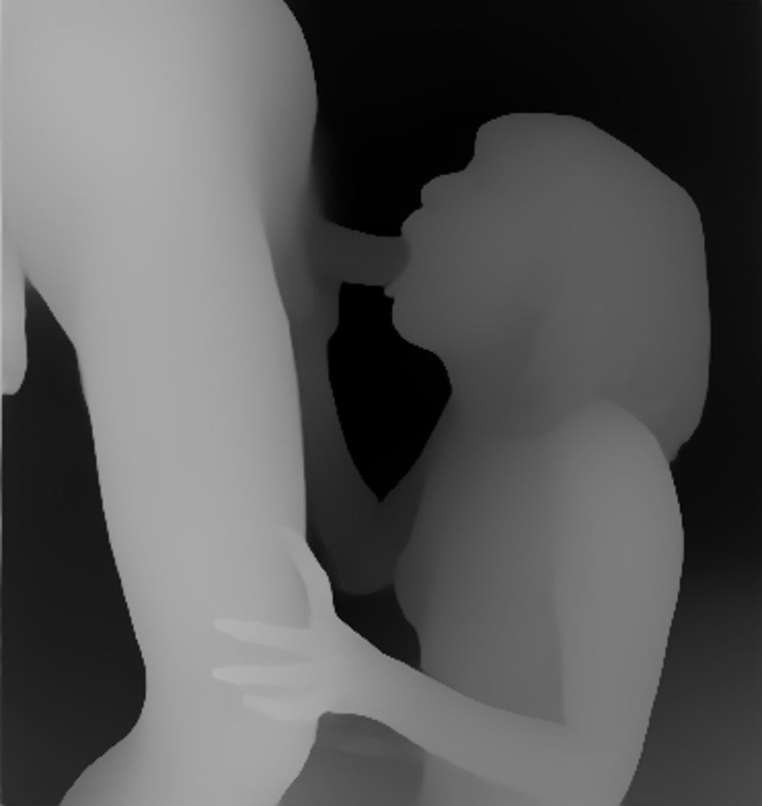

# Case5 — Yasal 30 秒横屏夜街露出→强暴（写实 · 3 × 10s 工作流）

> **角色**：Yasal —— 写实真人风格：黑直短发（齐刘海、透明发夹）、灰蓝眼睛、白衬衫（参考图 `ref/character/Yasal/exec-10bf9109-04b1-4aba-810b-6f89b3793cc9.png`）
> **总时长**：30 秒 = 3 个 workflow × 10 秒（24fps，1280×720，16:9 横屏）
> **分镜**：6 个镜头，每个 4-6 秒（6+4 / 5+5 / 4+6）
> **场景**：夜晚湿漉漉的城市人行道 → 暗巷砖墙（纯文字描述，不使用场景参考图，保持写实）
> **剧情**：她深夜在街上当众露出→路人驻足→被一个无脸男子抓住拖进暗巷→强制口交→靠墙强制传教士→被抛弃、衣衫凌乱哭倒在街头
> **动作**：纯文字 4 镜 + pose 深度图 2 镜（跪姿口交-站立男性、传教士侧面）

## 全局约束（三个工作流共同遵守）

- **画风锁定**：电影级写实真人风格（真实皮肤质感、自然胶片颗粒、自然光、浅景深、35mm 手持感），**不是动漫、不是卡通**——每条提示词 detailed_description 开头声明
- 脸部与发型完全由 `<Picture 1>` 锁定，提示词不额外描述面部/发饰细节
- Yasal 服装：白衬衫 + 深色修身裙 + 深色平底鞋；被扒后为裸体
- 男性**全程不露脸**（出画/阴影/背对镜头）、**全片无男性声音**（只有脚步声、衣物声、喘息等物理声）
- 路人/群众全部虚化、面部不清晰（避免生成多余清晰人脸）
- 她的声音：抽泣、恳求、呜咽（女性声音，允许）；无音乐（`non_diegetic_music: N/A`）
- 场景纯文字描述（写实风格不使用动漫场景参考图）；pose 深度图只用于有图的分镜

## 固定参考图（Picture 1，三个工作流完全相同）

- Yasal 面部参考（Picture 1）


## 分镜总表（6 shots）

| #   | 工作流 | 时间（全片） | 时长  | 动作来源                  | 内容（剧情节拍）                         |
| --- | --- | ------ | --- | --------------------- | -------------------------------- |
| 1   | W1  | 0-6s   | 6s  | 纯文字                   | 夜街中央当众露出（衬衫滑肩、裙摆撩起），路人驻足围观       |
| 2   | W1  | 6-10s  | 4s  | 纯文字                   | 无脸男子从背后抓住她的手腕，拖向暗巷               |
| 3   | W2  | 0-5s   | 5s  | 纯文字                   | 暗巷砖墙前被按压：衬衫被扒到腰、裙摆拉过胯            |
| 4   | W2  | 5-10s  | 5s  | 跪姿口交-站立男性_侧面 深度图      | 被按跪在地砖上强制口交                      |
| 5   | W3  | 0-4s   | 4s  | 传教士式性交-侧面_横图 深度图（0.4） | 靠墙强制传教士（俯侧固定机位）                  |
| 6   | W3  | 4-10s  | 6s  | 纯文字                   | 猛烈结束→拔出消失在黑暗→衣衫凌乱的她独自哭倒在街头（英雄镜头） |

---

## Workflow 1: 当众露出 → 被拖走（0-10s）

> **场景**：夜晚城市人行道（湿面、路灯、店铺招牌光、远处虚化路人）
> **分镜**：2 个 — Shot 1（6s）→ Shot 2（4s），全部纯文字动作

##### English Prompt

```txt
subject_definitions:
<Subject 1> is the woman's face and hair, defined by <Picture 1>. Preserve her face and hair exactly as in <Picture 1> throughout the video; do not inherit the background, clothing, or body pose from it.
<Subject 2> is the man, defined by text only (no reference image): a tall adult male in a dark jacket and jeans. His face is never visible in any shot — he stays out of frame, in shadow, or behind the woman — and his voice is never heard. Preserve his body and clothing consistency throughout the video.

summary:
[reference generation] The target video is a 10-second horizontal (16:9) two-shot cinematic photorealistic night street scene, featuring a realistic young woman (face from <Subject 1>) in a white shirt and dark slim skirt, and a man whose face is never visible (<Subject 2>). [Shot 1] is a medium shot: the woman stops in the middle of a wet night sidewalk and slowly exposes herself — the shirt sliding off her shoulders, the skirt hiked up around her waist — while out-of-focus passersby stop and stare. [Shot 2] cuts to the same street: a dark-jacketed hand grabs her wrist from behind and yanks her toward a dark side alley. No male voice appears anywhere in the video.

retention_analysis:
<Subject 1> (appears in [Shot 1], [Shot 2]): fully_preserved - the woman's face and hair from <Picture 1> are retained in both shots.
<Subject 2> (appears in [Shot 2]): fully_preserved - the man in the dark jacket is retained in [Shot 2], with his face never visible.

detailed_description:
The target video is a cinematic photorealistic live-action style scene: realistic human skin texture, natural film grain, naturalistic lighting, shallow depth of field, and a 35mm handheld camera feel — not anime, not cartoon. The setting is a wet city sidewalk at night with warm streetlights, glowing shop signs in the background, and a horizontal 16:9 frame. The man's face is never visible in any shot.

[Shot 1] A wet city sidewalk at night: warm streetlights, glowing shop signs, and a few distant passersby, out of focus, their faces never clearly visible. The woman (face and hair from <Subject 1>) stands in the middle of the sidewalk in her white shirt, dark slim skirt, and dark flats. She slowly unbuttons the white shirt from the top, letting it slide down off her shoulders to bare her breasts, then hikes the dark skirt up around her waist to bare her thighs. Her expression is a mix of thrill and fear, her breathing quickening. Two of the passersby stop and stare. The camera is static throughout [Shot 1], at a medium distance, at a level angle.

[Shot 2] At 00:06.000, the same sidewalk. A hand in a dark jacket sleeve — the man's — closes around the woman's wrist from behind. He yanks her hard toward a dark side alley. She stumbles after him, her white shirt half off, one shoe scuffing the wet pavement, her eyes wide with fear. The camera is static throughout [Shot 2], at a medium distance, at a level angle.

overall_soundscape:
A night city ambience continues throughout the video: a distant traffic hum, the low hum of a nearby shop, far-off murmured voices, and footsteps on the wet pavement. In [Shot 1], the soft rustle of fabric as the shirt slides off her shoulders, her low shuddering breaths and a small whimper as the passersby stop, and the distant murmur of voices layer over the ambience. In [Shot 2], the sharp yank on her wrist, her startled cry, the scuff of her shoes on the wet pavement, and their footsteps rushing toward the alley. No male voice is audible at any point in the video.

non_diegetic_music:
N/A
```

---

## Workflow 2: 暗巷扒衣 → 强制口交（10-20s）

> **场景**：暗巷（单盏昏黄路灯在巷尾、湿砖反光）
> **分镜**：2 个 — Shot 1（5s，纯文字）→ Shot 2（5s，跪姿口交-站立男性 深度图）

- 跪姿口交-站立男性（Picture 2）



##### English Prompt

```txt
subject_definitions:
<Subject 1> is the woman's face and hair, defined by <Picture 1>. Preserve her face and hair exactly as in <Picture 1> throughout the video; do not inherit the background, clothing, or body pose from it.
<Subject 2> is the man, defined by text only (no reference image): a tall adult male in a dark jacket and jeans. His face is never visible in any shot — he stays out of frame, in shadow, or behind the woman — and his voice is never heard. Preserve his body and clothing consistency throughout the video.
<Subject 3> is the sex position and camera angle reference, defined by <Picture 2>. Use this depth map to lock the kneeling oral body layout (woman kneeling, man standing, his legs on the left of the frame) and the side camera angle for [Shot 2]. Do not inherit the character's face, hair, clothing, or scene from <Picture 2>.

summary:
[reference generation] The target video is a 10-second horizontal (16:9) two-shot cinematic photorealistic side-alley scene at night, featuring a realistic young woman (face from <Subject 1>) and a man whose face is never visible (<Subject 2>). [Shot 1] is a medium side shot: the man pins the woman against a brick wall in a dark side alley, yanking her white shirt up over her hips and pulling the dark skirt up over her waist. [Shot 2] cuts to a side close shot: the woman is forced to her knees on the wet pavement and performs a trembling oral stroke on the standing man's body. No male voice appears anywhere in the video.

retention_analysis:
<Subject 1> (appears in [Shot 1], [Shot 2]): fully_preserved - the woman's face and hair from <Picture 1> are retained in both shots.
<Subject 2> (appears in [Shot 1], [Shot 2]): fully_preserved - the man in the dark jacket is retained in both shots, with his face never visible.
<Subject 3> (appears in [Shot 2]): partially_preserved - the kneeling oral body layout and the side camera angle are retained for [Shot 2].

detailed_description:
The target video is a cinematic photorealistic live-action style scene: realistic human skin texture, natural film grain, naturalistic lighting, shallow depth of field, and a 35mm handheld camera feel — not anime, not cartoon. The setting is a dark brick side alley at night with a single dim streetlight at the far end and a horizontal 16:9 frame. The man's face is never visible in any shot.

[Shot 1] The dark brick side alley, a single dim streetlight at the far end, the wet brick glistening. The man pins the woman (face and hair from <Subject 1>) against the brick wall, one hand caging both of hers behind her back and the other yanking the white shirt up over her hips, the dark skirt pulled up over her waist, her bare torso and bare thighs exposed in the dim light. She struggles weakly, her eyes wet, her breathing sharp. The camera is static throughout [Shot 1], at a medium side angle.

[Shot 2] At 00:05.000, the camera cuts to a side close shot. Following the posture of <Subject 3>, the woman is in a kneeling position on the wet pavement and the man is standing, his legs on the left side of the frame. Her mouth is open, slightly holding the head of the man's penis, and her hand is gripping the man's thigh. She performs an oral stroke with a trembling rhythm, her eyes wet with tears, her expression a mix of fear and forced compliance. The camera stays static throughout [Shot 2], shooting from a side angle at a close range.

overall_soundscape:
A dim side-alley ambience continues throughout the video: a faint drip of water, a distant city hum, and the soft creak of old brick. In [Shot 1], the scrape of her back against the brick wall, the rustle of fabric as the shirt is yanked up and the skirt pulled over her hips, and her muffled gasps and a low sob. In [Shot 2], the wet sounds of her mouth over the penis, the scrape of her knees on the wet pavement, and her muffled cries and heavy breathing layer over the ambience. No male voice is audible at any point in the video.

non_diegetic_music:
N/A
```

---

## Workflow 3: 靠墙强制传教士 → 抛弃街头（20-30s）

> **场景**：同一暗巷 → 湿漉漉的街头
> **分镜**：2 个 — Shot 1（4s，传教士侧面 深度图）→ Shot 2（6s，纯文字，英雄镜头收尾）

- 传教士侧面俯视（Picture 2，magapixels = 0.4 时才正确实现）
> ⚠️ 历史动作卡「传教士式性交-侧面_横图」当前不在 `ref/pose/pose.json`；此处不自动替换，请提交前重新选择当前动作卡。
##### English Prompt

```txt
subject_definitions:
<Subject 1> is the woman's face and hair, defined by <Picture 1>. Preserve her face and hair exactly as in <Picture 1> throughout the video; do not inherit the background, clothing, or body pose from it.
<Subject 2> is the man, defined by text only (no reference image): a tall adult male in a dark jacket and jeans. His face is never visible in any shot — he stays out of frame, in shadow, or behind the woman — and his voice is never heard. Preserve his body and clothing consistency throughout the video.
<Subject 3> is the sex position and camera angle reference, defined by <Picture 2>. Use this depth map to lock the missionary side body layout (woman on the ground with her back against the wall, man above her) and the fixed overhead side camera angle for [Shot 1]. Do not inherit the character's face, hair, clothing, or scene from <Picture 2>.

summary:
[reference generation] The target video is a 10-second horizontal (16:9) two-shot cinematic photorealistic night alley scene, featuring a realistic young woman (face from <Subject 1>) and a man whose face is never visible (<Subject 2>). [Shot 1] is a fixed overhead side view: the woman lies on the alley ground with her back against the brick wall, the man above her shows only his lower body and part of his arms, his hand grasping her wrist while his penis continuously inserts into her vagina. [Shot 2] cuts to a low medium shot: the man stops abruptly, pulls out, and vanishes into the dark; the woman is left alone on the wet street in torn clothes, curling into a ball and sobbing. No male voice appears anywhere in the video.

retention_analysis:
<Subject 1> (appears in [Shot 1], [Shot 2]): fully_preserved - the woman's face and hair from <Picture 1> are retained in both shots.
<Subject 2> (appears in [Shot 1]): fully_preserved - the man in the dark jacket is retained in [Shot 1], with his face never visible.
<Subject 3> (appears in [Shot 1]): partially_preserved - the missionary side body layout and the fixed overhead side camera angle are retained for [Shot 1].

detailed_description:
The target video is a cinematic photorealistic live-action style scene: realistic human skin texture, natural film grain, naturalistic lighting, shallow depth of field, and a 35mm handheld camera feel — not anime, not cartoon. The setting is a dark brick side alley at night with a single dim streetlight at the far end and a horizontal 16:9 frame. The man's face is never visible in any shot.

[Shot 1] The dark brick side alley, the dim streetlight at the far end. Following the posture of <Subject 3>, the woman (face and hair from <Subject 1>) is lying on the wet ground in a missionary position, her back against the brick wall, and her entire body can be seen in the picture. The man is positioned above her, only his lower body and part of his arms visible, his head out of frame. The man's hand is grasping the woman's wrist, and his penis is continuously inserting into her vagina. His lower body is constantly slapping the woman's buttocks. Due to the intense impact, the woman's body trembles slightly, her chest rises and falls violently, and from time to time she slightly opens her mouth and lets out a gasping sound, then clamps her jaw to hold the noise down. The picture is shot from a fixed overhead perspective to fully present the scene. The camera stays static throughout [Shot 1].

[Shot 2] At 00:04.000, the camera cuts to a low medium shot on the wet street. The man's thrusts grow erratic and violent, then he abruptly stops, pulls out, steps back into the shadow, and vanishes into the dark street. The woman is left alone on the wet sidewalk, her white shirt crumpled on the ground, her dark skirt torn and hiked up around her thighs, her legs still shaking; she curls into a ball and sobs, her breath hitching, the streetlight flickering over her bare shoulders. The camera stays static throughout [Shot 2].

overall_soundscape:
The side-alley ambience continues throughout the video: a faint drip of water and a distant city hum. In [Shot 1], the thud of her back against the brick, wet thrusting sounds, his lower body slapping her buttocks, and her gasping cries growing louder. In [Shot 2], the abrupt stop of the thrusts, the man's footsteps receding into the dark, and then only her sobs and hitching breaths, the distant city hum, and a soft drip of water filling the silence. No male voice is audible at any point in the video.

non_diegetic_music:
N/A
```

---

## 提交说明

- **画布/帧**：1280×720（16:9，宽高为 32 的倍数），24fps；10 秒 ≈ 243 帧（17n+5 对齐）
- **每个工作流的 Load Image 顺序**（必须与提示词标签一致）：
  - W1：`ref/character/Yasal/exec-10bf9109-04b1-4aba-810b-6f89b3793cc9.png` → `<Picture 1>`（1 张图，两镜均为纯文字动作）
  - W2：Yasal 脸 → `<Picture 1>`；`ref/pose/depth/跪姿口交-站立男性_侧面_竖图_depth.png` → `<Picture 2>`
  - W3：Yasal 脸 → `<Picture 1>`；旧动作卡「传教士式性交-侧面_横图」（当前 `ref/pose/pose.json` 无同名条目） → `<Picture 2>`
- **magapixels**（沿用历史工作流参数备注；当前 `ref/pose/pose.json` 不记录此字段）：W3 传教士侧面 = 0.4；其余未标注用默认值
- **跨工作流一致性**：`<Subject 1>`（脸）与 `<Subject 2>`（无脸男）的锁定文字在三个提示词中保持完全一致；暗巷（砖墙+巷尾昏黄路灯）在 W2/W3 保持一致；她的服装状态按剧情递进（完整→被扒→凌乱）
- **剪辑衔接**：三个 10 秒成片按 W1→W2→W3 顺序硬切拼接；每段内部切点（00:06.000 / 00:05.000 / 00:04.000）
- **声音设计**：全程环境声（夜街/暗巷滴水）+ 她的抽泣/恳求/呜咽（女性声音）；无音乐；男性只有物理声
- **写实约束**：不使用任何动漫场景参考图（场景纯文字），路人/群众虚化且面部不清晰，避免生成多余清晰人脸

## 成片


## 素材


