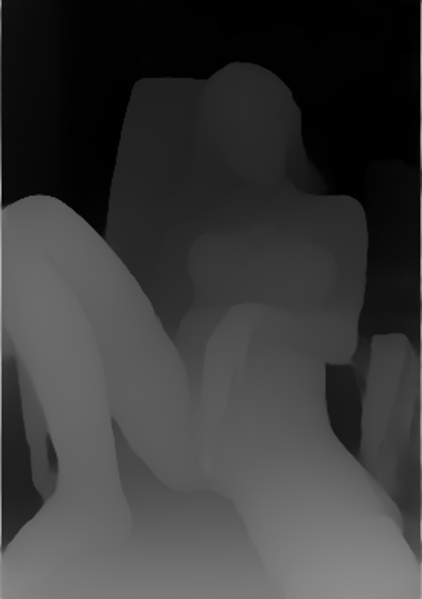

# Case9 — Yasal 30 秒横屏雨夜长椅温柔初夜（写实 · 3 × 10s 工作流）

> **角色**：Yasal —— 写实真人风格：黑直短发（齐刘海、透明发夹）、灰蓝眼睛、白衬衫（被雨打湿）+ 深色裙 + 平底鞋
> **总时长**：30 秒 = 3 个 workflow × 10 秒（24fps，1280×720，16:9 横屏）
> **分镜**：6 个镜头，每个 4-6 秒（6+4 / 5+5 / 4+6）
> **场景**：雨夜公园（路灯下的长椅、湿漉漉的小路、树影、细雨）（纯文字描述，不使用场景参考图，保持写实）
> **剧情**：雨夜公园长椅，与陌生男人的第一次——他脱下外套披上她肩→慢慢解开她湿衬衫→她坐进他腿上→长椅上传教士（初夜的紧绷与适应）→第一次高潮（哭喊被雨声盖住）→蜷进他怀里呼吸渐平（温柔收尾）
> **动作**：纯文字 5 镜 + pose 深度图 1 镜（传教士-俯侧视角）

## 全局约束（三个工作流共同遵守）

- **画风锁定**：电影级写实真人风格（真实皮肤质感、自然胶片颗粒、自然光、浅景深、35mm 手持感），**不是动漫、不是卡通**——每条提示词 detailed_description 开头声明
- 脸部与发型完全由 `<Picture 1>` 锁定，提示词不额外描述面部/发饰细节
- Yasal 服装：白衬衫（湿透微透）+ 深色裙 + 平底鞋；他的深色外套先披在她肩、后搭在长椅上
- 男性**全程不露脸**（出画/阴影/背对镜头）、**全片无男性声音**（只有雨声、衣物声、呼吸声等物理声）
- 她的声音：颤抖呼吸→轻唤→低吟→被雨盖住的哭喊→渐平（女性声音，允许）
- 场景纯文字描述（写实风格不使用动漫场景参考图）；pose 深度图只用于有图的分镜
- 无音乐（雨声主导，远处列车/路灯电流声为环境音；`non_diegetic_music: N/A`）

## 固定参考图（Picture 1，三个工作流完全相同）

- Yasal 面部参考（Picture 1）


## 分镜总表（6 shots）

| # | 工作流 | 时间（全片） | 时长 | 动作来源 | 内容（剧情节拍） |
|---|--------|--------------|------|----------|------------------|
| 1 | W1 | 0-6s | 6s | 纯文字 | 雨夜长椅：她抱膝发抖，他把自己深色外套披上她肩 |
| 2 | W1 | 6-10s | 4s | 纯文字 | 他慢慢解开她湿衬衫，她指尖攥住他袖口，呼吸带雾 |
| 3 | W2 | 0-5s | 5s | 纯文字 | 她坐进他腿上，裙摆被轻轻掀起，雨点打在上方树叶 |
| 4 | W2 | 5-10s | 5s | 传教士式性交-俯侧视角_横图_视频帧 深度图 | 长椅上传教士（俯侧固定机位），初夜的紧绷与适应 |
| 5 | W3 | 0-4s | 4s | 纯文字 | 第一次高潮：身体绷直、指甲掐进他肩膀、哭喊被雨声盖住 |
| 6 | W3 | 4-10s | 6s | 纯文字 | 她蜷进他怀里、额头抵他衣领、呼吸渐平；雨变小、远处列车声（英雄镜头：路灯轮廓光+泪） |

---

## Workflow 1: 雨夜长椅 · 外套披肩 → 慢解衬衫（0-10s）

> **场景**：雨夜公园（路灯下的长椅、湿路面、树影、细雨）
> **分镜**：2 个 — Shot 1（6s）→ Shot 2（4s），全部纯文字动作

##### English Prompt

```txt
subject_definitions:
<Subject 1> is the woman's face and hair, defined by <Picture 1>. Preserve her face and hair exactly as in <Picture 1> throughout the video; do not inherit the background, clothing, or body pose from it.
<Subject 2> is the man, defined by text only (no reference image): a tall adult male in a dark coat. His face is never visible in any shot — he stays out of frame, in shadow, or with his back to the camera — and his voice is never heard. Preserve his body and clothing consistency throughout the video.

summary:
[reference generation] The target video is a 10-second horizontal (16:9) two-shot cinematic photorealistic park scene on a rainy night, featuring a realistic young woman (face from <Subject 1>) in a rain-soaked white shirt and dark skirt, and a man whose face is never visible (<Subject 2>). [Shot 1] is a medium shot under a streetlight: she sits on a wet park bench hugging her knees and shivering, and he drapes his dark coat over her shoulders. [Shot 2] cuts closer: he slowly unbuttons her rain-soaked shirt while her fingers tighten around his sleeve, her breath fogging in the cold. No male voice appears anywhere in the video.

retention_analysis:
<Subject 1> (appears in [Shot 1], [Shot 2]): fully_preserved - the woman's face and hair from <Picture 1> are retained in both shots.
<Subject 2> (appears in [Shot 1], [Shot 2]): fully_preserved - the man in the dark coat is retained in both shots, with his face never visible.

detailed_description:
The target video is a cinematic photorealistic live-action style scene: realistic human skin texture, natural film grain, naturalistic lighting, shallow depth of field, and a 35mm handheld camera feel — not anime, not cartoon. The setting is a park at night in a light rain, a wooden bench under a warm streetlight, a wet path, dark trees, and a horizontal 16:9 frame. The man's face is never visible in any shot.

[Shot 1] A park at night in a light rain: a wooden bench under a warm streetlight, a wet path glistening, dark trees behind. The woman (face and hair from <Subject 1>) sits on the bench in her rain-soaked white shirt and dark skirt, hugging her knees and shivering, her hair damp and clinging to her face. The man in a dark coat stands behind the bench, his face out of frame; he steps forward and drapes his coat over her shoulders, his hands lingering on her arms. The camera is static throughout [Shot 1], at a medium distance, at a level angle.

[Shot 2] At 00:06.000, a closer view under the streetlight. He slowly unbuttons the rain-soaked white shirt from the top; the woman's fingers tighten around his sleeve, her breath fogging in the cold air, her eyes fluttering as the cool rain touches her bare collarbone. The camera is static throughout [Shot 2], at a close range, at a level angle.

overall_soundscape:
A light-rain ambience continues throughout the video: rain tapping on leaves, the wet bench, and a distant traffic hum. In [Shot 1], her shivering breaths, the soft creak of the bench, the rustle of the coat draping over her shoulders, and the rain. In [Shot 2], the slow click of each button, the wet fabric sliding, her quickened breathing fogging in the cold, and the rain. No male voice is audible at any point in the video.

non_diegetic_music:
N/A
```

---

## Workflow 2: 坐进他腿上 → 长椅传教士（10-20s）

> **场景**：同一长椅（雨仍在下、树叶滤雨声）
> **分镜**：2 个 — Shot 1（5s，纯文字）→ Shot 2（5s，传教士-俯侧视角 深度图）

- 传教士俯侧视角（Picture 2）



##### English Prompt

```txt
subject_definitions:
<Subject 1> is the woman's face and hair, defined by <Picture 1>. Preserve her face and hair exactly as in <Picture 1> throughout the video; do not inherit the background, clothing, or body pose from it.
<Subject 2> is the man, defined by text only (no reference image): a tall adult male in a dark coat. His face is never visible in any shot — he stays out of frame, in shadow, or with his back to the camera — and his voice is never heard. Preserve his body and clothing consistency throughout the video.
<Subject 3> is the sex position and camera angle reference, defined by <Picture 2>. Use this depth map to lock the missionary side body layout (woman on the bench, man above her) and the fixed over-shoulder side camera angle for [Shot 2]. Do not inherit the character's face, hair, clothing, or scene from <Picture 2>.

summary:
[reference generation] The target video is a 10-second horizontal (16:9) two-shot cinematic photorealistic park scene on a rainy night, featuring a realistic young woman (face from <Subject 1>) and a man whose face is never visible (<Subject 2>). [Shot 1] is a medium close shot: she slides into his lap on the bench, he lifts her dark skirt up over her hips, and rain taps on the leaves above them. [Shot 2] cuts to a fixed over-shoulder side view: the woman lies back on the bench in a missionary position, the man above her shows only his lower body and part of his arms, and his penis slowly inserts into her vagina for the first time. No male voice appears anywhere in the video.

retention_analysis:
<Subject 1> (appears in [Shot 1], [Shot 2]): fully_preserved - the woman's face and hair from <Picture 1> are retained in both shots.
<Subject 2> (appears in [Shot 1], [Shot 2]): fully_preserved - the man in the dark coat is retained in both shots, with his face never visible.
<Subject 3> (appears in [Shot 2]): partially_preserved - the missionary side body layout and the fixed over-shoulder side camera angle are retained for [Shot 2].

detailed_description:
The target video is a cinematic photorealistic live-action style scene: realistic human skin texture, natural film grain, naturalistic lighting, shallow depth of field, and a 35mm handheld camera feel — not anime, not cartoon. The setting is a park at night in a light rain, a wooden bench under a warm streetlight, and a horizontal 16:9 frame. The man's face is never visible in any shot.

[Shot 1] The bench under the streetlight, the rain still falling. The woman (face and hair from <Subject 1>) slides into the man's lap on the bench, her rain-soaked white shirt half off one shoulder, her bare chest rising and falling in the cold. He lifts her dark skirt up over her hips, the hem pooling around her waist, and his hand settles at the small of her back; her bare legs tremble. Rain taps on the leaves above them. The camera is static throughout [Shot 1], at a medium close range, at a level angle.

[Shot 2] At 00:05.000, the camera cuts to a fixed over-shoulder side view. Following the posture of <Subject 3>, the woman is lying back on the bench in a missionary position, her head resting on the bench back, and her entire body can be seen in the picture. The man is positioned above her, only his lower body and part of his arms visible, his head out of frame. His hand is cradling her hip, and his penis slowly inserts into her vagina for the first time; she gasps, her fingers gripping his forearm, then her body gradually loosens as she adapts to the slow, steady motion, her face flushed in the streetlight. The picture is shot from a fixed over-shoulder side perspective. The camera stays static throughout [Shot 2].

overall_soundscape:
The light-rain ambience continues throughout the video: rain tapping on leaves, the wet bench, and a distant traffic hum. In [Shot 1], the creak of the bench, the rustle of the skirt lifting, her trembling quickened breaths, and the rain. In [Shot 2], the slow wet sounds of the first insertions, the creak of the bench, her soft gasp giving way to steadier breathing, and the rain filling the pauses. No male voice is audible at any point in the video.

non_diegetic_music:
N/A
```

---

## Workflow 3: 第一次高潮 → 蜷进他怀里（20-30s）

> **场景**：同一长椅（雨变小、远处列车声）
> **分镜**：2 个 — Shot 1（4s，纯文字）→ Shot 2（6s，纯文字，英雄镜头收尾）

##### English Prompt

```txt
subject_definitions:
<Subject 1> is the woman's face and hair, defined by <Picture 1>. Preserve her face and hair exactly as in <Picture 1> throughout the video; do not inherit the background, clothing, or body pose from it.
<Subject 2> is the man, defined by text only (no reference image): a tall adult male in a dark coat. His face is never visible in any shot — he stays out of frame, in shadow, or with his back to the camera — and his voice is never heard. Preserve his body and clothing consistency throughout the video.

summary:
[reference generation] The target video is a 10-second horizontal (16:9) two-shot cinematic photorealistic park scene on a rainy night, featuring a realistic young woman (face from <Subject 1>) and a man whose face is never visible (<Subject 2>). [Shot 1] is a close shot on the bench: the woman reaches her first climax — her body tenses, her nails dig into his shoulder, and her soft cry is swallowed by the rain. [Shot 2] cuts to the same bench: she curls into his chest, her forehead against his collar, her breathing gradually settling as the rain softens; a distant train passes. No male voice appears anywhere in the video.

retention_analysis:
<Subject 1> (appears in [Shot 1], [Shot 2]): fully_preserved - the woman's face and hair from <Picture 1> are retained in both shots.
<Subject 2> (appears in [Shot 1], [Shot 2]): fully_preserved - the man in the dark coat is retained in both shots, with his face never visible.

detailed_description:
The target video is a cinematic photorealistic live-action style scene: realistic human skin texture, natural film grain, naturalistic lighting, shallow depth of field, and a 35mm handheld camera feel — not anime, not cartoon. The setting is a park at night in a light rain, a wooden bench under a warm streetlight, and a horizontal 16:9 frame. The man's face is never visible in any shot.

[Shot 1] The bench under the streetlight, the rain falling. The woman (face and hair from <Subject 1>) lies on the bench in a missionary position under the man's body, her dark skirt still pooled around her waist. Her body tenses, her nails dig into his shoulder, her mouth opens in a soft cry that the rain swallows, and her eyes flutter shut as the first climax runs through her, her back arching off the bench for a breath. The camera is static throughout [Shot 1], at a close range, at a level angle.

[Shot 2] At 00:04.000, the same bench. She curls into the man's chest, her forehead resting against his collar, her damp hair spread across the bench; the dark coat is draped over both of their legs. Her breathing gradually settles from ragged gasps to slow, even breaths, her fingers unclenching in his coat. The rain softens to a whisper, and a distant train passes through the dark trees. The camera stays static throughout [Shot 2], at a close range, at a slightly low angle, catching the rim of streetlight along her profile and the wet tracks of tears on her cheek.

overall_soundscape:
The rain ambience continues throughout the video: rain on leaves and the bench, and a distant traffic hum. In [Shot 1], the creak of the bench, the soft wet sounds of the final slow thrusts, and her soft cry swallowed by the rain. In [Shot 2], her breathing gradually settling from ragged gasps to slow even breaths, the rain softening to a whisper, a distant train passing through the trees, and the faint hum of the streetlight. No male voice is audible at any point in the video.

non_diegetic_music:
N/A
```

---

## 提交说明

- **画布/帧**：1280×720（16:9，宽高为 32 的倍数），24fps；10 秒 ≈ 243 帧（17n+5 对齐）
- **每个工作流的 Load Image 顺序**（必须与提示词标签一致）：
  - W1：`ref/character/Yasal/exec-10bf9109-04b1-4aba-810b-6f89b3793cc9.png` → `<Picture 1>`（1 张图，两镜均为纯文字动作）
  - W2：Yasal 脸 → `<Picture 1>`；`ref/pose/depth/传教士式性交-俯侧视角_横图_视频帧_depth.png` → `<Picture 2>`
  - W3：`ref/character/Yasal/exec-10bf9109-04b1-4aba-810b-6f89b3793cc9.png` → `<Picture 1>`（1 张图，两镜均为纯文字动作）
- **magapixels**：传教士-俯侧视角 无特殊标注，用默认值
- **跨工作流一致性**：`<Subject 1>`（脸）与 `<Subject 2>`（无脸男）的锁定文字在三个提示词中保持完全一致；雨夜公园（路灯长椅+湿路面+树影+细雨）在 W1-W3 保持一致；她的服装状态按剧情递进（湿衬衫→半脱→裙摆堆叠+外套盖腿）
- **剪辑衔接**：三个 10 秒成片按 W1→W2→W3 顺序硬切拼接；每段内部切点（00:06.000 / 00:05.000 / 00:04.000）
- **声音设计**：雨声主导（树叶/长椅/路面）+ 她的颤抖呼吸→轻唤→低吟→被雨盖住的哭喊→渐平；远处列车/路灯电流声；无音乐
- **写实约束**：不使用任何动漫场景参考图（场景纯文字）；男性头部始终出画/阴影/背对镜头，避免生成多余清晰人脸
