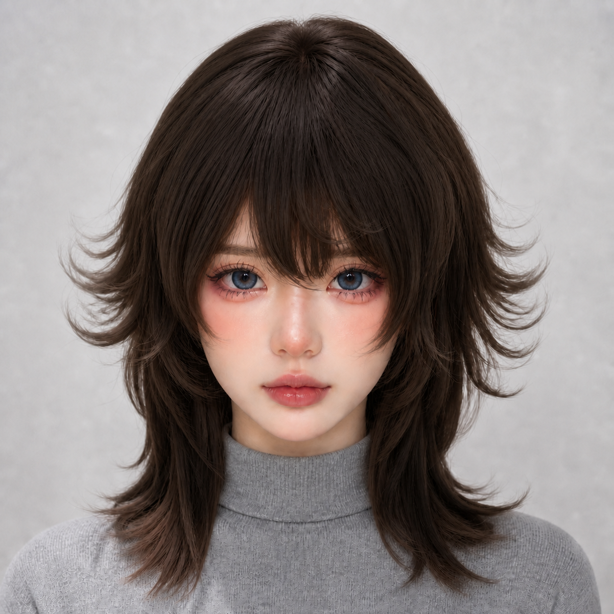

# 24. 雨夜酒店窗边




> **角色**：小菜刀夫斯基（棕发版本）
> **参考图**：Subject 1 = 棕发头像，仅用于锁定面部身份、发型和发色
> **镜头**：单镜头 10 秒，缓慢推进
> **服装**：黑色缎面吊带裙，肩带固定，完整遮盖

##### English Prompt

```txt
subject_definitions:
<Subject 1> is the facial identity, hairstyle, hair color, and adult female appearance of xiao caodao fousi, defined by <Picture 1>. Preserve her round face, soft curved jawline, slightly rounded chin, full cheeks, bright blue eyes, thin naturally arched eyebrows, small slightly upturned nose, natural pink M-shaped lips, fair even skin, dark brown shoulder-length hair, airy bangs, and naturally wavy ends. Preserve her facial identity, hairstyle, hair color, and adult appearance throughout the video. Do not inherit the sweater, background, lighting, or pose from <Picture 1>.

summary:
[reference generation] The target video is a 10-second vertical 9:16 cinematic photorealistic rainy-night hotel scene featuring xiao caodao fousi, whose facial identity and brown hairstyle come from <Subject 1>. She stands beside a floor-to-ceiling hotel window wearing an elegant fully covered black satin slip dress with secure straps. Rain streaks and blurred city lights appear outside. She slowly turns from the window toward the camera, adjusts one shoulder strap, places her fingertips against the glass, and ends with a restrained confident smile. The scene is intimate and sensual with nudity, explicit sexual action, or voyeuristic framing.

retention_analysis:
<Subject 1> (appears in [Shot 1]): fully_preserved - her round facial structure, bright blue eyes, fair skin, dark brown shoulder-length hair, airy bangs, and naturally wavy hair ends are fully retained throughout the video. The original sweater and background are not retained.

detailed_description:
The target video is shot in a cinematic photorealistic style with warm hotel interior lighting, cool blue reflections from the rainy city outside, shallow depth of field, and elegant sensuality. Vertical 9:16 aspect ratio.

[Shot 1] The scene opens in a quiet luxury hotel room at night. xiao caodao fousi, combining <Subject 1>, stands beside a floor-to-ceiling window. She wears a fully black satin slip dress with secure thin straps and a refined silhouette. Her dark brown shoulder-length hair, airy bangs, and naturally wavy ends are clearly visible. Rain trails down the window while blurred city lights shimmer outside. She initially faces the window with one hand resting near the glass. After a brief pause, she slowly turns toward the camera, allowing the satin fabric to move naturally with her body. She gently adjusts one shoulder strap without exposing any skin beyond the shoulder line, then places her fingertips against the glass. The camera performs a slow Push In with small amplitude at slow speed, moving from a medium shot toward an intimate upper-body framing. Her bright blue eyes gradually meet the lens. She maintains calm, confident eye contact and finishes with a subtle half-smile. The dress remains secure and fully covering throughout the shot.

overall_soundscape:
Soft rain against the hotel window, distant city traffic, quiet air-conditioning hum, and subtle satin fabric movement as she turns and adjusts the strap. Her breathing remains slow and natural.

non_diegetic_music:
Sparse piano notes, low sustained cello tones, and a slow minimal pulse gradually becoming slightly fuller during the final smile.
```

##### 中文翻译

```txt
subject_definitions:
<Subject 1> 是由 <Picture 1> 定义的小菜刀夫斯基的面部身份、发型、发色和成年女性形象。保持她圆润的脸型、柔和弯曲的下颌线、略圆的下巴、饱满的脸颊、明亮蓝色眼睛、纤细自然弯曲的眉毛、小巧微翘的鼻子、自然粉色 M 形嘴唇、均匀白皙的肤色，以及深棕色齐肩发、空气刘海和自然微卷的发尾。整段视频中保持她的面部身份、发型、发色和成年形象一致。不要继承 <Picture 1> 中的毛衣、背景、光线或姿势。

summary:
[reference generation] 目标视频是一段 10 秒、竖屏 9:16 的电影感写实雨夜酒店场景。主角为小菜刀夫斯基，她的面部身份和棕色发型来自 <Subject 1>。她穿着肩带固定、完全遮盖身体的黑色缎面吊带裙，站在酒店落地窗旁。窗外可以看到雨痕和虚化的城市灯光。她从窗边缓慢转向镜头，轻轻整理一侧肩带，用指尖触碰玻璃，最后以克制而自信的微笑结束。整体氛围私密而感性，但始终穿着完整，不包含裸体、露骨性行为或偷拍视角。

retention_analysis:
<Subject 1>（出现在 [Shot 1] 中）：fully_preserved - 她圆润的脸部轮廓、明亮蓝色眼睛、白皙肤色、深棕色齐肩发、空气刘海和自然微卷发尾在整段视频中完整保留。原图中的毛衣和背景不保留。

detailed_description:
目标视频采用电影感写实风格拍摄，使用温暖的酒店室内光线、窗外雨夜城市投射的冷蓝色反光、浅景深和克制优雅的感性氛围。竖屏 9:16 画幅。

[Shot 1] 场景开始于夜晚安静的高级酒店房间。结合 <Subject 1> 的小菜刀夫斯基站在落地窗旁，穿着肩带固定、完全遮盖身体、轮廓优雅的黑色缎面吊带裙。她深棕色的齐肩发、空气刘海和自然微卷发尾清晰可见。雨水沿玻璃窗缓慢滑落，窗外虚化的城市灯光在雨幕中闪烁。她起初面向窗户站立，一只手靠近玻璃。短暂停顿后，她缓慢转身面向镜头，缎面布料随着身体自然移动。她轻轻整理一侧肩带，但不露出超过肩部线条的皮肤，随后将指尖放在玻璃上。镜头以小幅度、慢速缓慢推进，从中景逐渐靠近上半身。她明亮的蓝色眼睛逐渐与镜头相遇，保持平静而自信的眼神交流，最后露出细微的半笑。整个镜头中裙子始终固定并完整遮盖身体。不出现裸体、露骨触摸、走光或偷拍视角。

overall_soundscape:
窗外的柔和雨声、遥远的城市交通声、安静的空调嗡鸣，以及她转身和整理肩带时缎面布料的细微摩擦声。她的呼吸始终缓慢自然。

non_diegetic_music:
稀疏的钢琴音、低沉延续的大提琴音和缓慢极简的节拍，在最后的微笑出现时逐渐变得稍微丰富。
```
