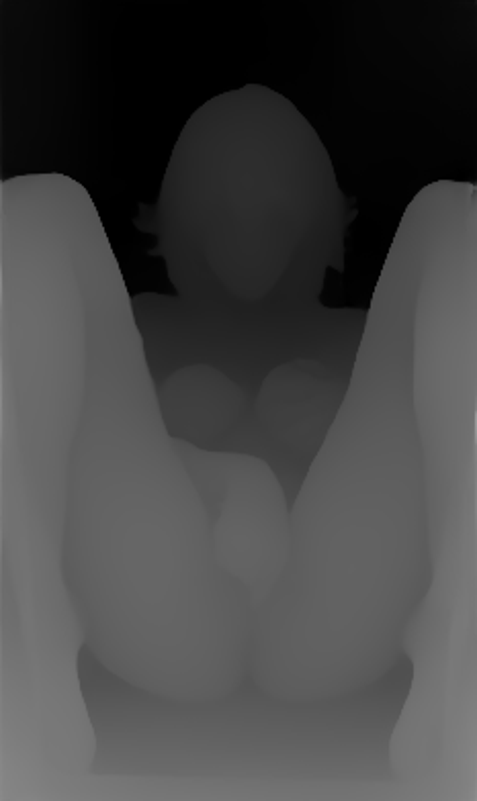

### Case 16: KTV Room — Mirror-selfie frog-leg masturbation (10s)

> **Scene**: KTV private karaoke room — disco ball lights, dark padded walls, leather sofa, microphone on table, neon LED strips
> **Position**: Frog-leg raised-leg masturbation, mirror selfie view
> **Duration**: 10s (1 workflow, 1 shot)
> **Character**: 幼女脸, 丰满沙漏型, pussy ref
> **Male**: absent (solo masturbation, blue hair variant)

#### Reference Assets

- Face ref (Picture 1): `ref/character/幼女脸/幼女脸_正脸_无头饰.png`
- Body ref (Picture 2): `ref/character/其他/人体_室内_体型参考_竖版_v1.jpg`
- Vulva ref (Picture 3): `ref/character/其他/人体_外阴特写.jpg`
- Pose ref (Picture 4): `ref/pose/color/蓝发蛙式抬腿手淫-镜面自拍_竖图.png`




#### Workflow: Mirror-selfie frog-leg masturbation in KTV room (10s)

> **Shot**: 1 — Single continuous 10s shot, mirror selfie perspective

```txt
subject_definitions:
<Subject 1> is the facial identity, hairstyle, and hair color of the female character, defined by <Picture 1>. Lock her softly rounded facial contours, generally close to an oval face, with a naturally rounded chin and subtle cheekbones. Lock her medium-to-large almond-shaped eyes with slightly upturned outer corners, gray-brown irises, dark pupils, and naturally long eyelashes. Lock her fine naturally arched dark-brown eyebrows, partly obscured by the bangs. Lock her small nose with a straight bridge, rounded tip, and subtly tapered nose wings. Lock her medium-full lips with a soft M-shaped cupid's bow, a slightly thinner upper lip and fuller lower lip, natural pink color, and a slight sheen. Lock her even fair complexion with fine skin texture and a faint pink flush on the cheeks. Lock her deep brown medium-to-long hair, thick and voluminous, with a natural parting at the top, thick straight bangs covering the forehead, layered textured hair on both sides, and ends that curl naturally falling below shoulders to chest level. Preserve her facial identity, hairstyle, and hair color consistency throughout the video; do not inherit the background, clothing, or body pose from <Picture 1>.

<Subject 2> is the body and figure of the female character, defined by <Picture 2>. Lock her extremely full hourglass figure, very full bust above D-cup, huge breast volume with natural droop, large breasts with prominent pink areola and obvious nipples, deep cleavage, smooth fine skin with light reflection highlights. Lock her body proportions, waist-to-hip ratio, limb length, and overall feminine curves. Preserve body consistency throughout the video; do not inherit facial features, clothing, or background from <Picture 2>.

<Subject 3> is the vulva reference for the female character, defined by <Picture 3>. Lock the external genital anatomy: full symmetrical labia majora, prominently protruding pink labia minora with clear natural folds, clitoral hood covering the clitoris, narrow slit vaginal opening, fair surrounding skin, and neatly trimmed pubic area. Use this reference for consistent pussy depiction during masturbation; do not inherit background or pose from <Picture 3>.

<Subject 4> is the sex position and camera angle reference, defined by <Picture 4>. Use this depth map to lock the frog-leg raised-leg masturbation position with mirror selfie camera perspective — the woman lying on her back with legs raised wide in a frog-leg stance, one hand holding a phone/camera filming into the mirror, the other hand thrusting a dildo into her vagina. Do not inherit the character's face, clothing, or scene from <Picture 4>.

summary:
[reference generation] The target video is a 10-second vertical (9:16) single-shot solo-mirror-selfie-masturbation scene set in a KTV karaoke room. The woman lies on the leather sofa with legs raised wide in a frog-leg stance, filming herself in the mirror while thrusting a dildo into her vagina. The disco ball lights, neon LED strips, and dark padded walls create a vibrant party atmosphere.

retention_analysis:
<Subject 1> (appears throughout): fully_preserved — her face is visible in the mirror reflection.
<Subject 2> (appears throughout): fully_preserved — her full body and breasts are prominently displayed in the mirror.
<Subject 3> (appears throughout): fully_preserved — the vulva is the primary focus of the frog-leg mirror view during dildo insertion.
<Subject 4> (appears throughout): partially_preserved — the frog-leg mirror selfie body layout is retained.

detailed_description:
The target video is shot in a cinematic photorealistic style with colorful disco ball light projections, dark padded walls, neon LED strip lighting in shifting colors, a leather sofa, and a microphone on a glass table — a vibrant KTV party atmosphere. Vertical 9:16 aspect ratio. Single continuous 10-second shot from a mirror selfie perspective — the camera is a phone held in her hand, filming the mirror reflection.

The scene opens in a KTV private karaoke room. The room is decorated with dark sound-absorbing padded walls. A disco ball on the ceiling projects rotating spots of colorful light across the room — red, blue, purple, and green beams that shift and rotate continuously. Neon LED strip lights line the walls, cycling through vibrant colors. A plush leather sofa covers one wall, its surface dark and glossy. A glass coffee table in front of the sofa holds a wireless microphone and a bottle of water. The large wall mirror reflects the entire scene. The character, combining <Subject 1> and <Subject 2>, lies on her back on the leather sofa, her body completely naked and glistening under the shifting colored lights. Her deep brown hair is spread across the sofa behind her. Her legs are raised wide in a frog-leg stance, knees bent outward, feet resting on the sofa cushion, her vulva fully exposed and facing the mirror. Her extremely full breasts rest against the leather surface, D+ cup volume with natural droop visible, both nipples erect and prominent, dark pink areola glistening under the disco lights.

Her left hand holds a smartphone, filming her reflection in the wall mirror — the camera view is this mirror selfie angle. Her right hand grips a colorful flesh-toned dildo, positioning it against her vaginal opening. The vulva anatomy matches <Subject 3>: full symmetrical labia majora part as the dildo tip enters, prominently protruding pink labia minora stretch around the entering shaft, the narrow slit vaginal opening expanding. She begins thrusting the dildo in and out of her vagina with her right hand, moving up and down with controlled rhythm. Each forward thrust pushes the dildo deeper, compressing her labia. Each backward pull draws it partially out before driving back in. Her frog-leg stance trembles with each movement, the fair skin of her inner thighs glistening under the colored lights. Her breasts shift against the leather sofa with each thrust, the D+ volume compressing and rebounding. In the mirror, her face shows escalating pleasure: eyes half-closed and lips parted progressing to heavy-lidded gaze, tongue visible, soft moans escalating to loud cries, her face flushed deep pink. The disco ball colors shift across her body throughout the 10 seconds, creating a dynamic light show. The thrusting cadence increases steadily throughout the 10-second duration.

overall_soundscape:
The KTV room has a unique acoustic environment: the padded walls absorb direct sounds while the disco ball motor produces a faint continuous rotating hum. Neon LED strips produce an electrical buzzing sound. A faint echo of a karaoke song plays from the room's speakers in the background. The leather sofa produces soft creaking and shifting sounds beneath her body. The smartphone camera produces a subtle electronic shutter sound. The wet friction of the dildo inside her vagina is prominent, the labia compressing creating moist squelching sounds that are partially absorbed by the padded walls. The woman's moans start soft and escalate throughout the 10 seconds, her voice muffled slightly by the padding but still carrying intensity. The soft slapping of her breasts against the leather sofa produces rhythmic sounds. The dildo produces soft plastic-on-skin sounds with each thrust. The thrusting cadence and wet sounds intensify steadily from 00:00 to 00:10.

non_diegetic_music:
N/A
```
